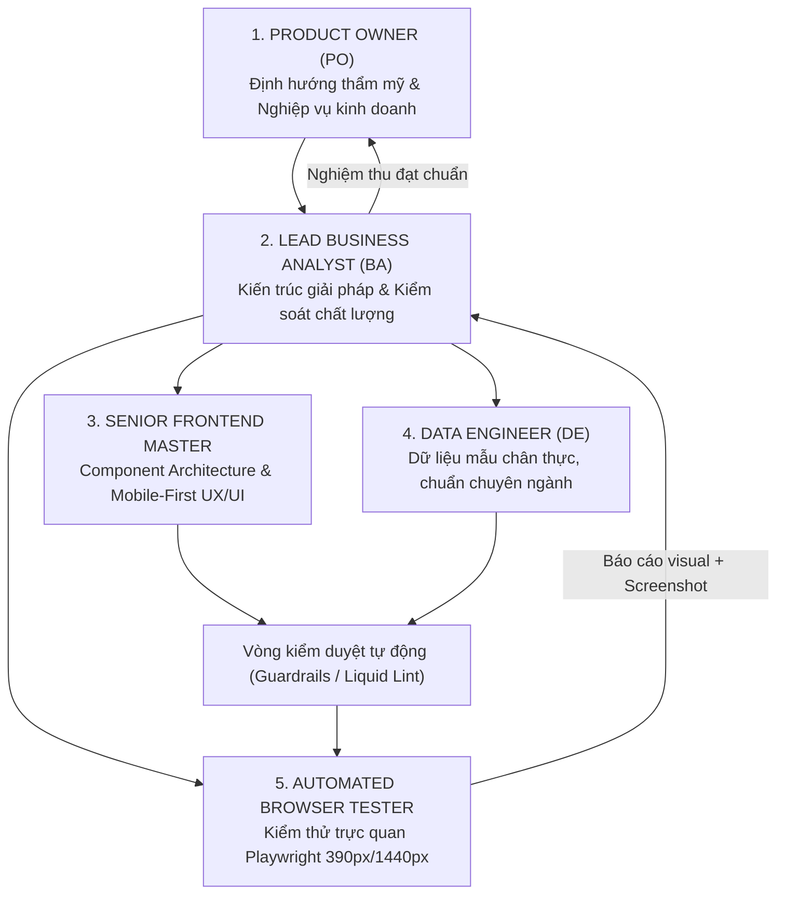

# KHUNG VẬN HÀNH BỘ MÁY PHÁT TRIỂN THEME CHUẨN CAO CẤP (OPERATING PLAYBOOK)
> **Mục tiêu:** Tài liệu hóa toàn bộ cơ cấu nhân sự, nguyên lý kiến trúc, quy trình kiểm soát và văn hóa kỹ thuật đã được chứng minh hiệu quả qua đợt tái cấu trúc Mobile (M-01..M-31) để tái sử dụng cho mọi dự án và giai đoạn tiếp theo.

---

## I. CƠ CẤU NHÂN SỰ & PHÂN ĐỊNH TRÁCH NHIỆM (RACI MATRIX)



| Vai trò | Nhân sự đảm nhiệm | Trách nhiệm cốt lõi (Không kiêm nhiệm chéo) |
| :--- | :--- | :--- |
| **PO (Product Owner)** | Chủ dự án / Khách hàng | - Đưa ra tầm nhìn thương hiệu, trải nghiệm mong muốn.<br>- Duyệt nghiệm thu cuối cùng trên môi trường thực tế. |
| **Lead BA** | Trưởng nhóm Phân tích | - Phân tích yêu cầu từ PO thành **tiêu chí nghiệm thu (Acceptance Criteria - AC)**.<br>- Ngăn chặn tình trạng "thấy đâu sửa đấy" (Symptom-fixing).<br>- Giám sát 100% tuân thủ Design Tokens và luật cấm của nền tảng.<br>- Chốt chặn kiểm thử trước khi bàn giao lại cho PO. |
| **Senior FE Master** | Kỹ sư Frontend chính | - **Tư duy Component-First (SSOT)**: Mọi UI lặp lại $\ge 2$ lần đều phải trừu tượng hóa thành Snippet hạt nhân.<br>- **Mobile-First UX/UI**: Vùng chạm $\ge 44\text{px}$ (dùng pseudo-element `::after` nếu thanh công cụ hẹp), chữ $\ge 12\text{px}$, căn lề đồng bộ lề container 16px.<br>- **Tailwind theo Token 100%**: Tuyệt đối không viết CSS tĩnh tự do, không lạm dụng `!important`, không `@media` tùy tiện.<br>- Dứt khoát dọn sạch CSS chết (Dead code elimination). |
| **Data Engineer (DE)**| Kỹ sư Dữ liệu ngành | - Chuẩn bị bộ dữ liệu mẫu (Mock data, JSON configs) đúng chuẩn ngành hàng (Dược mỹ phẩm: tên hoạt chất thật, công dụng thật, bài viết chuyên môn có giá trị).<br>- Tuân thủ văn hóa nội dung: Dùng "Chuyên gia / Dược sĩ" (không tự xưng Bác sĩ), không bịa đặt số liệu ảo. |
| **Automated QA** | Bot Tester (Playwright) | - Chụp ảnh màn hình thật tại các viewport chuẩn: Mobile (**390px × 844px**) và Desktop (**1440px**).<br>- Bắt lỗi thanh cuộn ngang (Horizontal scrollbar), vỡ khung, tràn chữ. |

---

## II. 3 NGUYÊN TẮC KIẾN TRÚC SỐNG CÒN (CORE ARCHITECTURE PRINCIPLES)

### 1. Trừu tượng hóa Component (Single Source of Truth - SSOT)
- **Sai lầm cũ:** Khách bảo "sửa nút Xem tất cả ở mục A", lập tức vào file `section_A.bwt` sửa flex, hôm sau khách bảo "sửa mục B", lại vào `section_B.bwt` sửa $\rightarrow$ Vỡ giao diện toàn site, code phân mảnh.
- **Chuẩn mới:** Trừu tượng hóa ngay thành `snippets/ui_section_head.bwt`.
  - Tiêu đề bên trái, link "Xem tất cả" bên phải.
  - Trên mobile: tự động thu gọn thành nút tròn icon mũi tên $\ge 44\text{px}$ (nền `bg-brand-tint`, icon `text-brand-deep`).
  - Trên desktop: tự động bung đầy đủ chữ và icon.
  - Sửa 1 nơi $\rightarrow$ Toàn bộ 10+ section trên toàn trang tự động đẹp và chuẩn.

### 2. Tư duy dọn rác (Refactoring & Dead Code Cleanup)
- Khi chuyển đổi sang Tailwind, **phải xóa bỏ class CSS cũ tương ứng** trong `ui-src/css/components.css`.
- Không giữ code chết vì tâm lý "sợ vỡ". Càng để code cũ, độ ưu tiên CSS (Specificity) càng rối, gây xung đột và sinh lỗi viền đen, vỡ màu ngoài ý muốn.

### 3. Quy chuẩn nền tảng Sapo Web & Design Tokens
- **Màu thương hiệu bất di bất dịch:** `#3CB371` (MediumSeaGreen) và các biến token (`--pc-brand`, `--pc-brand-deep`, `--pc-brand-tint`).
- **CDN hình ảnh Sapo:** Chỉ dùng các size chuẩn (`large`, `grande`, `1024x1024`, `2048x2048`). **Tuyệt đối cấm dùng `master`** (gây lỗi 404).
- **Cỡ chữ:** Phải dùng biến `var(--fs-*)` hoặc class Tailwind tương ứng. Không hardcode `px` trong CSS.

---

## III. QUY TRÌNH TRIỂN KHAI 5 BƯỚC KHÉP KÍN (THE 5-STEP WORKFLOW)

```text
[BƯỚC 1: Tiếp nhận & Phân tích] (Lead BA)
  ↳ Chuyển phản ánh của PO thành Mã đầu việc chuẩn (vd: M-01, M-02...)
  ↳ Xác định: Đây là lỗi cá thể hay lỗi hệ thống? Cần tạo Component chung nào?

[BƯỚC 2: Cung cấp Dữ liệu chuẩn] (Data Engineer)
  ↳ Tạo schema, mock data và text chân thực trước khi lên giao diện.

[BƯỚC 3: Triển khai Code & Refactor] (Senior Frontend Master)
  ↳ Viết bằng 100% Tailwind Tokens.
  ↳ Dọn dẹp CSS cũ tương ứng trong components.css.
  ↳ Tối ưu UX Mobile: Vùng bấm >= 44px, Swiper mượt mà, không thanh cuộn thô.

[BƯỚC 4: Kiểm duyệt Kỹ thuật Tự động (Guardrails)] (Senior FE & Lead BA)
  ↳ Chạy: node scripts/lint-guardrails.js (Bắt buộc PASS)
  ↳ Chạy: node scripts/lint-liquid-globals.js (Bắt buộc PASS)
  ↳ Chạy: npm run build (Biên dịch lại CSS minified)

[BƯỚC 5: Kiểm thử Trực quan & Bàn giao] (Browser QA & Lead BA)
  ↳ Chụp ảnh thực tế 390px x 844px.
  ↳ Commit chuẩn tiếng Việt có dấu, push lên Git và báo cáo PO.
```

---

## IV. BẢNG CHECKLIST TỰ KIỂM (SELF-CHECK TRƯỚC KHI BÀN GIAO)

Trước khi gửi báo cáo cho PO, Lead BA và Senior FE phải tự trả lời "CÓ" cho tất cả các câu hỏi sau:

- [ ] **Mobile-First:** Khi xem ở màn hình 390px, nội dung có bị dính sát mép màn hình không? (Bắt buộc cách lề container chuẩn 15-16px).
- [ ] **Vùng chạm:** Các icon bấm, nút đóng, nút lọc, nút chuyển trang có đạt tối thiểu $44\text{px} \times 44\text{px}$ không?
- [ ] **Thanh cuộn:** Có bị xuất hiện thanh scrollbar ngang thô kệch dưới đáy màn hình không? (Nếu có $\rightarrow$ chuyển sang Swiper hoặc dùng class ẩn thanh cuộn).
- [ ] **Component tái sử dụng:** Phần này có thể tái sử dụng cho trang khác được không? Đã tách ra snippet hạt nhân chưa?
- [ ] **Lint & Build:** `lint:guardrails` và `lint:liquid-globals` có PASS 100% không?
- [ ] **Hồi quy:** Bản sửa này có làm vỡ bất kỳ màn hình nào trước đó đã được PO duyệt không?

---
*Tài liệu này được lưu trữ trực tiếp tại repo để làm kim chỉ nam vận hành cho toàn bộ các chiến dịch nâng cấp và dự án tiếp theo.*
