# Chuẩn triển khai UX/UI — Pharma Cosmetics (UI-STANDARD)

> **Nguồn duy nhất về giao diện** cho mọi agent AI (Claude, Codex…) và lập trình viên. Mâu thuẫn với `.clinerules/03`
> ⇒ tài liệu này thắng. Luật nền tảng Sapo / Liquid / vận hành repo (`.clinerules/01`, `02`, `AGENTS.md`) vẫn giữ (A.6).
>
> **Bản Sapo — 24/10/2026.** Chuyển từ bản Docs "Chuẩn triển khai UX-UI - Pharma Cosmetics" (viết cho Hugo) sang stack
> thật của repo: theme **Sapo `.bwt` (Liquid / DotLiquid)**, preview Node (`npm run preview`, `localhost:3000`), build
> `npm run build:sapo`. Mọi chỗ bản gốc ghi Hugo (`hugo server`, Hugo Pipes, `layouts/partials/components/*.html`,
> `errorf`) đã được đổi sang tương đương Sapo ở Phần A–C, F.3, G. Phần D–E giữ nguyên nội dung.
>
> **Quyết định của chủ dự án (24/10/2026):**
> - Icon: theo tài liệu này — **bỏ Font Awesome, icon SVG nội tuyến qua `snippets/ui_icon.bwt`** (thay UI-9 cũ).
> - **L09 Flash Sale: giá có đổi thật mỗi ngày** ⇒ giữ đồng hồ chu kỳ 24h; không phải Dark Pattern.
> - **Mọi lỗi kiểm ở local** (`npm run preview`, agent tự chuẩn bị dữ liệu mẫu trong `data/*.js`) — **không kiểm trên
>   Sapo thật**, không deploy.
> - **Câu chữ pháp lý giữ nguyên như hiện tại** — agent không sửa, không chờ duyệt.
>
> Thứ tự đọc: A. Luật bắt buộc · B. Cấu hình theme · C. Thư viện component · D. Do / Don't · E. Hiện trạng & lỗi ·
> F. Kế hoạch & cổng kiểm · G. Vòng lặp tự sửa. Agent đọc A → B → C trước khi viết bất kỳ dòng mã nào; lệnh chạy ở Phần G.

## PHẦN A — Luật bắt buộc cho agent

### A.1 Phạm vi, thứ tự ưu tiên, từ khoá

- **Thứ tự ưu tiên khi các phần mâu thuẫn:** A > B > C > D > E–F. Không điều gì ở E–F được dùng làm lý do phá luật ở A.
- **PHẢI / KHÔNG ĐƯỢC:** bắt buộc, không ngoại lệ nếu chủ dự án chưa duyệt bằng văn bản.
- **NÊN:** khuyến nghị; bỏ qua thì ghi lý do trong báo cáo (A.5).
- **Ngoài phạm vi tài liệu:** ghi câu hỏi vào `ui-loop/STATUS.md`, không tự quyết.

### A.2 10 luật bất biến

| Mã | Luật | Cách kiểm |
| :-- | :-- | :-- |
| R1 | **Không CSS tự viết.** CSS mới chỉ được viết trong 3 file nguồn `ui-src/css/main.css`, `ui-src/css/tokens.css`, `ui-src/css/components.css`; build ra `assets/pc-ui.css` (file sinh, không sửa tay). KHÔNG ĐƯỢC tạo file `.css` / `.scss.bwt` mới trong `assets/`, thêm `<style>`, `style="…"`, `!important` hay CSS trong JS. File CSS cũ (`assets/*.css`, `assets/*.scss.bwt`, `snippets/*_style.bwt`) bị **đóng băng**: chỉ được XOÁ quy tắc (khi chỗ đó đã chuyển sang `pc-*`), không thêm. | `node scripts/ui-guard.mjs` (so mốc `ui-loop/guard-baseline.json`) |
| R2 | **Chỉ dùng token.** Màu, cỡ chữ, bo góc, đổ bóng, z-index chỉ lấy từ `tailwind.pc.config.js` (B.4). KHÔNG ĐƯỢC ghi mã hex, px tuỳ ý hay class giá trị tuỳ ý (`w-[37px]`, `bg-[#3CB371]`) trong `.bwt`. | ui-guard |
| R3 | **Chỉ lắp từ thư viện.** Nút, thẻ sản phẩm, ô nhập, nhãn, điều hướng slider, header, thanh đáy, thanh mua, popup, thông báo, nút nổi, icon PHẢI gọi snippet `snippets/ui_*.bwt` (Phần C) bằng ``. KHÔNG ĐƯỢC tự dựng HTML cho các thành phần này ở chỗ mới sửa. | ui-guard (`<button` mới ngoài `snippets/ui_*.bwt`) |
| R4 | **Phân tầng thiết bị.** Mọi bề mặt `shadow-none`. Desktop ≥ 1024px: `rounded-none`. Mobile < 1024px: bo 12px (`rounded-xl`) hoặc 16px (`rounded-2xl`); nút tròn nhỏ và nhãn `rounded-full`. Hình thái nằm sẵn trong class `pc-*`; agent KHÔNG tự thêm class bo góc, đổ bóng. | Kiểm 390px và 1440px |
| R5 | **Thư viện bị khoá sau đợt 0.** `tailwind.pc.config.js`, `ui-src/css/*`, `assets/pc-ui.js`, `snippets/ui_*.bwt`, `scripts/ui-guard.mjs`, ngưỡng trong `scripts/ui-verify.mjs` chỉ được sửa trong đợt 0 hoặc khi chủ dự án duyệt đề xuất (C.6). Thiếu component ⇒ ghi đề xuất, đánh việc `BLOCKED_OWNER`, không tự chế. | Review diff |
| R6 | **Không sửa ngoài phạm vi.** Chỉ đổi đúng phần việc yêu cầu; KHÔNG tiện tay đổi màu, khoảng cách, font, nhãn, thứ tự khối chỗ khác. | Diff chỉ chạm file trong phạm vi |
| R7 | **Không thêm phụ thuộc.** KHÔNG thêm CDN, thư viện JS/CSS, font, bộ icon mới hay giữ Tailwind CDN. Icon = `snippets/ui_icon.bwt` (SVG nội tuyến); Font Awesome bị gỡ dần (đợt Tốc độ), không thêm `<i class="fa-…">` mới. | ui-guard |
| R8 | **Một hành động, một tên.** Cùng hành động dùng cùng nhãn và cùng component (luôn "Thêm vào giỏ", không "Chọn mua" / "Mua hàng"). | Review |
| R9 | **Tiếp cận là bắt buộc.** KHÔNG xoá viền focus, bỏ nhãn form, bỏ `aria-label` của nút chỉ có icon; mọi popup đóng được bằng Escape. | axe-core: 0 lỗi mới |
| R10 | **Xong = đã kiểm trên trình duyệt thật.** Chỉ báo xong khi đạt toàn bộ cổng F.3 và có báo cáo A.5 với số đo lấy từ trình duyệt trong chính lần sửa đó. | Báo cáo A.5 |

### A.3 Class được dùng trong template và mẫu cấm

**Được dùng trực tiếp trong `.bwt`:** class `pc-*` (chỉ qua snippet `ui_*`) và utility bố cục theo thang — `flex`, `grid`,
`grid-cols-*`, `gap-*`, `items-*`, `justify-*`, `order-*`, `p-*`, `m-*`, `space-*`, `w-*`, `max-w-*`, `h-*`, `hidden`, `block`,
`sr-only`, `text-xs` → `text-4xl`, `font-normal/medium/semibold/bold`, `text-ink`, `text-ink-secondary`, `text-price`,
`text-left/center`, `line-clamp-*`, cùng tiền tố `sm: md: lg: xl:`. Màu nền, viền, bo góc, đổ bóng, z-index, position,
transition chỉ đến từ class `pc-*`.

| Mẫu cấm (code mới) | Ví dụ sai | Thay bằng |
| :-- | :-- | :-- |
| `style="…"` | `<div style="margin-top:12px">` | `mt-3` |
| `<style>` hoặc file CSS mới | `custom.css`, `x.scss.bwt`, `snippets/x_style.bwt` | Class `pc-*` có sẵn hoặc đề xuất C.6 |
| Mã hex trong `.bwt` | `text-[#3CB371]` | `text-brand`, `text-price` |
| Giá trị tuỳ ý | `w-[37px]`, `text-[11px]` | `w-9`, `text-xs` |
| Đổ bóng | `shadow-md`, `drop-shadow` | Không có — viền trong `pc-card` |
| Bo góc tự thêm | `rounded-md` trên thẻ | Đã có trong `pc-card`, `pc-btn` |
| Chữ < 12px | `text-[10px]` | `text-xs` (12px) là nhỏ nhất |
| `#3CB371` làm chữ hoặc nền chữ trắng | `bg-brand-deco text-white` | `bg-brand text-white` |
| `!important` | `color:red !important` | Không cần |
| Tailwind CDN | `cdn.tailwindcss.com` | `assets/pc-ui.css` build sẵn (B.5) |
| Icon font | `<i class="fa-solid fa-cart">` | `` |
| Nút / thẻ / popup tự dựng | `<button class="btn-mua">` | `` |

### A.4 Quy trình mỗi lần sửa

1. Đọc việc, ghi rõ thay đổi chạm luồng nào trong 4 luồng chính (E.1) và mã lỗi (L01–L44, N01…).
2. Tra danh mục C.2. Có component ⇒ dùng. Không có ⇒ dừng, ghi đề xuất C.6, không code.
3. Đối chiếu bảng Do / Don't của nhóm liên quan (Phần D).
4. Sửa `.bwt`: chỉ gọi snippet `ui_*` và utility bố cục ở A.3; nội dung hiển thị vẫn cấu hình hoá qua `settings` (A.6).
5. Chạy cổng F.3; kiểm 390px trước, rồi 320 / 768 / 1024 / 1440px và màn ngang; kiểm bàn phím (Tab, Shift+Tab, Escape).
6. Ghi báo cáo theo A.5 vào `ui-loop/reports/<mã>.md`.

### A.5 Mẫu báo cáo sau mỗi thay đổi

```
## Báo cáo thay đổi UI
Việc / mã lỗi: L07
Luồng bị ảnh hưởng: Mua hàng
File đã sửa: templates/product.bwt, snippets/ui_action_bar.bwt (đợt 0)
Component đã dùng: ui_button (primary), ui_action_bar
Đề xuất thay đổi thư viện: không
Cổng F.3: ui-guard ✔ · build:sapo ✔ · axe 0 lỗi mới ✔ · ui-verify --quick 0 lỗi mới ✔ · LCP 4G 2,3s ✔
Kiểm trình duyệt: 390 Chromium ✔ · 390 WebKit ✔ · 320 ✔ · 768 ✔ · 1024 ✔ · 1440 ✔ · ngang ✔ · Tab/Escape ✔
Số đo: giá y = 612px; thanh mua hiện sau khi cuộn 900px; link đổi trả HTTP 200
Ảnh: ui-loop/evidence/L07/after-chromium-390.png …
Việc chưa làm, rủi ro: …
```

### A.6 Luật nền tảng Sapo giữ nguyên (từ AGENTS.md, `.clinerules/01`, `02`)

- Liquid Sapo = DotLiquid: chuỗi rỗng là TRUE ⇒ kiểm `!= blank`; không truy cập mảng bằng chỉ số biến; `blogs['x']` có thể nil.
- Ảnh qua `img_url` + `alt` riêng + `width`/`height`; dưới màn đầu `loading="lazy"`; ảnh LCP preload. Mỗi trang 1 `<h1>`.
- Nội dung hiển thị **cấu hình hoá**: `settings.<id>` + `| default:`; khai báo ở `configs/settings_schema.json`, giá trị ở
  `settings_data.json`. Không xoá trường schema có sẵn.
- Dùng "Chuyên gia", không "Bác sĩ" (RULE-P0-02). Không bịa dữ liệu (đánh giá, % đã bán, số liệu).
- **Câu chữ pháp lý giữ nguyên** (quyết định 24/10/2026): không sửa chính sách, điều khoản, câu đồng ý xử lý dữ liệu,
  dải pháp lý footer — chỉ được đổi màu/khung bao quanh chúng.
- Commit: conventional commits + tiếng Việt có dấu, chỉ `git add` đúng file của việc (KHÔNG `git add -A` / `.`);
  không commit `dist/`, `sapo-dist/`, `vercel-dist/`, `exports/`, `node_modules/`, `.env*`.
- Không push, không deploy (`npx vercel`), không sửa dữ liệu trên Sapo thật.
- Không đụng 2 file chủ dự án đang sửa dở nếu việc không yêu cầu: `configs/settings_data.json`, `snippets/section_flash_sale.bwt`.

## PHẦN B — Cấu hình theme (nguồn duy nhất của giao diện)

Mọi giá trị giao diện chỉ khai báo ở đây. Template và snippet chỉ tham chiếu token.

### B.0 Bộ nhận diện thương hiệu

| Thuộc tính | Quy định |
| :-- | :-- |
| Tên hiển thị | PHARMA COSMETICS × SKIN HEALTH BEAUTY — đúng nguyên văn, chữ HOA, dấu ×. Ngoại lệ duy nhất của quy tắc không viết HOA tiêu đề. |
| Brand mark | Biểu tượng PC — 1 file SVG gốc (`assets/PharmaCosmetics.svg`) qua snippet logo; không vẽ lại, không kéo méo; 2 biến thể: xanh trên nền trắng, trắng trên Deep Forest / Dark Forest. |
| Phong cách | Luxury Medical Minimalism × Botanical Skin Health |
| Bio | Dược mỹ phẩm toàn cầu • Giao hàng toàn quốc Phân tích da • Phác đồ cá nhân hóa • Trị liệu da 1:1 tại Hà Nội |

**Bảng màu thương hiệu → token** (tương phản trên nền trắng, WCAG 2.2):

| Màu thương hiệu | Hex | Token | Vai trò | Tương phản |
| :-- | :-- | :-- | :-- | :-- |
| Primary Green | #3CB371 | brand-deco | Logo, mảng trang trí, hoạ tiết, icon ≥ 24px, viền, chữ trên nền Dark Forest. KHÔNG làm chữ trên nền sáng hay nền dưới chữ trắng. | 2,7 : 1 trên trắng ✗ · 5,6 : 1 trên #002E23 ✓ |
| Secondary Green | #075B40 | brand, price | Nút chính, link, giá, viền nút phụ, viền focus | 8,1 : 1 ✓ |
| Deep Forest | #003F2D | brand-deep, surface-footer, brand-hover | Topbar, footer, khối nền tối; hover nút chính | 12,0 : 1 ✓ |
| Dark Forest | #002E23 | brand-darkest | Nhấn nút chính; hero/banner tối; lớp phủ ảnh | 14,8 : 1 ✓ |
| White | #FFFFFF | surface-card, white | Nền thẻ, popup, header; chữ trên nền xanh đậm | — |

Màu chức năng ngoài bảng (slate cho chữ/viền, đỏ giảm giá – lỗi, vàng cảnh báo) chỉ cho chữ, trạng thái, thông báo.

**Chữ — Montserrat, 4 độ đậm:** Headline 700/600 (`font-bold` / `font-semibold`: H1–H2 700; H3, tiêu đề khối, giá, nhãn
nút 600) · Subheading 500 (`font-medium`: tiêu đề phụ, tên sản phẩm, nhãn form, mục menu) · Body 400 (`font-normal`).

**Phong cách quy ra luật:** Luxury Minimalism — nhiều khoảng trắng (`pc-section`), mỗi khối 1 điểm nhấn màu và 1 nút
chính; không đổ bóng, không gradient, không viền dày; desktop góc vuông (R4). Medical — thông tin chính xác, "Chuyên gia",
không hứa hẹn kết quả. Botanical — hoạ tiết lá chỉ trang trí bằng Primary Green / brand-tint, không đặt sau chữ; không ảnh
stock rực màu, không GIF. Bio dùng nguyên văn ở footer, trang Giới thiệu.

### B.1 Stack và cấu trúc thư mục (Sapo)

- Theme Sapo `.bwt` (Liquid / DotLiquid); preview Node `npm run preview` (LiquidJS, `localhost:3000`, dữ liệu mẫu `data/*.js`,
  `preview-mock.js`); đóng gói `npm run build:sapo`.
- Tailwind CSS 3.4 **biên dịch sẵn bằng CLI** (`npx tailwindcss`) ra `assets/pc-ui.css` — không biên dịch trên trình duyệt.
  Sapo không chạy PostCSS ⇒ file CSS sinh ra được commit cùng theme.
- Swiper: giữ `assets/swiper.js` + CSS lõi có sẵn; nút/chấm điều hướng dùng `ui_swiper_nav`.
- Font Montserrat chỉ 400 / 500 / 600 / 700, `font-display: swap` — **tự host file tĩnh** `assets/montserrat-<độ đậm>-<vietnamese|latin-ext|latin>.woff2`, `@font-face` trong `ui-src/css/tokens.css`, preload `montserrat-400-latin.woff2` ở layout (N19, chủ dự án duyệt 30/10/2026: Google Fonts trả 1 file variable mà WebKit kiểm không vẽ độ đậm). Không nạp lại Google Fonts.
- Icon: SVG nội tuyến qua `snippets/ui_icon.bwt`; gỡ dần Font Awesome.

```
repo/
├─ package.json                 thêm script build:pc (+ chèn vào build:sapo)
├─ tailwind.pc.config.js        KHOÁ — thang token (B.4). (tailwind.config.js hiện có là của MOPS admin — không đụng)
├─ tailwind.legacy.config.js    TẠM — bản sao cấu hình Tailwind CDN cũ trong layouts/theme.bwt (B.6)
├─ ui-src/css/                  nguồn CSS, KHÔNG đóng gói lên Sapo
│  ├─ main.css                  KHOÁ — điểm vào duy nhất
│  ├─ tokens.css                KHOÁ — biến màu + quy tắc nền (B.3)
│  └─ components.css            KHOÁ — thư viện pc-* (C.3)
├─ assets/pc-ui.css             SINH — không sửa tay
├─ assets/pc-legacy-tw.css      SINH, TẠM — thay Tailwind CDN cho class cũ, xoá khi hết tham chiếu (B.6)
├─ assets/pc-ui.js              KHOÁ — hành vi popup, thông báo, slider, form (C.5)
├─ snippets/ui_*.bwt            KHOÁ — mỗi component 1 file (C.2)
├─ scripts/ui-guard.mjs         KHOÁ — cổng mẫu cấm (F.3)
└─ scripts/ui-verify.mjs        KHOÁ ngưỡng — bộ kiểm trình duyệt thật (G.4)
```

### B.2 Design tokens

3 tầng: Primitive (chỉ trong `tokens.css`) → Semantic (bảng dưới — agent chỉ dùng tầng này) → Component (class `pc-*`).

| Token (class) | Giá trị | Dùng cho | Tương phản |
| :-- | :-- | :-- | :-- |
| brand (`bg-brand`, `text-brand`, `border-brand`) | #075B40 | Nút chính, link, nút phụ viền | 8,1 : 1 |
| brand-hover | #003F2D | Hover nút chính | 12,0 : 1 |
| brand-darkest | #002E23 | Nhấn nút chính, hero / banner tối | 14,8 : 1 |
| brand-deco | #3CB371 | Chỉ trang trí. KHÔNG làm màu chữ hay nền chữ trắng | 2,7 : 1 |
| surface-footer / brand-deep | #003F2D | Nền topbar, footer (chữ trắng) | 12,0 : 1 |
| brand-tint | #E8F5EE | Nền nhạt nhãn, hover nút phụ | Chữ brand trên nền này 7,3 : 1 |
| surface-page | #F8FAFC | Nền trang | — |
| surface-card | #FFFFFF | Thẻ, popup, header | — |
| ink | #0F172A | Chữ chính | 17,9 : 1 |
| ink-secondary | #475569 | Chữ phụ, giá gốc gạch | 7,6 : 1 |
| price | #075B40 | Giá bán | 8,1 : 1 |
| line | #E2E8F0 | Viền thẻ, đường phân cách | — |
| line-control | #64748B | Viền ô nhập, checkbox, nút slider | 4,8 : 1 |
| sale / sale-tint | #B91C1C / #FEE2E2 | Nhãn giảm giá, chữ lỗi / nền hộp lỗi | 6,5 : 1 · 5,3 : 1 |
| warning / warning-tint | #92400E / #FEF3C7 | Cảnh báo | 6,4 : 1 |

Thang khác (B.4, ngoài thang là không có class): cỡ chữ 12 / 14 / 16 / 18 / 20 / 24 / 30 / 36px · bo góc 0 / 12 / 16px /
tròn · đổ bóng: chỉ none · khoảng cách bội 4px · z-index: header 30, thanh đáy 40, nút nổi 45, lớp phủ 50, popup 55,
thông báo 60, skip link 70.

### B.3 tokens.css

`ui-src/css/tokens.css` — KHOÁ. **Mã đầy đủ ở Phụ lục M.1** (bản Docs bị dồn 1 dòng khi xuất, ghi chú `//` nuốt mất mã — không
chép từ bản Docs). Khác bản Docs vì Sapo: biến mang tiền tố `--pc-` (`--pc-color-brand-primary`, `--pc-color-ink`…) để không
trùng biến cũ trong `snippets/design_tokens.bwt` (`--color-brand-primary`, `--color-brand-dark`… đang dùng toàn site);
`font-family`/`color`/`background` của `html` để CSS cũ quyết đến đợt 12. Trong giai đoạn chuyển, `design_tokens.bwt` đóng băng.
**N02 (24/10/2026):** quy tắc nền link viết `:where(p a, li a)` (độ ưu tiên 0) để không gạch chân / đổi màu menu header,
breadcrumb, link cũ (D03 làm đổi 1 093 lượt phần tử); `a { text-underline-offset: 3px }` toàn cục hoãn tới đợt 12 (D09) — bật lại
khi xoá CSS cũ. Link thư viện tự đặt offset (`.pc-btn--link`, `.pc-toast a`: `underline-offset-4`).

### B.4 tailwind.pc.config.js

**Mã đầy đủ ở Phụ lục M.2.** Ghi đè hoàn toàn `colors`, `fontSize`, `borderRadius`, `boxShadow`, `zIndex`, `fontWeight`
(không đặt trong `extend`) nên class ngoài thang (`shadow-md`, `rounded-md`, `text-[11px]`, màu hex) không sinh CSS — lớp khoá
thứ hai sau R2. `screens` sm 640 / md 768 / lg 1024 / xl 1280; `extend.maxWidth.content = 1280px`. 3 điểm chỉnh cho Sapo:

- `content`: `["./layouts/**/*.bwt", "./templates/**/*.bwt", "./snippets/**/*.bwt", "./assets/pc-ui.js"]`.
- `corePlugins: { preflight: false }` trong giai đoạn chuyển (preflight sẽ reset CSS cũ toàn site); bật lại ở đợt 12 khi
  không còn CSS cũ.
- Màu đọc `var(--pc-color-…)` (B.3).

### B.5 Build CSS (thay Hugo Pipes)

- `package.json`: `"build:pc": "tailwindcss -c tailwind.pc.config.js -i ui-src/css/main.css -o assets/pc-ui.css --minify"`;
  chèn `npm run build:pc &&` vào đầu `build:sapo` và `build`. Tailwind CLI 3.4 tự xử lý `@import` nội bộ.
  **N03 (24/10/2026):** `build:pc` chạy thêm `node scripts/pc-css-px.mjs assets/pc-ui.css` — đổi rem → px (1rem = 16px) chỉ
  trong quy tắc có selector `.pc-`, vì CSS cũ đặt `html { font-size: 90% }` / 15px làm thang rem của thư viện co lại (nút
  39,6px). Utility bố cục dùng chung với template cũ giữ rem. Bỏ bước này ở đợt 12 (D09) khi xoá CSS cũ.
- `ui-src/css/main.css` theo M.3 (chỉ gồm 5 dòng `@import`; `@import` phải đứng đầu file)
  (không `@import "swiper/css"` — Swiper không cài qua npm, CSS lõi đã có trong assets).
- `layouts/theme.bwt` (và `layouts/chat.bwt` nếu dùng): `{{ 'pc-ui.css' | asset_url | stylesheet_tag }}` nạp SAU CSS cũ.
- **Gỡ `<script src="https://cdn.tailwindcss.com">` + `tailwind.config = {…}` khỏi `layouts/theme.bwt`** (nguyên nhân chính
  L03) — chỉ sau khi `assets/pc-legacy-tw.css` thay thế được (B.6).
- JS không thiết yếu (`swiper.js`, chat, `pc-ui.js`) nạp `defer`; jQuery chỉ giữ cho plugin Sapo còn phụ thuộc, không viết mã mới bằng jQuery.
- `scripts/lint-guardrails.js`: thêm `pc-ui.css`, `pc-legacy-tw.css` vào nhóm file sinh (VENDOR) và `snippets/ui_icon.bwt`
  vào miễn trừ SVG; luật Font Awesome UI-9 thay bằng R7.
- **Mục tiêu (đo lại sau build):** `pc-ui.css` ≤ 50KB gzip; 0 file CSS chặn hiển thị mới.

### B.6 Chuyển CSS cũ sang thư viện

Hiện site chạy Tailwind CDN + ~12 file CSS (`storefront-v3.css`, `global_core.scss.bwt`, `vendor_bootstrap.css`, …) + style
inline đè chéo. Chuyển theo thứ tự:

1. **Thay CDN không đổi giao diện:** chép cấu hình `tailwind.config` trong `layouts/theme.bwt` ra `tailwind.legacy.config.js`
   (giữ nguyên `corePlugins`, `theme.extend`, map cỡ chữ về `--fs-*`), build ra `assets/pc-legacy-tw.css` quét `.bwt`, rồi
   gỡ CDN. Đạt khi ảnh chụp 390/1440 của 10 trang chính không đổi so với trước (ui-verify so baseline).
   **Đã làm (D06, 24/10/2026):** `npm run build:tw-legacy` (`scripts/build-tw-legacy.mjs`, đầu vào `ui-src/css/legacy-tw.css`,
   chạy trong `build` và `build:sapo`) quét `.bwt` + `assets/*.js` + `configs/settings_data.json` + `data/` (CDN quét DOM lúc
   chạy nên cần cả nội dung chèn bằng JS / dữ liệu), safelist class ghép động `bg-{emerald,teal,cyan}-100`
   `text-…-700` (about-us), autoprefixer như CDN, không minify. Nạp CUỐI `<head>` sau `content_for_header` — đúng chỗ CDN chèn
   `<style>` — nên ở 36 class trùng tên khác khai báo với `pc-ui.css` bản cũ vẫn thắng như trước (`ui-loop/css-inventory.md`).
2. **Kiểm kê:** liệt kê class cũ (`.btn-mua`, `.pc-pcard`…) mỗi trang đang dùng → `ui-loop/css-inventory.md`.
3. **Ánh xạ & thay** theo đợt F.2: mỗi class cũ → 1 component `pc-*` hoặc utility A.3.
4. **Xoá:** chỉ xoá quy tắc/file CSS cũ khi grep không còn tham chiếu và cổng F.3 đạt trên 70 trang.

Trùng tên class giữa `pc-legacy-tw.css` và `pc-ui.css` (vd `text-sm` 13px cũ / 14px mới): `pc-ui.css` nạp sau nên thang mới
thắng — đây là thay đổi có chủ đích theo B.7; ghi danh sách trùng vào `ui-loop/css-inventory.md`.

### B.7 Ngưỡng bắt buộc

| Hạng mục | Ngưỡng |
| :-- | :-- |
| Tương phản | Chữ thường ≥ 4,5 : 1; chữ lớn (≥ 24px hoặc ≥ 19px đậm), icon, viền ô nhập ≥ 3 : 1 |
| Cỡ chữ mobile | Tối thiểu 12px; nút ≥ 14px; thân bài 15–16px; ô nhập 16px |
| Vùng chạm | Mobile ≥ 44 × 44px; tuyệt đối ≥ 24 × 24px; 2 đích kề nhau cách ≥ 8px |
| Khoảng cách section | Mobile 40–56px, desktop 64–80px (`pc-section`) |
| Phần tử nổi | Tổng ≤ 15% màn ở mọi khung kể cả màn ngang; đáy màn mobile chỉ 1 lớp; tối đa 1 nút nổi |
| Tốc độ 4G mobile | FCP ≤ 1,8s · LCP ≤ 2,5s · TBT < 0,2s · CLS ≤ 0,1 |
| Dung lượng | Trang ≤ 1,5MB (trang chủ ≤ 2,5MB); ảnh nội dung WebP ≤ 200KB, đúng cỡ hiển thị |
| Chuyển động | Đổi trạng thái 150–200ms, mở panel 250–300ms, tối đa 400ms; tắt khi giảm chuyển động |

## PHẦN C — Thư viện component dùng chung (pc-*)

Thư viện là cách duy nhất để dựng giao diện mới. 13 component, dựng trong đợt 0.

### C.1 Nguyên tắc (Sapo)

- 1 component = 1 nhóm class `pc-*` trong `ui-src/css/components.css` + 1 snippet `snippets/pc_<tên>.bwt` + (nếu có hành vi)
  1 module trong `assets/pc-ui.js`.
- Class `pc-*` chỉ được viết trong snippet `ui_*`; template gọi snippet, không viết tay class `pc-*`.
- Gọi: ``. Biến thể bằng tham số
  (`variant`, `tone`, `size`), không bằng class bổ sung. Snippet đọc tham số qua tên biến (DotLiquid: biến include là biến cục bộ).
- **Thay `errorf`:** Liquid không dừng build được ⇒ snippet kiểm tham số và khi sai in
  `<!-- PC-ERROR ui_button: variant "x" không hợp lệ -->` (không in gì khác). `ui-verify` báo lỗi mọi trang có chuỗi
  `PC-ERROR`; `ui-guard` kiểm tĩnh mọi `include 'ui_button'` có `label:`.
- Hình thái desktop / mobile (R4) và trạng thái hover / focus / nhấn / vô hiệu / đang xử lý nằm sẵn trong class.
- Tên class BEM rút gọn: `pc-khối`, `pc-khối__phần`, `pc-khối--biến-thể`. Snippet thư viện dùng tiền tố **`ui_`**
  (`snippets/ui_button.bwt`…) vì repo đã có snippet cũ `pc_*` (`pc_article_card`, `pc_clinical_components`,
  `pc_is_rx`, `pc_result_*`, `pc_brands_carousel_script`) — các snippet cũ đó KHÔNG thuộc thư viện.
- **Trùng tên class (đã quét 24/10/2026):** `pc-btn` (2 file), `pc-section` (2 file), `pc-topbar` (6 file) đang có quy tắc
  CSS cũ. Việc D02 đổi tên class cũ sang `pc-btn-v3`, `pc-section-v3`, `pc-topbar-v3` (đổi tên thuần, giao diện không đổi,
  ui-verify không có lỗi mới) TRƯỚC khi `pc-ui.css` được nạp. — ✅ Đã đổi 23/10/2026 (D02).

### C.2 Danh mục component (ánh xạ sang file Sapo)

| # | Component | Snippet / file | Thay cho (hiện tại) | Tham số | Quy định bắt buộc | Lỗi |
| :-- | :-- | :-- | :-- | :-- | :-- | :-- |
| 1 | Khung trang (pc-container, pc-section, pc-skip-link) | `layouts/theme.bwt` | `portal-skip-link` (chỉ trang chủ) | — | Mỗi trang: skip link "Đến nội dung chính", 1 header, 1 `<main id="main">`, 1 footer | L10, L16, L40 |
| 2 | Nút PC-Button | `snippets/ui_button.bwt` | `.btn`, `.btn-cart`, `.mops-btn-submit`, `.lt-btn`… | label, variant (primary \| secondary \| link), href, type, size (md \| lg), block, disabled, loading, aria_label | 3 cấp nút; 1 primary mỗi khối; cao ≥ 44px; không chữ HOA | L26, L10, L15 |
| 3 | Thẻ sản phẩm PC-ProductCard | `snippets/ui_product_card.bwt` | `product_card_collection.bwt`, `product_grid_office_sale`, `ab-most-view-product-module` | product, context (home \| catalog) | Đúng 2 context; ảnh 1:1 qua `img_url`; tên 2 dòng; nút "Thêm vào giỏ"; sao chỉ khi `metafields.bpr` có | L27, L02 |
| 4 | Ô nhập PC-Field | `snippets/ui_field.bwt` | input trong form đăng nhập/đăng ký/đặt lịch/B2B/liên hệ | name, label, type, required, autocomplete, inputmode, hint, error, id | Nhãn trên ô; chữ 16px; cao 44px; lỗi tiếng Việt dưới ô, `aria-describedby`; `novalidate` trên form | L04, L05, L18 |
| 5 | Nhãn PC-Badge | `snippets/ui_badge.bwt` | nhãn giảm giá, eyebrow | text, tone (brand \| sale \| warning \| neutral) | Không truyền thông tin chỉ bằng màu | L02, L25 |
| 6 | Điều hướng slider PC-SwiperNav | `snippets/ui_swiper_nav.bwt` | mũi tên/chấm swiper các section | id, label_prev, label_next | Nút 44 × 44px có `aria-label`; phím mũi tên; chấm không bấm; không tự chạy khi giảm chuyển động | L24, L38 |
| 7 | Header PC-HeaderNav | `snippets/header.bwt` (giữ tên, chuyển sang class `pc-header`) + `snippets/site_topbar.bwt` | header hiện tại | — | Topbar nền surface-footer; menu ☰ mobile mở **cây danh mục sản phẩm** (menu Sapo `main-menu`); Escape đóng, trả focus | L01, L02, L06 |
| 8 | Thanh đáy PC-BottomNav | `snippets/mobile_bottom_nav.bwt` (chuyển sang `pc-bottomnav`) | `.pc-bottom-nav` | current | 4 mục: Trang chủ · Danh mục · Soi da & Dịch vụ · Tài khoản; nhãn đọc trọn; `aria-current`; ẩn ở màn ngang thấp và khi trang có thanh mua | L01, L06, L34 |
| 9 | Thanh mua PC-ActionBar | `snippets/ui_action_bar.bwt` | `#pc-bd-sticky`, `#sh-cart-bar`, `.lt-sticky` | price, label, href \| form | Thay thanh đáy ở trang sản phẩm, giỏ, dịch vụ, liệu trình; luôn hiện giá + nút chính | L07, L29 |
| 10 | Popup / khung trượt PC-Modal | `snippets/ui_modal.bwt` | `popup-coupon`, panel lọc, popup giỏ | id, title | Mobile khung trượt từ đáy; desktop hộp giữa; focus vào popup, Escape đóng, trả focus, khoá cuộn nền, nút đóng 44px | L13, L15, L41 |
| 11 | Thông báo PC-Toast | `snippets/ui_toast.bwt` | `.pc-cart-toast`, alert yêu thích | message, action_label, action_href | 1 kiểu cho mọi xác nhận; đáy màn trên thanh đáy; tự ẩn 5s; không chồng 2 cái | L28 |
| 12 | Nút nổi PC-Fab | `snippets/ui_fab.bwt` | robot chat `.main-widget`, `.backtop` | aria_label, href | Tối đa 1 nút nổi (robot chat); không che nội dung; bỏ nút "lên đầu" trên mobile | L06 |
| 13 | Icon | `snippets/ui_icon.bwt` | Font Awesome `<i class="fa-…">` | name, size (20 \| 24 \| em), label, sprite (defs \| use — N25, duyệt 31/10/2026; có trong mã từ vòng 65 — 01/11/2026) | SVG nội tuyến; `aria-hidden` khi trang trí, có label khi đứng một mình; bộ icon Lucide/Heroicons (MIT) chép path vào snippet. Nơi lặp nhiều icon (menu `header_nav_cate`): `sprite: 'defs', name: 'a,b'` 1 lần/trang NGOÀI template JS + `sprite: 'use'` từng chỗ | L03, L19, N25 |

### C.3 components.css

`ui-src/css/components.css` — KHOÁ. **Mã đầy đủ ở Phụ lục M.4** (13 nhóm `pc-container` … `pc-fab` + khối màn ngang, bọc
`@layer components`, phiên bản + changelog đầu file). Đã biên dịch thử bằng Tailwind 3.4 của repo: đủ 47 class, không lỗi `@apply`.

### C.4 Snippet mẫu (Liquid)

```liquid
 snippets/ui_button.bwt — KHOÁ. Tham số: label (bắt buộc), variant = primary|secondary|link, href,
  type = button|submit, size = md|lg, block, disabled, loading, aria_label 

<!-- PC-ERROR ui_button: variant "{{ pc_v }}" không hợp lệ -->
<!-- PC-ERROR ui_button: thiếu label -->

  pc-btn pc-btn--{{ pc_v }} pc-btn--lg pc-btn--block
  
    <a href="{{ href }}" class="{{ pc_cls }}" aria-label="{{ aria_label | escape }}">{{ label }}</a>
  
    <button type="{{ type | default: 'button' }}" class="{{ pc_cls }}" disabled aria-busy="true" aria-label="{{ aria_label | escape }}">{{ label }}</button>
  

```

`snippets/ui_product_card.bwt` theo cùng khuôn (bản Docs C.4), đổi cú pháp: `{{ product.featured_image | img_url: 'medium' }}`,
`alt="{{ product.featured_image.alt | default: product.title | escape }}"`, giá `{{ product.price | money }}`, giá gốc
`compare_at_price`, nhãn giảm giá gọi ``, nút gọi `ui_button` với
`variant` = `secondary` (home) / `primary` (catalog) và form `/cart/add` hiện có (giữ class JS `add_to_cart` để ajax cart chạy).

### C.5 Cách gọi trong template

```liquid
 ĐÚNG 



<div class="grid grid-cols-2 gap-3 lg:grid-cols-4 lg:gap-6">…</div>
 SAI — vi phạm R1–R4 
<button class="bg-[#3CB371] text-white rounded-md shadow-lg px-3 py-1 text-[11px] uppercase">MUA NGAY</button>
<div style="margin-top:120px">…</div>
```

**Hành vi dùng chung** trong `assets/pc-ui.js` (KHOÁ, JS thuần, nạp `defer`), gắn qua `data-pc-*`: `data-pc-modal` (mở/đóng,
giữ focus, Escape, trả focus, khoá cuộn nền), `data-pc-toast` (1 thông báo, tự ẩn 5s), `data-pc-swiper` (Swiper a11y +
keyboard, pagination không bấm, autoplay tắt khi `prefers-reduced-motion`), `data-pc-form` (kiểm form tiếng Việt: lỗi dưới
ô, hiện tất cả, focus ô sai đầu tiên, `aria-invalid`). Agent KHÔNG viết JS điều khiển giao diện riêng.

### C.6 Quy trình thay đổi thư viện

1. Ngoài đợt 0, agent không sửa thư viện. Thiếu component/biến thể ⇒ ghi đề xuất vào `ui-loop/proposals/<mã>.md` (vấn đề,
   mã lỗi, vì sao component có sẵn không đáp ứng, class / tham số đề xuất, trang bị ảnh hưởng), đánh việc `BLOCKED_OWNER`.
2. Chủ dự án duyệt hoặc từ chối bằng văn bản (ghi vào đề xuất).
3. Khi duyệt: 1 commit riêng chỉ sửa thư viện, tăng phiên bản + changelog đầu `components.css`.
4. Chạy cổng F.3 trên 70 trang trước khi tiếp tục; cập nhật bảng C.2.

## PHẦN D — Do / Don't: chuẩn UX/UI đầy đủ

Bộ chuẩn áp cho mọi thay đổi giao diện từ nay; cột Hiện trạng ghi Đạt / Chưa (kèm mã lỗi ở E.4) / Một phần. Mỗi dòng Do thực hiện bằng token (Phần B) và component (Phần C); không có component phù hợp thì theo C.6.

### **D.1 Quy trình làm việc**

| Do | Don't | Hiện trạng |
| :---- | :---- | :---- |
| Xác định thay đổi chạm luồng nào trong 4 luồng chính trước khi sửa | Sửa không biết ảnh hưởng luồng nào | — |
| Kiểm mobile 390px trước, rồi 320 / 360 / 768 / 1024 / 1440 và màn ngang | Chỉ xem desktop | Một phần |
| Màn quan trọng đủ 5 trạng thái: đủ dữ liệu · trống · đang tải · lỗi · dữ liệu quá dài | Chỉ làm trạng thái "đẹp" | Một phần (L23, L39) |
| Kiểm thao tác thật: bấm, gõ, lỗi, Escape, bàn phím | Duyệt bằng ảnh chụp tĩnh | Chưa |
| Kiểm thử với 5 khách thật mỗi vòng cho luồng soi da → giỏ và đặt lịch | Tối ưu theo cảm tính, số liệu bịa | Chưa |
| Đo trước/sau bằng số (tỷ lệ chuyển đổi, tỷ lệ rời bỏ từng bước) | Tuyên bố "cải thiện" không số đo | Chưa |

### **D.2 Bố cục, lưới, khoảng cách**

| Do | Don't | Hiện trạng |
| :---- | :---- | :---- |
| Một khung nội dung chung, mép chữ mọi khối thẳng mép logo | Khung tự dựng, lề lồng nhau | Đạt |
| Khoảng cách theo bội 4/8px; trong cụm nhỏ hơn giữa các cụm | Cụm dính nhau, khoảng lẻ | Một phần (L40) |
| Khoảng cách section đều: desktop 64–80px, mobile 40–56px | Khoảng trắng 120px vô cớ | Chưa (L40) |
| Một trục căn mỗi khối | Căn giữa và căn trái trộn trong cùng dải | Chưa (L35) |
| Không cuộn ngang ở 320–1440px | Phần tử tràn mép | Đạt |
| Nội dung chính vào màn đầu mobile (danh mục: sản phẩm đầu; sản phẩm: tên + giá + nút) | Hero, banner đẩy nội dung xuống 1,5 màn | Chưa (L07, L12) |

### **D.3 Chữ**

| Do | Don't | Hiện trạng |
| :---- | :---- | :---- |
| Một font Montserrat; cỡ chữ theo thang chuẩn | Ghi cỡ chữ tại chỗ | Đạt |
| Mobile: chữ ≥ 12px, nút ≥ 13px | Chữ 10–11px cho thông tin cần đọc | Chưa (L25) |
| Thân bài 15–16px, dãn dòng 1,5–1,7, căn trái, dòng 45–75 ký tự | Căn đều 2 bên trên mobile | Chưa (L30) |
| Tiêu đề viết hoa chữ đầu câu; chữ HOA chỉ cho nhãn ngắn | Tiêu đề, menu, tên sản phẩm chữ HOA; Hoa Từa Chữ | Chưa (L36) |
| Chỉ nạp độ đậm dùng thật (400/500/600/700) | Nạp cả 300 và 800 | Đạt (N19, N21) |
| Chữ không bị cắt mất nghĩa | "Về chúng t…", "Tìm trong nh…" | Chưa (L13, L34) |

### **D.4 Màu & tương phản**

| Do | Don't | Hiện trạng |
| :---- | :---- | :---- |
| Chữ thường ≥ 4,5 : 1; chữ lớn, icon, viền ô ≥ 3 : 1 | Chữ dưới ngưỡng | Đạt (L02) |
| #3CB371 chỉ cho mảng trang trí, icon lớn, viền, nền nhạt; chữ/giá/link xanh và nút đặc dùng #075B40 hoặc #003F2D | #3CB371 làm màu chữ hoặc nền chữ trắng | Đạt (L02) |
| Topbar, footer nền Deep Forest #003F2D chữ trắng | Chữ trắng trên #3CB371 | Đạt (L02) |
| Link trong đoạn văn có gạch chân hoặc tương phản ≥ 3 : 1 với chữ thường | Link chỉ khác màu rất nhẹ | Đạt (N20) |
| Chữ trên ảnh có lớp phủ đảm bảo tương phản | Chữ xanh trên ảnh xanh | Chưa (L11) |
| Thông tin không chỉ truyền bằng màu (kèm chữ/icon) | Viền đỏ không chữ | Một phần |

### **D.5 Nút & lời kêu gọi hành động**

| Do | Don't | Hiện trạng |
| :---- | :---- | :---- |
| 3 cấp nút toàn site: Chính (nền đặc) · Phụ (viền) · Liên kết ("Xem tất cả →"); mỗi cấp 1 bo góc, 1 chiều cao 44/48px, 1 cỡ chữ | 92 kiểu nút, 6 màu, 12 bo góc | Chưa (L26) |
| Một nút chính duy nhất mỗi khối | 2 nút đặc cùng cấp | Chưa (L26) |
| Cùng hành động = cùng nhãn ("Thêm vào giỏ" mọi nơi) | "Chọn mua" / "Mua hàng" / "Thêm vào giỏ" cho cùng việc | Chưa (L26) |
| Nhãn nói rõ kết quả ("Sao chép mã" → "Đã sao chép") | "Đã lưu" khi thực ra là sao chép | Chưa (L15) |
| Đủ trạng thái: mặc định, hover, focus, nhấn, vô hiệu, đang xử lý | Thiếu trạng thái focus | Chưa (L10) |

### **D.6 Vùng chạm**

| Do | Don't | Hiện trạng |
| :---- | :---- | :---- |
| Vùng chạm mobile ≥ 44×44px; tuyệt đối ≥ 24×24px | Link 16px, chấm 10px, nút × 18px | Chưa (L24) |
| Hai đích chạm kề nhau cách ≥ 8px | Nút dính nhau | Một phần |
| Thao tác vuốt luôn có nút bấm thay thế | Chỉ vuốt mới chuyển | Đạt |

### **D.7 Form & báo lỗi**

| Do | Don't | Hiện trạng |
| :---- | :---- | :---- |
| Nhãn nằm trên ô, gắn đúng với ô | Placeholder thay nhãn | Một phần (L18) |
| Ô nhập mobile chữ ≥ 16px, cao ≥ 44px | 14–15px, cao 40px | Chưa (L05) |
| Báo lỗi tiếng Việt ngay dưới ô: icon + chữ + cách sửa | Bóng trình duyệt tiếng Anh; 1 lỗi chung dưới nút gửi | Chưa (L04) |
| Gửi lỗi: hiện tất cả lỗi cùng lúc, đưa con trỏ tới ô sai đầu tiên | Báo từng lỗi một | Chưa (L04) |
| Ô đúng kiểu: email, số điện thoại (bàn phím số), tự điền tên/mật khẩu | SĐT bàn phím chữ | Chưa (L18) |
| Cho dán mật khẩu, hiện/ẩn mật khẩu, không bắt nhập lại | Chặn dán | Đạt |
| Gửi thành công: màn xác nhận nói rõ bước tiếp theo | Thông báo biến mất | Cần kiểm trên Sapo |
| Đồng ý xử lý dữ liệu có link chính sách, checkbox ≥ 24px | Checkbox 16px | Một phần (L24) |

### **D.8 Điều hướng**

| Do | Don't | Hiện trạng |
| :---- | :---- | :---- |
| Mobile có lối vào danh mục sản phẩm trong menu ☰ hoặc thanh đáy | Menu mobile chỉ có trang giới thiệu | Đạt (L01) |
| Menu ☰ nằm trên mọi lớp nổi, Escape đóng, khoá cuộn nền | Thanh đáy + robot đè menu | Một phần (L06) |
| Thanh đáy 3–5 mục, nhãn đọc trọn, trỏ đúng trang nhãn hứa | Nhãn cắt, link lệch nhãn | Đạt (L34) |
| Breadcrumb mục cuối = tên trang thật | "PHARMA COSMETICS" | Chưa (L21) |
| Link nội bộ 0 lỗi trên Sapo thật | Link tag bài viết về trang chủ | Chưa (L08) |
| Link nói rõ đích đến | "Xem chi tiết", "Đọc tiếp ..." trơ trọi | Chưa (L19) |
| Footer mobile dạng accordion; dải pháp lý căn giữa | — | Đạt |
| Nút trợ giúp (hotline/chat) cùng vị trí mọi trang | — | Đạt |
| Trang 404 có thông điệp + nút về trang chủ | — | Đạt |

### **D.9 Tìm kiếm, lọc, sắp xếp**

| Do | Don't | Hiện trạng |
| :---- | :---- | :---- |
| Mở tìm kiếm ⇒ con trỏ vào ô ngay, có nút xoá chữ | Mất focus | Đạt mobile, chưa desktop (L14) |
| Gợi ý khi gõ: sản phẩm (ảnh + giá) + bài viết; không có thì gợi ý từ khoá phổ biến | Khung "Không tìm thấy" rỗng | Chưa (L14) |
| Trang không kết quả: nói rõ từ khoá, gợi ý sửa, từ khoá phổ biến | — | Đạt |
| Nút "Bộ lọc" ≥ 44px, hiện số bộ lọc đang áp | Nút 34px | Chưa (L13) |
| Panel lọc: nút đóng ≥ 44px, Escape đóng, nút "Xem N sản phẩm" cố định đáy | Lọc ngay không biết số kết quả | Chưa (L13) |
| Sắp xếp có "Bán chạy", "Mới", "Giá ↑↓" | — | Một phần (thiếu "Bán chạy") |

### **D.10 Thẻ sản phẩm & trang danh mục**

| Do | Don't | Hiện trạng |
| :---- | :---- | :---- |
| Đúng 2 họ thẻ: thẻ trang chủ & thẻ danh mục | Họ thẻ thứ 3 | Chưa (L27) |
| Ảnh cùng tỉ lệ, tên 2 dòng, giá đậm dễ đọc, giá gốc gạch đủ tương phản | Giá xanh nhạt | Một phần (tương phản giá đạt — L02) |
| Thẻ cùng hàng cao bằng nhau, nút thẳng hàng | — | Đạt |
| Đánh giá sao chỉ khi có dữ liệu thật | Bịa sao, % đã bán | Đạt |
| Hero danh mục mobile ≤ 1/3 màn | 1,6 màn trước sản phẩm đầu | Chưa (L12) |

### **D.11 Trang sản phẩm**

| Do | Don't | Hiện trạng |
| :---- | :---- | :---- |
| Mobile: tên + giá + nút chính trong màn đầu hoặc thanh mua cố định khi cuộn | Phải cuộn ngược lên để mua | Chưa (L07) |
| Ngay dưới nút mua: phí & thời gian giao, chính sách đổi trả, cam kết chính hãng | Không có thông tin đổi trả | Chưa (L07) |
| Tab mô tả dùng được bằng bàn phím (mobile: dạng mở/đóng) | Tab chỉ bấm chuột | Chưa (L17) |
| Trình xem ảnh: vuốt, phóng to, đóng — tối đa 3 nút | 10 nút công cụ | Chưa (L32) |
| Thêm giỏ ⇒ thông báo ngay có "Xem giỏ", số trên icon giỏ cập nhật | — | Đạt |

### **D.12 Giỏ hàng**

| Do | Don't | Hiện trạng |
| :---- | :---- | :---- |
| Mỗi dòng: ảnh, tên, loại, đơn giá, số lượng, thành tiền dòng | Chỉ đơn giá khi số lượng 2 | Chưa (L29) |
| Xoá có hoàn tác, nút xoá ≥ 44px | Chữ "Xóa" nhỏ, mất ngay | Chưa (L29) |
| Tổng tiền + nút thanh toán dính đáy mobile | Bị thanh đáy che | Chưa (L29) |
| Phí vận chuyển, mã giảm giá hiện trước khi thanh toán | — | Đạt |
| Giỏ trống: minh hoạ + thông điệp + nút + gợi ý soi da | — | Đạt |

### **D.13 Đặt lịch & dịch vụ**

| Do | Don't | Hiện trạng |
| :---- | :---- | :---- |
| Form đặt lịch theo chuẩn D.7; tóm tắt dịch vụ/chi nhánh/ngày ở bước xác nhận | Lỗi dưới nút gửi | Chưa (L04) |
| Nhãn nhóm dịch vụ = tên hiển thị | Hiện mã nội bộ | Chưa (L20) |
| Nút dịch vụ cùng hệ nút chung | Nút vuông 10px chữ HOA | Chưa (L26) |
| Trước & Sau luôn kèm "Kết quả khác nhau tùy cơ địa" | — | Đạt |

### **D.14 Soi da AI & khảo sát**

| Do | Don't | Hiện trạng |
| :---- | :---- | :---- |
| Nói rõ AI làm được gì, kết quả chỉ tham khảo, ảnh xử lý ở đâu | — | Đạt |
| Luôn có lối tới chuyên gia thật | — | Đạt |
| Không mở được camera ⇒ thông báo + nút tải ảnh ngay cạnh | Nút tải ở cuối màn | Chưa (L39) |
| Khảo sát ≤ 10 câu bắt buộc, phần sâu là tuỳ chọn; đáp án không bị che | 18 câu, ô nhập che đáp án | Một phần (L33) |
| Dùng "Chuyên gia", không "Bác sĩ" | Tag bac-si-tu-van hiển thị | Chưa (L20) |

### **D.15 Nội dung & câu chữ**

| Do | Don't | Hiện trạng |
| :---- | :---- | :---- |
| Ngôn ngữ đời thường theo vấn đề da, kèm tên hoạt chất | Thuật ngữ nội bộ | Một phần (L20) |
| Thông báo hệ thống tiếng Việt, nói rõ việc cần làm tiếp | "Please fill out this field.", "Click để xem" | Chưa (L04, L32) |
| Không chữ demo trên site thật | "Nội dung trang demo." | Chưa (L20) |
| Thông tin voucher đủ trường; trường trống thì ẩn | "Ngày hết hạn:" trống | Chưa (L15) |
| Không bịa số liệu, đánh giá | — | Đạt |

### **D.16 Thông báo, popup**

| Do | Don't | Hiện trạng |
| :---- | :---- | :---- |
| Một kiểu thông báo cho mọi xác nhận (đáy màn, trên thanh đáy, tự ẩn 4–6s) | Thông báo đáy cho giỏ, hộp đầu trang cho yêu thích | Chưa (L28) |
| Popup: con trỏ vào popup, Escape đóng, nút đóng ≥ 44px | Nút đóng 11×23px, Escape không đóng | Chưa (L15, L41) |
| Không mở 2 thông báo chồng nhau | 2 thông báo cùng lúc | Chưa (L28) |

### **D.17 Phần tử nổi (dính màn hình)**

| Do | Don't | Hiện trạng |
| :---- | :---- | :---- |
| Tổng phần tử nổi khi cuộn ≤ 15% màn ở mọi khung, kể cả màn ngang | 20% (320px), 31% (ngang), 56% (dịch vụ, ngang) | Chưa (L06) |
| Đáy màn mobile chỉ 1 lớp: thanh điều hướng hoặc thanh hành động của trang | 2 thanh đè nhau | Chưa (L06) |
| Tối đa 1 nút nổi (robot chat); "lên đầu" chỉ hiện khi đã cuộn > 2 màn, không che nội dung | Robot + nút lên đầu che form, giá | Chưa (L06) |
| Màn ngang / thấp: ẩn thanh đáy, thu gọn header | Phần tử nổi chiếm 1/3 màn | Chưa (L06) |
| Phần tử đang focus không bị header/thanh đáy che | — | Chưa có cơ chế |

### **D.18 Ảnh, media, carousel**

| Do | Don't | Hiện trạng |
| :---- | :---- | :---- |
| Mọi ảnh có mô tả, kích thước, tải chậm dưới màn đầu; ảnh hero tải trước | — | Đạt |
| Mô tả ảnh không lặp chữ bên cạnh | Lặp tên, mã viết HOA | Chưa (L42) |
| Ảnh đúng cỡ hiển thị, định dạng WebP, ảnh nội dung ≤ 200KB | PNG chụp màn hình 460KB, ảnh 3163px cho ô 390px | Chưa (L37, L03) |
| Không dùng GIF làm minh hoạ lớn | GIF linh vật là phần tử hiện lâu nhất | Chưa (L03) |
| Carousel tự chạy có nút dừng, không tự chạy khi bật giảm chuyển động | Carousel và topbar tự chạy | Chưa (L38) |

### **D.19 Chuyển động**

| Do | Don't | Hiện trạng |
| :---- | :---- | :---- |
| Đổi trạng thái 150–200ms, mở panel 250–300ms (≤ 400ms) | Hiệu ứng chậm, lặp vô hạn | Đạt (N17) |
| Tiêu đề và nút chính hiện ngay, hiệu ứng chỉ trang trí | Tiêu đề hero chờ hiệu ứng | Chưa (L11) |

### **D.20 Tiếp cận (bàn phím, trình đọc màn hình)**

| Do | Don't | Hiện trạng |
| :---- | :---- | :---- |
| Viền focus 2px rõ cho mọi phần tử bấm được | Bỏ viền focus | Chưa (L10) |
| Skip link "Đến nội dung chính" ở mọi trang | Chỉ trang chủ | Chưa (L10) |
| Mỗi trang 1 header, 1 vùng nội dung chính, 1 footer | 50 trang thiếu vùng nội dung chính | Chưa (L16) |
| Tiêu đề theo bậc, 1 tiêu đề chính có chữ | Nhảy bậc, tiêu đề rỗng | Chưa (L23, L43) |
| Thành phần tương tác dùng nút/link thật | Khối giả nút | Chưa (L13, L15, L17, L41) |
| Nút mở/đóng báo trạng thái mở; Escape đóng | — | Đạt (ngôn ngữ, danh mục, menu) |
| Kiểm bằng VoiceOver/TalkBack luồng mua + đặt lịch trước khi phát hành | — | Chưa |

### **D.21 Tốc độ**

| Do | Don't | Hiện trạng |
| :---- | :---- | :---- |
| Mobile 4G: FCP ≤ 1,8s, LCP ≤ 2,5s, TBT < 0,2s, CLS ≤ 0,1; trang ≤ 1,5MB (trang chủ ≤ 2,5MB) | — | Chưa (L03) |
| CSS dựng sẵn, không biên dịch Tailwind trên trình duyệt | Tailwind chạy trên trình duyệt | Đạt (D06) |
| JS không thiết yếu tải sau; chỉ nạp CSS trang đang dùng | 17–19 file chặn hiển thị | Một phần (L03a: swiper/lazy defer; jQuery giữ đồng bộ theo B.5) |
| Giữ chỗ cho khối nạp sau để bố cục không nhảy | CLS 0,24–0,39 | Chưa (L12, L29) |

### **D.22 Đạo đức thiết kế, tin cậy, pháp lý**

| Do | Don't | Hiện trạng |
| :---- | :---- | :---- |
| Đồng hồ khuyến mãi = thời hạn thật; hết giờ thì ẩn khối hoặc đổi giá thật | Đồng hồ tự quay vòng 24h | Chưa (L09) |
| Thúc đẩy tích cực (nhắc soi da, nhắc mã sắp hết hạn thật) | Khẩn cấp giả, khan hiếm giả, tự tích dịch vụ thu phí | Một phần (L09) |
| Chính sách đổi trả / vận chuyển / bảo mật có link đúng từ footer, trang sản phẩm, giỏ | Đường dẫn gõ sai, trang sản phẩm không có link | Một phần (L07) |
| Dải pháp lý (tên hộ kinh doanh, MST, địa chỉ, đã thông báo Bộ Công Thương) mọi trang | — | Đạt |
| Đồng ý xử lý dữ liệu cá nhân trước khi gửi form chứa thông tin sức khoẻ | — | Đạt |
| Câu chữ dịch vụ không hứa hẹn như cơ sở khám chữa bệnh khi không có giấy phép | — | Cần rà câu "mục đích khám chữa bệnh" ở form đặt lịch |

### **D.23 SEO ảnh hưởng trải nghiệm**

| Do | Don't | Hiện trạng |
| :---- | :---- | :---- |
| Tiêu đề tab = tên trang + thương hiệu | Đuôi  tagged "" | Chưa (L22) |
| 1 tiêu đề chính mô tả đúng trang | Tiêu đề ẩn/rỗng | Chưa (L23) |
| Khai báo ngôn ngữ tiếng Việt, không chặn phóng to | — | Đạt |

## **PHẦN E — Hiện trạng và lỗi cần sửa (dữ liệu kiểm 23/10/2026)**

Phần tham chiếu: giải thích vì sao có các luật ở Phần A–D và lỗi nào cần sửa. Khi sửa lỗi, cách làm luôn theo Phần A–C.

### **E.1 Bối cảnh dự án**

Website phục vụ 3 mảng; mọi thay đổi giao diện được xét theo 4 luồng chính trên mobile.

| Mảng | Trang chính | Mục tiêu người dùng | Mục tiêu kinh doanh |
| :---- | :---- | :---- | :---- |
| Bán dược mỹ phẩm | Trang chủ, danh mục, sản phẩm, tìm kiếm, giỏ, tra cứu đơn | Tìm đúng sản phẩm cho vấn đề da, mua nhanh, tin hàng chính hãng | Tỷ lệ chuyển đổi, giá trị đơn |
| Dịch vụ Skin Health Beauty | Dịch vụ, chi tiết dịch vụ, liệu trình, đặt lịch, thanh toán đặt lịch | Hiểu liệu trình, xem Trước & Sau, đặt lịch không cần gọi điện | Lượt đặt lịch, lượt tư vấn |
| Soi da AI & nội dung chuyên gia | Soi da, khảo sát da, kết quả, tra cứu hoạt chất, tin tức, chuyên gia | Biết da mình cần gì bằng ngôn ngữ đời thường | Dẫn về sản phẩm/dịch vụ phù hợp |

**4 luồng chính phải mượt trên mobile:**

1. Mua hàng: trang chủ / tìm kiếm / menu → danh mục (lọc) → trang sản phẩm → giỏ → thanh toán.  
2. Đặt lịch: dịch vụ → chi tiết → đặt lịch tư vấn → xác nhận.  
3. Soi da / khảo sát → kết quả → thêm phác đồ vào giỏ.  
4. Đọc kiến thức → bài viết → sản phẩm liên quan.

Dự án chưa có dữ liệu nghiên cứu người dùng thật (phỏng vấn, analytics); tài liệu không dựng persona hay số liệu giả định.

### **E.2 Phương pháp kiểm**

8 bộ kiểm chạy bằng trình duyệt thật trên bản review hugo-theme-sept2026-test.vercel.app (dữ liệu mẫu), ưu tiên mobile trước; đường dẫn đáng ngờ được đối chiếu trên site Sapo thật.

| # | Bộ kiểm | Phạm vi | Đo gì |
| :---- | :---- | :---- | :---- |
| 1 | Quét UX tự động | 70 trang × mobile 390px + desktop 1440px | Vùng chạm, chữ nhỏ, tương phản, ô nhập, ảnh, phần tử nổi, tốc độ, h1 |
| 2 | axe-core 4.10 (WCAG 2.2 A/AA) | 68 trang × 2 khung | Toàn bộ quy tắc tiếp cận tự động |
| 3 | Thống kê nhất quán | 68 trang × 2 khung | Kiểu nút, bo góc, chữ HOA, link mơ hồ, ảnh quá cỡ, nội dung demo |
| 4 | 19 luồng thao tác thật | Menu, tìm kiếm, lọc, thêm giỏ, giỏ, voucher, form (bỏ trống, nhập sai), soi da, khảo sát, 404 | Phản hồi giao diện, thông báo lỗi, Escape |
| 5 | Co giãn | 24 trang × 320 / 360 / 768 / 1024px + màn ngang | Cuộn ngang, chữ bị cắt, diện tích bị phần tử nổi che |
| 6 | Tốc độ trên 4G chậm | 10 trang chính, mạng 1,6 Mbps + CPU chậm 4× | FCP, LCP, TBT, CLS, dung lượng |
| 7 | Bàn phím (desktop) | Header, danh mục, tìm kiếm, popup, lọc, tab sản phẩm | Thứ tự Tab, viền focus, skip link |
| 8 | Link nội bộ | 545 link trên 70 trang | Link hỏng, đối chiếu Sapo thật |

**Thuật ngữ chỉ số:** FCP = lúc nội dung đầu tiên hiện; LCP = lúc nội dung lớn nhất hiện; TBT = thời gian trang bị khoá không phản hồi thao tác; CLS = độ nhảy bố cục khi tải.

### **E.3 Tổng quan kết quả**

Website đạt phần khung (không cuộn ngang, không ảnh vỡ), nhưng chưa đạt ở tương phản, tốc độ, form, bàn phím và điều hướng mobile.

| Hạng mục | Kết quả | Chuẩn |
| :---- | :---- | :---- |
| Cuộn ngang (320 → 1440px) | Đạt — 0 trang | 0 |
| Ảnh vỡ / thiếu mô tả ảnh | Đạt — 0 | 0 |
| Mobile vào được danh mục sản phẩm từ menu | **Chưa — không có lối vào** | Có |
| Lỗi tương phản màu | **68/68 trang**, 1.489 phần tử (mobile) | 0 |
| Vùng chạm nhỏ hơn 24px | 68/68 trang, 576 phần tử (desktop) | 0 |
| Thiếu vùng nội dung chính <main> | 50/68 trang | 0 |
| Nút không có viền focus bàn phím | 204/208 lượt | 0 |
| Ô nhập bị iPhone tự phóng to (chữ < 16px) | 100% ô, 18 trang | 0 |
| Thông báo lỗi form | Bóng trình duyệt tiếng Anh ở 5 form | Tiếng Việt, ngay dưới ô |
| FCP / LCP trên 4G chậm | **4,4–6,6s / 5,7–12s** | ≤ 1,8s / ≤ 2,5s |
| TBT (trang bị khoá) | **2,0–4,3s** | < 0,2s |
| Số kiểu nút khác nhau | 92 kiểu, 12 kiểu bo góc, 6 màu nút hành động | 3 cấp nút |
| Link hỏng trên Sapo thật | Toàn bộ link tag bài viết + 3 link nhóm dịch vụ | 0 |

### **E.4 Lỗi cần sửa (khẩn)**

44 lỗi, chia **P0** (sửa trước tiên) và **P1** (sửa ngay sau). Mức nghiêm trọng theo thang Jakob Nielsen: 4 thảm hoạ · 3 lớn · 2 nhỏ · 1 thẩm mỹ. "Đã xác minh trên Sapo" = kiểm trực tiếp trên site thật.

#### **P0 — sửa trước tiên**

##### **L01 · Mức 4 — Mobile không có lối vào danh mục sản phẩm** — ✅ ĐÃ SỬA 24/10/2026 (7bfa173)

Menu ☰ trên điện thoại chỉ hiện 5 mục giới thiệu; 291 link danh mục có sẵn nhưng bị ẩn hết. Thanh đáy (Trang chủ / Trước Sau / Về chúng tôi / Tài khoản) cũng không có mục Sản phẩm. Desktop thì có mega-menu đầy đủ.

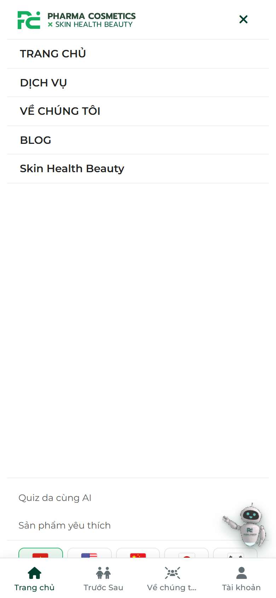

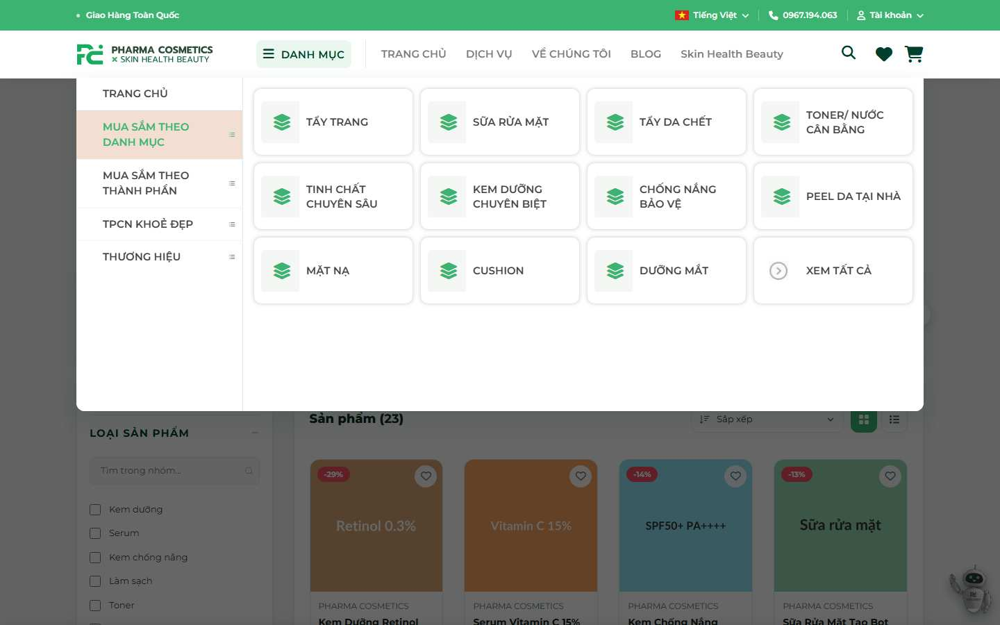

##### **L02 · Mức 3 — Màu xanh thương hiệu #3CB371 thiếu tương phản** — ✅ ĐÃ SỬA 30/10/2026 (04c14de)

Chữ trắng trên nền #3CB371 (topbar, toàn bộ footer, nút "Lấy mã", "Mua ngay") và chữ màu #3CB371 (giá, "Còn hàng", mã sản phẩm) chỉ đạt 2,5–2,7 : 1, chuẩn là ≥ 4,5 : 1\. Lỗi có trên cả 68/68 trang. Thêm: giá gốc xám 2,1 : 1, nhãn màu đào 2,4 : 1, link trong đoạn văn trang Giới thiệu 1,1 : 1 so với chữ thường.


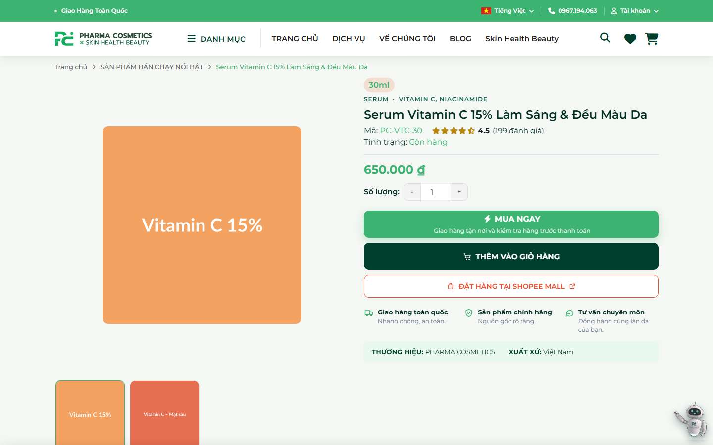

##### **L03 · Mức 3 — Trang tải rất chậm trên mobile 4G**

FCP 4,4–6,6s, LCP 5,7–12s, trang bị khoá 2–4,3s ở cả 10 trang đo. Nguyên nhân đo được: Tailwind chạy trình biên dịch ngay trên trình duyệt; 17–19 file chặn hiển thị (jQuery, Swiper, ~12 file CSS); nạp 6 độ đậm font; trọn bộ Font Awesome (~290KB); trang chủ 3,6–4,6MB ảnh, nhiều ảnh chụp màn hình PNG 200–460KB, ảnh 3163px hiển thị ở ô 390px.

##### **L04 · Mức 3 — Form báo lỗi bằng bóng tiếng Anh**

Đăng nhập, đăng ký, quên mật khẩu, đại lý B2B, liên hệ hiện "Please fill out this field." của trình duyệt. Form đặt lịch báo từng lỗi một, hộp lỗi nằm dưới nút gửi cách ô sai cả màn hình; nhập SĐT "123" rời ô không báo.

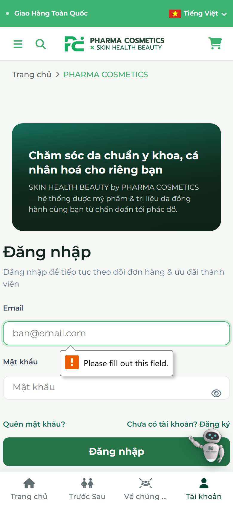

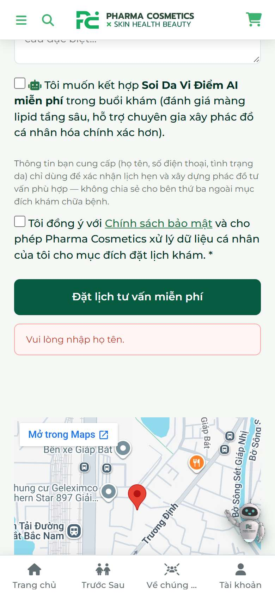

##### **L05 · Mức 3 — iPhone tự phóng to khi chạm ô nhập**

Chữ trong ô nhập 14–15px (dưới 16px) ở 100% ô của 18 trang có form, ô cao 40px (chuẩn ≥ 44px).

##### **L06 · Mức 3 — Phần tử nổi che nội dung**

Header + thanh đáy + robot chat + nút "lên đầu" luôn hiện, chiếm 20% màn ở 320px, 31% khi xoay ngang, 56% ở trang dịch vụ. Robot che ô chọn chi nhánh, nút Đăng nhập, tên và giá sản phẩm. Thanh giỏ dịch vụ đè đúng lên thanh đáy; thanh đáy đè cả menu ☰.

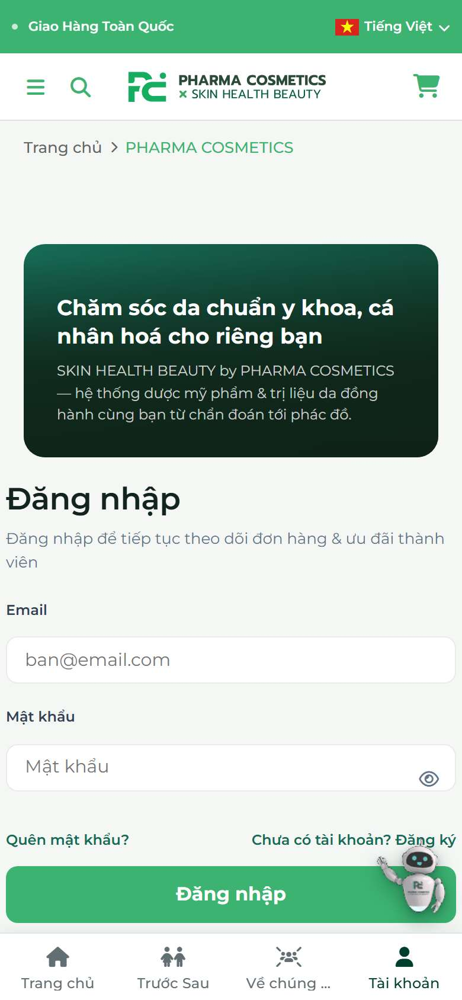

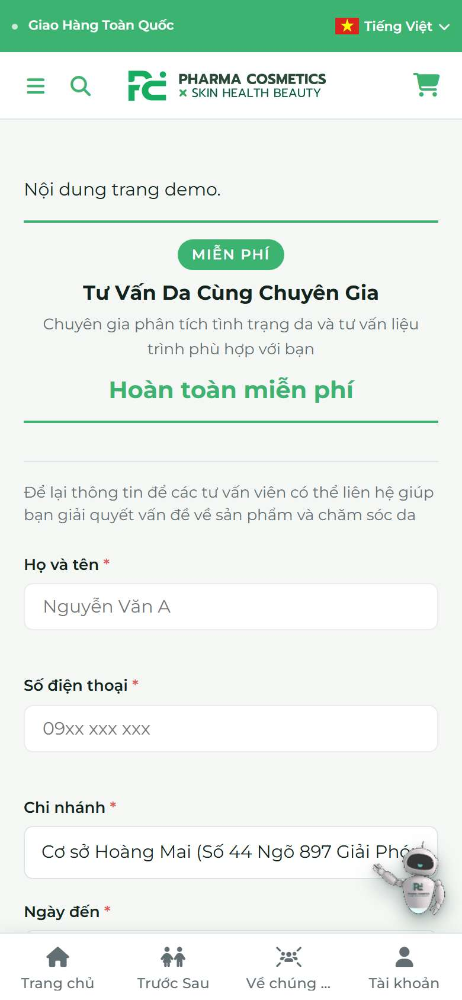

##### **L07 · Mức 3 — Trang sản phẩm mobile khó mua**

Giá nằm ở y = 826px, nút "Thêm vào giỏ" ở y = 986px trong khi màn hình cao 844px; không có thanh mua cố định khi cuộn. Không có thông tin đổi trả / phí giao gần nút mua (trang đổi trả trên Sapo có nhưng đường dẫn gõ sai /chinh-xach-doi-tra — đã xác minh trên Sapo).

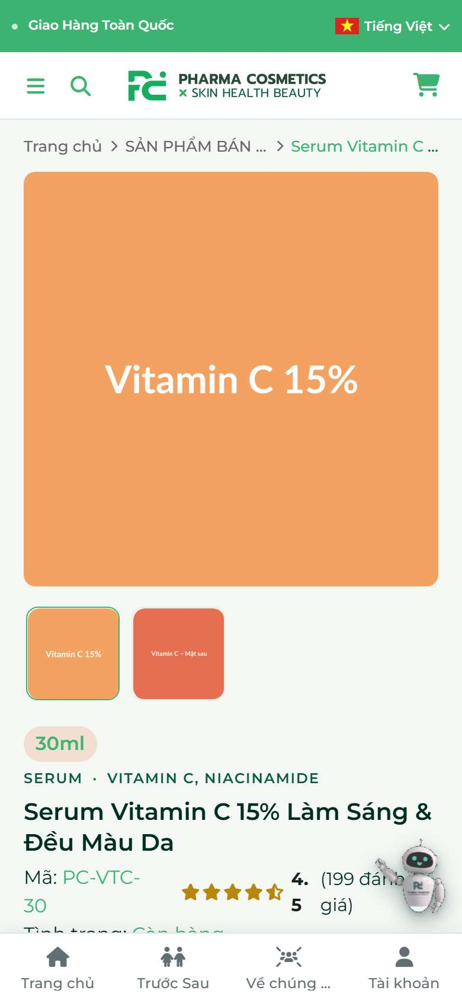

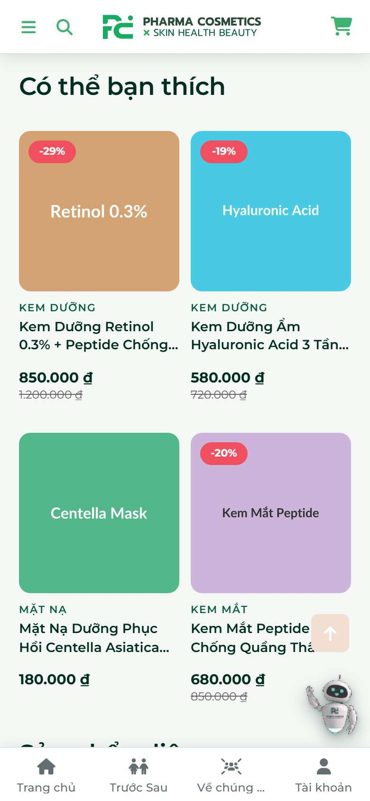

##### **L08 · Mức 3 — Link tag bài viết hỏng trên Sapo thật**

Mọi link tag dạng /blogs/all/tagged/((tag)) bị chuyển về trang chủ; 3 link nhóm dịch vụ (/targeted-treatments, /invasive-treatments, /maintenance-skin-care) cũng vậy — đã xác minh trên Sapo.

##### **L09 · Mức 3 — Đồng hồ Flash Sale tự đếm lại mỗi 24 giờ**

Mốc gốc 05/07/2026 đã qua, chu kỳ 24 giờ nên ngày nào cũng "còn vài giờ". Nếu giá khuyến mãi không thật sự kết thúc theo đồng hồ, đây là Dark Pattern "đồng hồ khẩn cấp giả" — rủi ro thông tin gây nhầm lẫn theo Luật Bảo vệ quyền lợi người tiêu dùng 2023\. **Cần chủ dự án cho biết Flash Sale có đổi giá thật mỗi ngày không.**

**Đã quyết (24/10/2026): giá Flash Sale đổi thật mỗi ngày ⇒ giữ đồng hồ chu kỳ 24h — không phải Dark Pattern; chỉ kiểm hiển thị (G.7).**

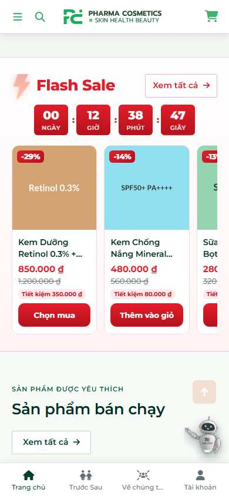

##### **L10 · Mức 3 — Không dùng được bằng bàn phím**

Mọi nút, ô nhập, checkbox không có viền focus (204/208 lượt Tab). Chỉ trang chủ có skip link "Đến nội dung chính"; trang danh mục phải Tab ~40 lần mới tới sản phẩm.

#### **P1 — sửa ngay sau P0 (có ảnh)**

##### **L11 · Mức 3 — Hero trang chủ không đọc được ngay**

Tiêu đề hero hiện bằng hiệu ứng mờ dần, sau 1,5 giây vẫn còn mờ và làm LCP lên 7,4s trên 4G. Nút "Đặt lịch phân tích da" chữ xanh trên ảnh xanh; màn đầu desktop không có thông điệp nào đọc được.

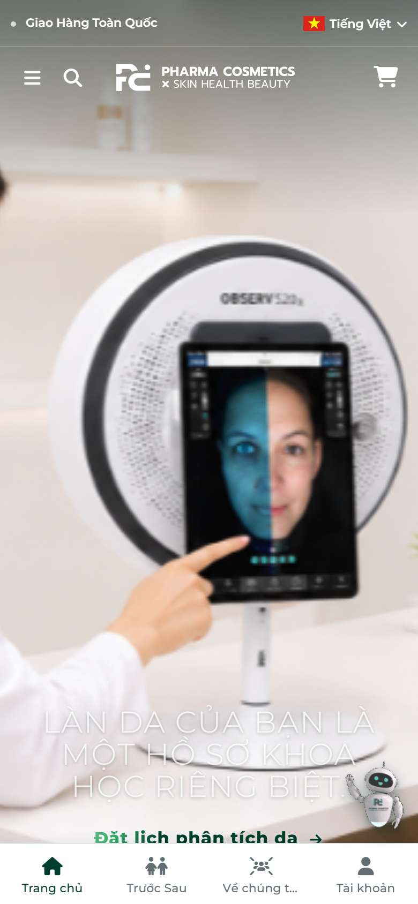

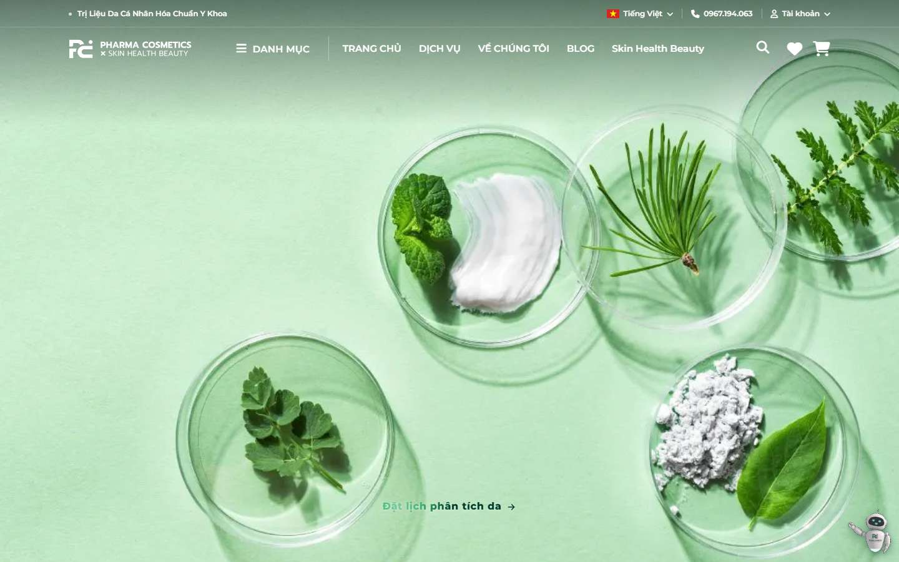

##### **L12 · Mức 3 — Danh mục mobile: sản phẩm đầu nằm dưới 1,6 màn hình**

Breadcrumb, hero, 4 icon cam kết, khối voucher đẩy sản phẩm đầu tiên xuống y ≈ 1370px; bố cục nhảy khi tải (CLS 0,24–0,37).

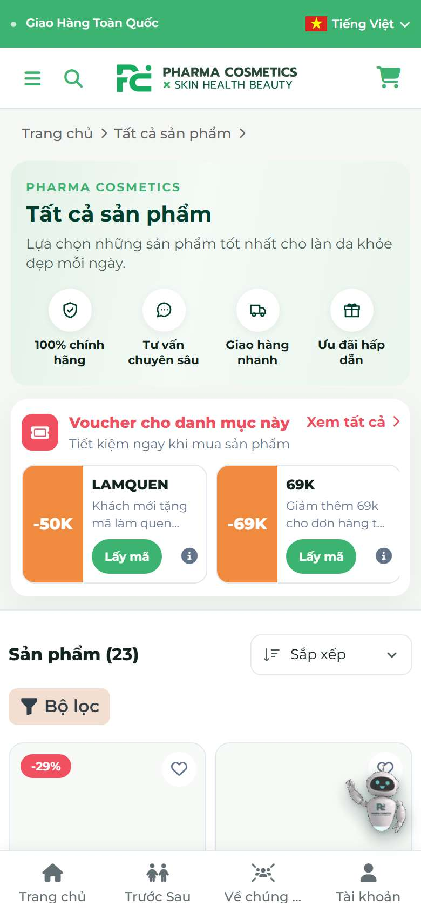

##### **L13 · Mức 3 — Bộ lọc mobile**

Nút "Bộ lọc" 94×34px; panel mở không chuyển focus vào trong; nút đóng 30×30px; ô tìm bị cắt "Tìm trong nh…"; nút xoá bộ lọc 18×18px; tích là lọc ngay, không biết còn bao nhiêu sản phẩm.

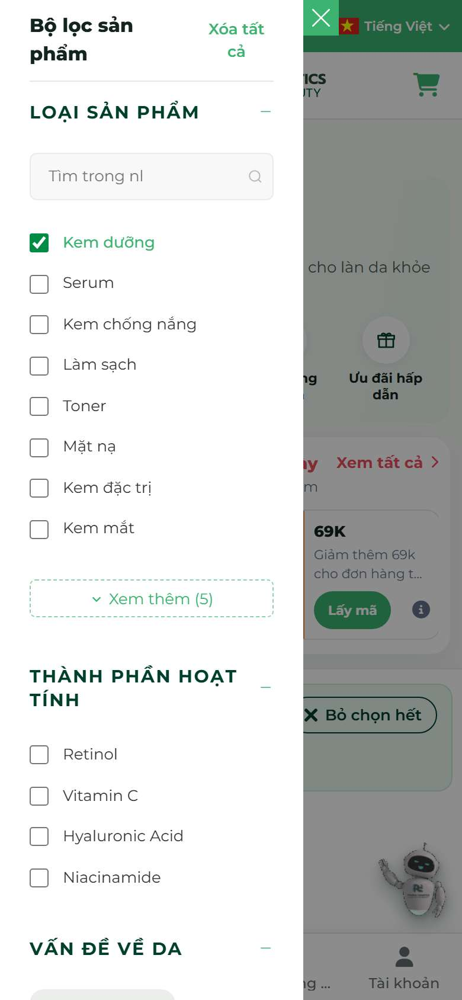

##### **L14 · Mức 3 — Tìm kiếm**

Gợi ý khi gõ "retinol" báo "Không tìm thấy" trong khi trang kết quả có 2 sản phẩm (thấy trên bản review — cần kiểm lại trên Sapo). Trang tìm kiếm: icon kính lúp lỗi đè chữ. Desktop: mở tìm kiếm bằng bàn phím thì mất focus.

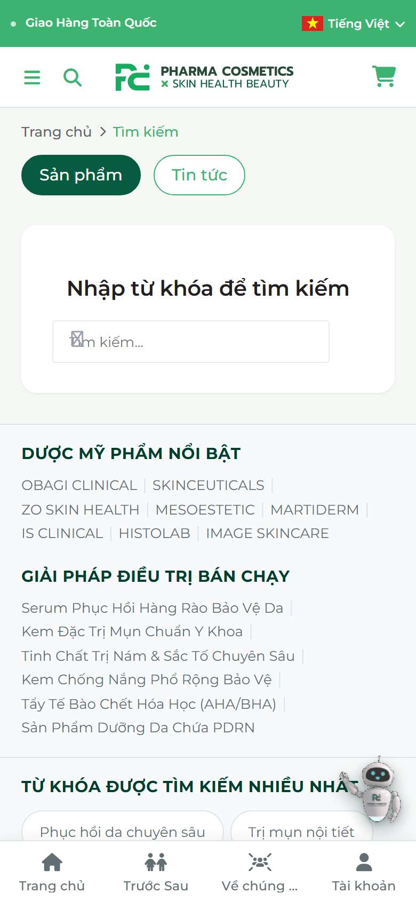

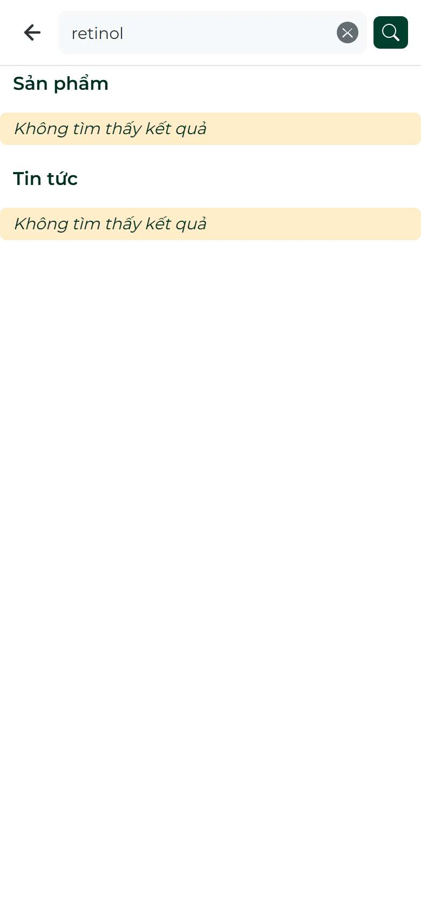

\[image: Trang tìm kiếm: icon lỗi đè chữ\]

##### **L15 · Mức 3 — Popup điều kiện voucher**

Nút đóng chỉ 11×23px; phím Escape không đóng; dòng "Ngày hết hạn:" để trống. Nút "Lấy mã" đổi thành "Đã lưu" nhưng thực chất là sao chép mã.

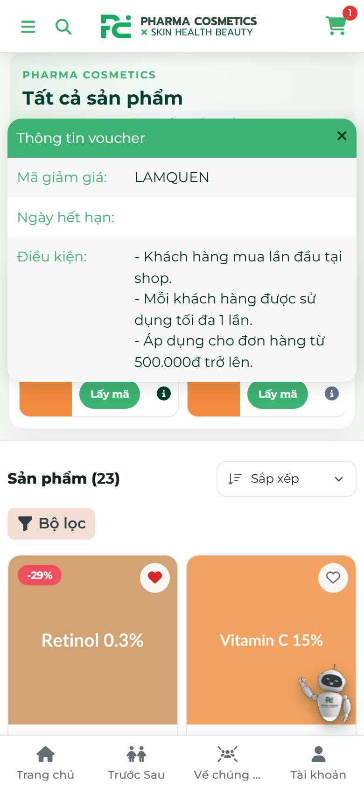

\[image: Popup voucher\]

##### **L20 · Mức 2 — Lộ mã nội bộ và chữ demo**

Menu dịch vụ hiện DIEU-TRI-CHUYEN-SAU; chi tiết dịch vụ hiện chong-lao-hoa, san-pham-noi-bat; Trước & Sau hiện "Liệu trình: elaine-brennan-getglowing-micro-peel-.."; tag bài viết hiện bac-si-tu-van (vi phạm quy định dùng "Chuyên gia"); trang đặt lịch hiện "Nội dung trang demo.". Nút dịch vụ 10px chữ HOA.


\[image: Trang dịch vụ: lộ mã nội bộ, nút 10px chữ HOA\]

##### **L27 · Mức 2 — Họ thẻ sản phẩm thứ 3**

Khối "SẢN PHẨM XEM NHIỀU NHẤT" cuối trang chủ khác cả 2 kiểu thẻ chuẩn: chữ HOA, giá xanh nhạt, mũi tên đè thẻ.


\[image: Thẻ sản phẩm xem nhiều\]

##### **L28 · Mức 2 — Thông báo không đồng bộ**

Thêm giỏ = thông báo đáy màn; yêu thích = hộp xanh đầu trang che sản phẩm; 2 thông báo có thể hiện cùng lúc.

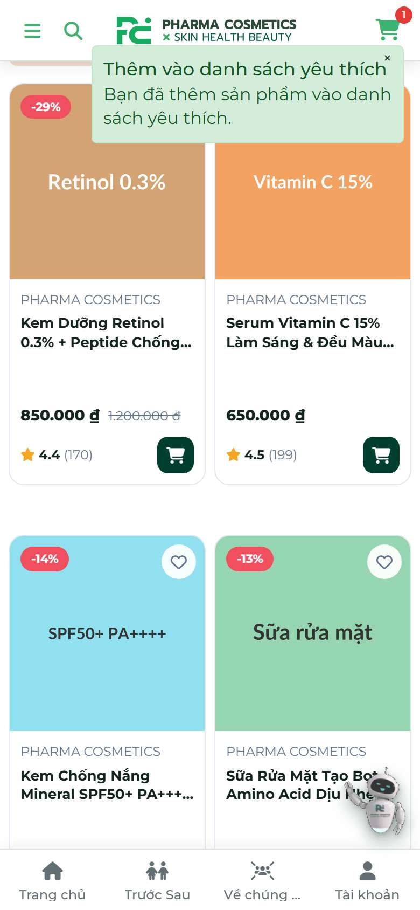

\[image: Thông báo yêu thích che sản phẩm\]

##### **L29 · Mức 2 — Giỏ hàng**

Dòng sản phẩm số lượng 2 chỉ hiện đơn giá, không có thành tiền; "Xóa" là chữ nhỏ không hoàn tác; tổng tiền và nút đặt hàng bị thanh đáy che; bố cục nhảy CLS 0,39. Giỏ trống đạt chuẩn.

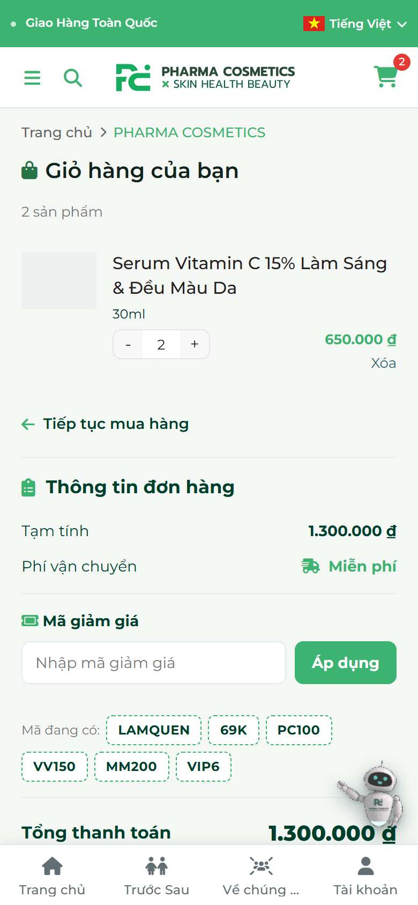

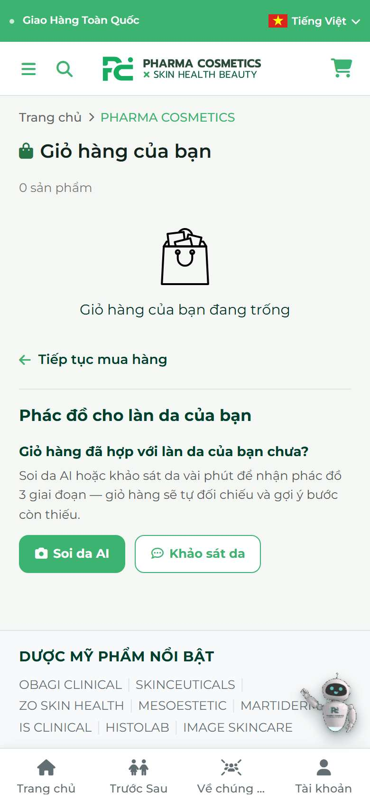

\[image: Giỏ có hàng\]

\[image: Giỏ trống đạt chuẩn; breadcrumb sai tên trang\]

##### **L30 · Mức 2 — Tin tức căn đều 2 bên**

Chữ căn đều trên màn hẹp tạo khoảng trắng lớn giữa các chữ.

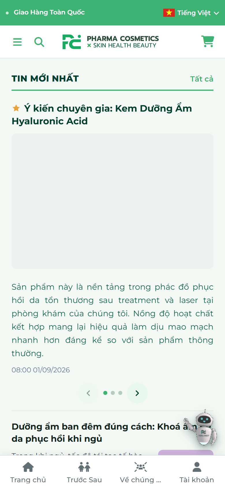

\[image: Tin tức căn đều\]

##### **L32, L33, L39 · Mức 2 — Xem ảnh sản phẩm, khảo sát da, soi da không camera**

Trình xem ảnh có 10 nút công cụ (xoay, lật, tải xuống, chia sẻ Google+ đã khai tử). Khảo sát da 18 câu, ô nhập che đáp án. Soi da khi không mở được camera: thông báo không kèm nút tải ảnh ngay cạnh.

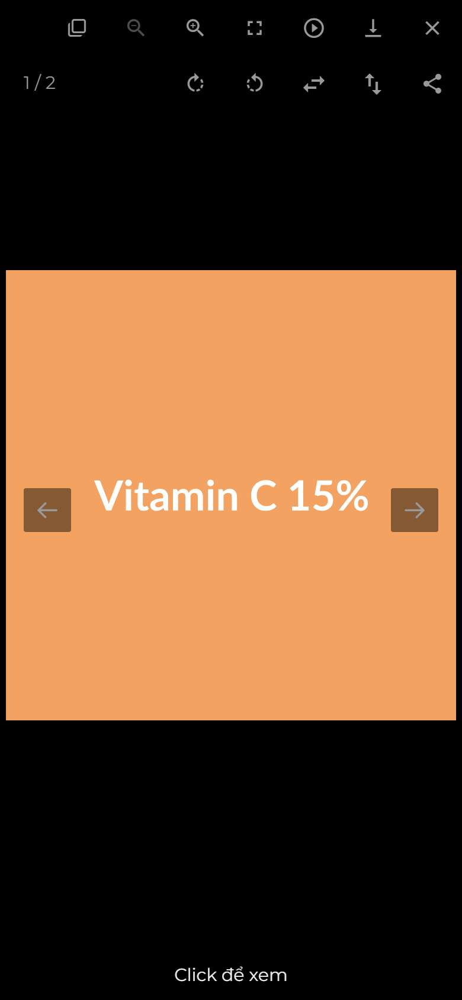

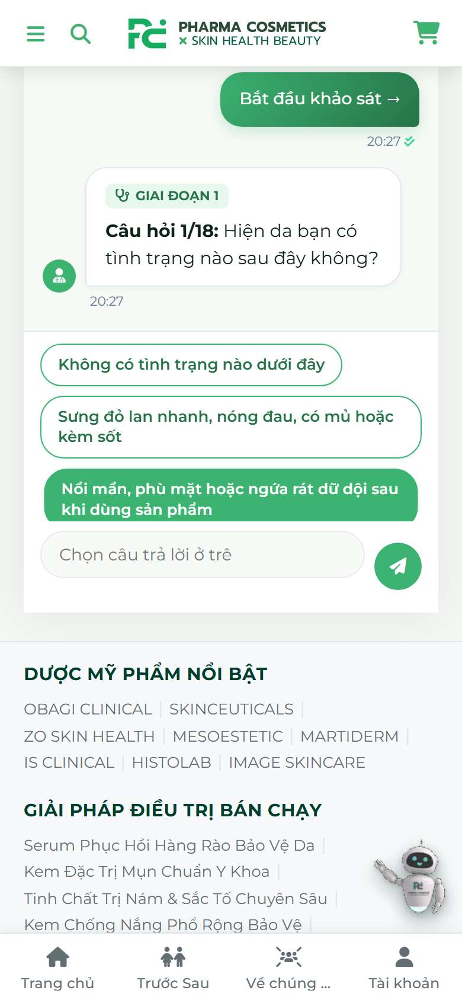

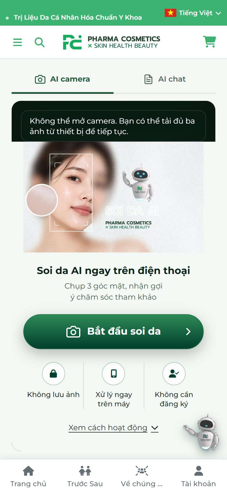

\[image: Trình xem ảnh 10 nút\]

\[image: Khảo sát da 18 câu\]

\[image: Soi da không camera\]

##### **L40 · Mức 1 — Trang chủ dài 15,2 màn hình**

Khoảng trắng ~120px dưới nhãn chương "KHÁM PHÁ"; nút "lên đầu" che thẻ.

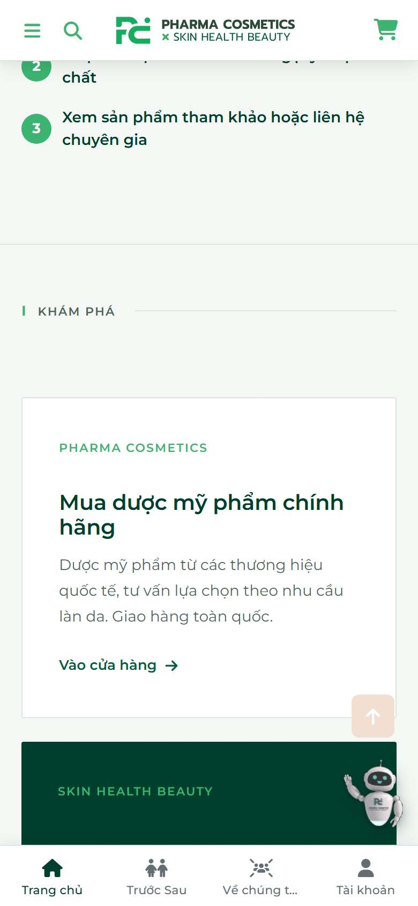

\[image: Trang chủ giữa trang\]

#### **P1 — các lỗi còn lại**

| Mã | Mức | Lỗi | Chuẩn vi phạm |
| :---- | :---- | :---- | :---- |
| L16 | 3 | 50/68 trang không có vùng nội dung chính <main>; trang khảo sát AI có 2 header + 2 footer về ngữ nghĩa; vùng ẩn vẫn nhận focus ở trang Skin Health Beauty | WCAG 1.3.1, 4.1.2 |
| L17 | 3 | Tab mô tả sản phẩm (Thông tin / Thành phần / Hướng dẫn / Đánh giá) không dùng được bằng bàn phím | WCAG 2.1.1 |
| L18 | 2 | Thiếu nhãn cho ô số lượng, checkbox bộ lọc, ô chọn dịch vụ, form B2B, chát AI; đăng nhập/đăng ký thiếu tự điền, SĐT không bật bàn phím số | WCAG 1.3.5, 4.1.2 |
| L19 | 2 | Link ảnh, nút "lên đầu", nút giỏ/yêu thích không có tên cho trình đọc màn hình (tới 41 phần tử/trang); link mơ hồ "Xem chi tiết" ×51, "Đọc tiếp ..." ×42 | WCAG 2.4.4 |
| L21 | 2 | Breadcrumb giỏ hàng, đăng nhập, tài khoản hiện "PHARMA COSMETICS" thay tên trang | Heuristic 1 |
| L22 | 2 | Tiêu đề tab trình duyệt mọi trang có đuôi  tagged "" | SEO |
| L23 | 2 | Trang thanh toán đặt lịch mất tiêu đề chính khi lỗi; 2 trang có tiêu đề chính rỗng | WCAG 1.3.1 |
| L24 | 2 | Vùng chạm nhỏ: link footer cao 16px, chấm chuyển ca Trước & Sau 10–12px, tim yêu thích 32px, nút ± 35px, "Lấy mã" 65×32, checkbox đặt lịch 16px | WCAG 2.5.8 |
| L25 | 2 | Chữ 10–11px trên mobile: topbar, chọn ngôn ngữ, nhãn giảm giá, "Trước/Sau", nút dịch vụ | Chuẩn ≥ 12px |
| L26 | 2 | 92 kiểu nút; 6 màu nút hành động; "Thêm vào giỏ" ≥ 5 kiểu; trang sản phẩm desktop có 2 nút đặc cùng cấp | Heuristic 4 |
| L31 | 2 | Trang sản phẩm mobile: hàng mã / đánh giá vỡ dòng ("4. / 5") | Đọc hiểu |
| ✅ L34 | 2 | Thanh đáy "Trước Sau" trỏ trang phản hồi chung, không phải trang Trước & Sau; nhãn "Về chúng t…" bị cắt | Information scent |
| L35 | 2 | Trộn trục căn giữa/trái ở đặt lịch; form đăng nhập sát mép 10px | Gestalt |
| L36 | 2 | Tiêu đề chữ HOA (footer, menu, nhóm lọc) và Hoa Từa Chữ ("Câu Hỏi Thường Gặp") | Typography |
| L37 | 2 | Ảnh quá cỡ: 3163px hiển thị 390px; trang Skin Health Beauty 2,9MB ảnh | Hiệu năng |
| L38 | 2 | Carousel vẫn tự chạy khi người dùng bật "giảm chuyển động"; topbar tự chạy không có nút dừng | WCAG 2.2.2 |
| L41 | 1 | Widget liên hệ: nút đóng không phải nút thật; "Hiện lại nút liên hệ nhanh" luôn hiện | WCAG 4.1.2 |
| L42 | 1 | 55 ảnh có mô tả trùng chữ bên cạnh ⇒ trình đọc màn hình đọc 2 lần | WCAG 1.1.1 |
| L43 | 1 | ID trùng trên mọi trang; tiêu đề nhảy bậc ở 10–11 trang | WCAG 1.3.1 |
| L44 | 1 | Mega-menu desktop: 11 danh mục dùng cùng 1 icon | Heuristic 8 |

**Ghi chú:** link sản phẩm, /checkout, /san-pham-yeu-thich, /dieu-khoan, /chinh-sach báo lỗi trên bản review nhưng **tồn tại trên Sapo** — không tính là lỗi. Ảnh sản phẩm trống trong giỏ là do dữ liệu mẫu. Đánh giá sao lấy từ đánh giá thật — đạt.

### **E.5 Kết quả theo trang**

Trên mạng 4G chậm, cả 10 trang chính đều vượt ngưỡng LCP 2,5s; trang danh mục chậm nhất (12,0s).

#### **Tốc độ trên 4G chậm (mobile)**

| Trang | FCP | LCP | Phần tử hiện lâu nhất | TBT | CLS | Dung lượng |
| :---- | :---- | :---- | :---- | :---- | :---- | :---- |
| Danh mục /collections/all | 5,8s | **12,0s** | Ảnh thẻ sản phẩm | 3,5s | 0,001 | 669KB |
| Soi da /soi-da | 5,4s | 9,1s | Ảnh minh hoạ 1437px | 2,6s | 0,017 | 867KB |
| Đặt lịch /dat-lich-tu-van | 5,4s | 9,1s | Ảnh GIF linh vật | 2,8s | 0,165 | 610KB |
| Đăng nhập | 6,6s | 7,8s | Dòng chữ banner | 2,3s | 0 | 633KB |
| Trang chủ / | 5,9s | 7,4s | Tiêu đề hero (chờ hiệu ứng) | 4,3s | 0,006 | **4.458KB** |
| Sản phẩm (Serum Vitamin C) | 5,5s | 6,7s | Ảnh sản phẩm | 3,2s | 0,093 | 642KB |
| Bài viết (Retinol) | 5,4s | 6,3s | Ảnh bài | 2,4s | 0,02 | 633KB |
| Tin tức /tin-tuc | 5,4s | 6,3s | Đoạn tóm tắt | 2,5s | 0,022 | 608KB |
| Dịch vụ Skin Health Beauty | 4,4s | 5,9s | Mô tả hero | 2,1s | 0 | 596KB |
| Giỏ hàng | 4,5s | 5,8s | Đoạn chữ phác đồ | 2,0s | **0,39** | 660KB |

Chuẩn: FCP ≤ 1,8s · LCP ≤ 2,5s · TBT < 0,2s · CLS ≤ 0,1.

#### **Quét 70 trang (mobile 390px)**

Cột: **Chạm** = số vùng chạm nhỏ hơn 24px / 44px · **Chữ<12** = số đoạn chữ nhỏ hơn 12px · **Tương phản** = số đoạn chữ thiếu tương phản · **Không tên** = link/nút không có tên cho trình đọc màn hình · **Ô nhập** = ô bị iPhone phóng to / tổng ô. Mọi trang có sẵn ~17 / 5 / 18 lỗi nền từ header + footer dùng chung — sửa header/footer là giảm ở cả 70 trang.

| Trang | Chạm <24 / <44 | Chữ<12 | Tương phản | Không tên | Ô nhập |
| :---- | :---- | :---- | :---- | :---- | :---- |
| Trang chủ | 24 / 34 | 34 | 93 | 4 | – |
| Tất cả sản phẩm | 25 / 122 | 37 | 47 | 41 | 1/1 |
| Danh mục SkinCeuticals | 24 / 22 | 22 | 31 | 2 | – |
| Giải pháp mụn trứng cá | 25 / 62 | 24 | 34 | 21 | 1/1 |
| Flash Sale | 25 / 79 | 34 | 44 | 26 | 1/1 |
| Danh mục liệu trình | 17 / 30 | 14 | 18 | 1 | – |
| Danh mục Skin Health | 18 / 81 | 99 | 49 | 1 | – |
| Danh sách danh mục | 17 / 15 | 5 | 93 | 2 | – |
| Sản phẩm Serum Vitamin C | 20 / 40 | 17 | 40 | 13 | 1/1 |
| Sản phẩm Kem Retinol | 20 / 45 | 15 | 43 | 16 | 1/1 |
| Sản phẩm liệu trình | 17 / 15 | 15 | 26 | 1 | – |
| Tìm kiếm | 17 / 20 | 5 | 19 | 2 | 1/1 |
| Giỏ hàng | 18 / 17 | 5 | 21 | 2 | – |
| Thanh toán đặt lịch | 17 / 13 | 5 | 18 | 1 | – |
| Tra cứu đơn | 19 / 17 | 10 | 17 | 2 | 2/2 |
| Đăng nhập | 17 / 17 | 5 | 20 | 2 | 2/2 |
| Đăng ký | 19 / 21 | 5 | 20 | 2 | 5/5 |
| Quên mật khẩu | 17 / 15 | 5 | 19 | 2 | 2/2 |
| Tài khoản | 25 / 19 | 5 | 22 | 6 | – |
| Đơn hàng | 18 / 14 | 5 | 22 | 1 | – |
| Đổi mật khẩu | 18 / 13 | 5 | 19 | 1 | 3/3 |
| Tích điểm | 17 / 16 | 6 | 19 | 2 | – |
| Đặt lịch tư vấn | 29 / 16 | 5 | 20 | 2 | 5/5 |
| Chuyên gia | 22 / 15 | 5 | 19 | 2 | – |
| Skin Health Beauty | 18 / 16 | 9 | 16 | 1 | – |
| Chi tiết dịch vụ | 18 / 18 | 2 | 15 | 2 | 2/2 |
| Dịch vụ Skin Health Beauty | 20 / 45 | 57 | 33 | 1 | – |
| GetGlowing Micro-Peel | 20 / 16 | 25 | 31 | 1 | – |
| Trước & Sau chăm sóc da từ xa | 25 / 16 | 8 | 28 | 1 | – |
| Soi da | 17 / 13 | 5 | 18 | 1 | – |
| Khám da AI / khảo sát | 17 / 18 | 8 | 18 | 2 | 1/1 |
| Kết quả khảo sát | 18 / 15 | 5 | 20 | 1 | – |
| Tra cứu hoạt chất | 21 / 24 | 30 | 25 | 2 | – |
| Tin tức | 25 / 37 | 26 | 43 | 15 | – |
| Danh mục bài viết | 24 / 24 | 9 | 26 | 3 | – |
| Bài viết | 18 / 26 | 13 | 21 | 2 | – |
| Video | 23 / 33 | 5 | 18 | 1 | – |
| Danh mục Trước & Sau | 18 / 30 | 22 | 18 | 2 | – |
| Hoạt chất | 36 / 23 | 9 | 24 | 10 | – |
| Bản tin dạng Instagram | 29 / 73 | 11 | 17 | 1 | – |
| Giới thiệu | 21 / 49 | 5 | 17 | 2 | 4/4 |
| Đại lý B2B | 17 / 24 | 5 | 19 | 2 | 9/9 |
| Chính sách bảo mật | 19 / 14 | 5 | 18 | 2 | – |
| Trang 404 | 17 / 16 | 5 | 19 | 2 | – |

Bảng đầy đủ 70 trang nằm trong file tài liệu gốc của dự án.

### **E.6 Đối chiếu trên bản live (hugo-theme-sept2026-test.vercel.app)**

Tiến hành duyệt thực tế qua trình duyệt web trên bản live test https\://hugo-theme-sept2026-test.vercel.app để đối chiếu với 44 điểm khuyến nghị trong tài liệu.

5. **Flash Sale & Đồng hồ đếm ngược (L09):** Đồng hồ đang chạy đếm ngược theo giây thực tế (định dạng Ngày : Giờ : Phút : Giây), không bị treo. Cần cấu hình mốc kết thúc thật hoặc cơ chế hạ giá/ẩn banner khi hết giờ để tuân thủ Luật Bảo vệ quyền lợi người tiêu dùng 2023\.  
6. **Điều hướng & Megamenu (L01):** Trên Desktop, nút DANH MỤC kích hoạt Megamenu lưới 2 cột rất đầy đủ (Danh mục, Thành phần, TPCN, Thương hiệu). Cần đảm bảo trên Mobile Hamburger Menu ☰ cũng đồng bộ mở được cây danh mục này thay vì chỉ hiện 5 trang giới thiệu.  
7. **Màu sắc & Độ tương phản (L02):** Nền Footer và nút 'MUA NGAY' đang dùng màu #3CB371 với chữ trắng (tương phản ~2.6:1). Cần đổi nền Footer sang Deep Forest #003F2D và nút chính sang #075B40 để đạt chuẩn WCAG 2.2 AA (≥ 4.5:1).  
8. **Phần tử nổi & Nút bấm (L06, L26):** Trên màn hình có 3 phần tử nổi đồng thời (Sticky Header, Trợ lý AI Robot góc phải, Nút Scroll to top). Cần tối ưu để trên Mobile không chiếm quá 15% diện tích màn hình. Trang sản phẩm có 2 nút 'MUA NGAY' (xanh lá) và 'THÊM VÀO GIỎ HÀNG' (xanh đậm) cần phân cấp rõ nút Chính (Primary) và Phụ (Secondary Outline).  
9. **Luồng Soi da AI & Trải nghiệm Clinic:** Tính năng Khám da AI hoạt động tốt với 2 lựa chọn (chụp/tải 3 góc mặt và khảo sát hội thoại với Chuyên gia Pharma AI), giao diện chuyên nghiệp, cần tối ưu thời gian phản hồi khi chuyển tab trên thiết bị di động.

Khuyến nghị: đồng bộ ngay điều hướng mobile và bảng màu chuẩn tương phản trước khi chạy chiến dịch bán hàng.

### E.7 Theo dõi tiến độ sửa (agent cập nhật sau MỖI vòng)

Đồng bộ với `ui-loop/BACKLOG.md`. Trạng thái: ⬜ Chưa sửa · 🔧 Đang sửa · ⚠️ Kiểm chưa đạt (lần thử) · ✅ Đã sửa · ⛔ Bị chặn · ❓ Chờ chủ dự án.
Mục ✅ KHÔNG được sửa lại trừ khi ui-verify báo hồi quy (khi đó mở việc N mới, ghi "hồi quy của <mã>").

| Mã | Đợt | Việc | Trạng thái | Commit | Ngày | Số đo chính (từ trình duyệt) |
|-----|-----|------|------------|--------|------|------------------------------|
| D01 | 0 | Nguồn CSS + build: `ui-src/css/tokens.css`, `components.css`, `main.css` theo M.1/M.3/M.4; | ✅ Đã sửa | 3e09f7c | 23/10/2026 | build:sapo exit 0; pc-ui.css gzip 6 406 B; 47/47 class biên dịch; nút 44px #075B40, bo 12px mobile / 0 desktop, focus 2px (7 khung Chromium + WebKit) |
| D02 | 0 | Đổi tên 3 class cũ trùng thư viện: `pc-btn`→`pc-btn-v3`, `pc-section`→`pc-section-v3`, `pc | ✅ Đã sửa | 2223508 | 23/10/2026 | grep tên cũ 0; 70 lượt (10 trang × 7 khung Chromium + WebKit): 0 phần tử còn class cũ, 119 phần tử × 20 thuộc tính computed 0 lệch, chiều cao trang trước = sau 70/70; ui-verify --quick 0 lỗi mới |
| D03 | 0 | Nạp `pc-ui.css` trong `layouts/theme.bwt` (+ `layouts/chat.bwt`) SAU CSS cũ | ✅ Đã sửa | 8cfaccb | 24/10/2026 | 42 lượt (6 trang Q × 7 khung Chromium + WebKit): pc-ui.css HTTP 200 42/42, 1 link trong head, 0 CSS cũ trong head nạp sau, cssRules 503; chiều cao trang trước = sau 42/42; ui-verify --quick 0 lỗi mới (hồi quy gạch chân link → N02) |
| D04 | 0 | 12 snippet `ui_*` (button, product_card, field, badge, swiper_nav, action_bar, modal, toas | ✅ Đã sửa | 78eca07 | 24/10/2026 | Lần 2, 7 khung Chromium + WebKit: đủ 10 snippet (fab ẩn ở 844×390 đúng M.4); PC-ERROR ngoài ô thử 0, ô thử 11/11; 17 nút ≥ 44px, swiper 44, fab 48, nút đóng popup 44×44; ô nhập 16px; Tab solid 2px rgb(7,91,64); axe #pc-kit 0 (thường + popup mở) 7/7 khung; ui-verify --quick 0 lỗi mới (lần 1: nút 39,6px, focus none, target-size → N03–N06) |
| N01 | 0 | Thư viện: preflight tắt ⇒ viền pc-* thiếu `border-style: solid`, pc-input thiếu `box-sizing: border-box` | ✅ Đã sửa | df26637 | 24/10/2026 | 7 khung Chromium + WebKit: 44–46 phần tử × 4 cạnh 0 sai — nút phụ outset → solid 2px rgb(7,91,64); nút chính outset 2px → 0; thẻ none → solid 1px rgb(226,232,240); slider outset → solid 1px; ô nhập viền rgb(235,235,235) (CSS cũ) → rgb(100,116,139), border-box 44px; viền 1 cạnh header/thanh đáy/thanh mua/popup đúng cạnh; quy tắc ngoài .pc- 589/589 trùng; ui-verify --quick 0 lỗi mới |
| N02 | 0 | Hồi quy của D03: `p a, li a` trong tokens.css gạch chân + đổi màu menu header, breadcrumb, link trong li/p; ảnh "Xem nhiều" 320/768 đổi cỡ | ✅ Đã sửa | d1f33ff | 24/10/2026 | 42 lượt (6 trang Q × 7 khung Chromium + WebKit): bật/tắt pc-ui.css 1 093 → 0 phần tử cũ đổi gạch chân/màu; `a.nav-link` 1024/1440 gạch chân 5/5 → 0; ảnh 1440 bật vs tắt 0 điểm khác (trước 0,10–0,18 %); "Xem nhiều" 195/222px bằng nhau khi chặn hẳn pc-ui.css ⇒ không do pc-ui; ui-verify --quick 0 lỗi mới |
| N03 | 0 | Thư viện dùng đơn vị rem nhưng CSS cũ đặt `html { font-size }` = 14,4px (< 1024) / 15px (≥ 1024) ⇒ `min-h-11`/`h-11`/`h- | ✅ Đã sửa | bfa0480 | 24/10/2026 | 7 khung Chromium + WebKit: html giữ 14,4 / 15px; pc-btn 44px (trước 39,6 / 41,3), btn--lg 48px, swiper 44×44, fab 48×48, modal close 44×44; quy tắc ngoài .pc-* 589/589 trùng; ui-verify --quick 0 lỗi mới |
| N04 | 0 | Viền focus của nút thư viện bị CSS cũ tắt: `vendor_bootstrap.css` `button, input { outline: none !important }` + `global | ✅ Đã sửa | 796c8e8 | 24/10/2026 | 8 khung Chromium 1440/390/320/768/1024/844×390 + WebKit 1440/iPhone 13: Tab 17–21 phần tử thư viện 0 sai viền — solid 2px rgb(7,91,64) offset 2px (trước none / 3px #3CB371); Shift+Tab 4/4; ô nhập, nút đóng popup solid 2px brand; 389 lượt focus phần tử ngoài pc-* đổi 0; ui-verify --quick: 2 lỗi webkit390 /collections/all có cả ở HEAD → N07 |
| N05 | 0 | Phần tử nổi cũ đè thư viện: `nav.pc-bottom-nav` (z 9990) không bị ẩn bởi `body:has(.pc-actionbar) .pc-bottomnav` (tên cl | ✅ Đã sửa | ab4efc4 | 24/10/2026 | 8 khung Chromium + WebKit: thanh mua 118,8 → 64px (390), 135 → 64 (320); nút + giá thanh mua trúng 9/9 (trước 0–3/9); toast giao thanh mua 38,8 → 0px; nút nổi 3 → 1; popup 19/25 → 25/25; axe target-size 0 (trước ×1 ở 768/844×390 + popup mở); hồi quy Q 0/72 đổi; ui-verify --quick 0 lỗi mới |
| N06 | 0 | CSS cũ ẩn checkbox: `input[type=checkbox]` của `ui_field` type checkbox có opacity 0, position absolute ⇒ ô không nhìn t | ✅ Đã sửa | b842de2 | 24/10/2026 | Lần 2, 7 khung Chromium + WebKit: opacity 0 → 1, absolute → static; ô bấm 44×44 (< 1024) / 24×24 (≥ 1024), ô vẽ ::before 24×24 viền solid 2px, tích nền rgb(7,91,64); Tab viền none → solid 2px brand; bấm ô/chữ/Space đổi trạng thái; 78 checkbox cũ 0 đổi; ui-verify --quick 0 lỗi mới (lần 1: 2 lỗi touch<44) |
| N09 | 0 | CSS cũ `label { display: inline-block !important }` đè `inline-flex` của `.pc-check` ⇒ gap 12px mất, ô cách chữ 3,7px | ✅ Đã sửa | e71bce2 | 24/10/2026 | 7 khung Chromium + WebKit: `label.pc-check` display block → flex; ô bấm → chữ 3,7 → 12px; lệch tâm dọc ô ↔ chữ 7 → 0px; bấm chữ/ô, Tab + Space đạt; 24 lượt / 225 label+checkbox cũ 0 khác; ui-verify --quick 0 lỗi mới |
| N07 | 9 | Mốc baseline webkit390 `/collections/all` đếm thiếu thẻ SP (touch<44 90 / noName 24, Chromium 390 cùng trang 120 / 40) | ⬜ Chưa sửa | — | — | Vòng 6: WebKit đo 120 / 40 cả ở HEAD 5390119 lẫn sau N04 (3 lần chạy); lỗi gốc a.pc-pcard__img không tên, button.btn-cart / pc-voucher__take < 44px → L19, L24 |
| N08 | 0 | Thư viện: toast `.pc-toast` (z 60, `bottom-20`) chồng `.pc-fab` và ô nhập trong `.pc-modal` khi popup mở ở < 1024 | ✅ Đã sửa | 887639b | 24/10/2026 | components.css v1.6; 7 khung Chromium + WebKit: toast–fab giao 28 → 0px (có thanh mua), 44/40 → 0px (không thanh mua), cách 36px (< 1024) / 28px (≥ 1024); popup mở: giao toast–popup 44 → 0px, ô nhập bị che 30,6 → 0px; hồi quy rect toast/fab/popup = HEAD 7/7; ui-verify --quick 0 lỗi mới |
| N10 | 0 | Popup thư viện mở nhưng header cũ (`header.header` z 9980 / `.main-header` z 100, `.pc-topbar-v3` z 10010) nằm trên lớp phủ `.pc-overlay` z 50 | ✅ Đã sửa | 941a42f | 24/10/2026 | components.css v1.7 (`header.header` `isolate z-header` khi popup mở); 7 khung Chromium + WebKit × cuộn 0 / 1200: lưới header trúng lớp phủ 0/15 → 15/15; bấm ☰ / giỏ / menu khi popup mở: mở drawer, đổi URL → 0 tác dụng; đóng popup header về z cũ; hồi quy Q 36/36 = HEAD; ui-verify --quick 0 lỗi mới |
| N11 | 0 | Thư viện: `.pc-modal__close` mang nền + viền mặc định trình duyệt (preflight tắt) — ô xám nổi | ✅ Đã sửa | 0359edd | 24/10/2026 | components.css v1.8; 7 khung Chromium + WebKit, popup mở: nền rgb(240,240,240) / WebKit rgb(192,192,192) → transparent (hover cũng vậy); viền outset 2px → none; padding → 0; 44×44px, icon X 24×24 tương phản 17,85:1; Tab solid 2px rgb(7,91,64); axe #kit-modal 0; 113 phần tử .pc-* khác HEAD = sau; ui-verify --quick 0 lỗi mới |
| N12 | 8 | "Xem nhiều" trang chủ: thẻ "TRETINOIN CREAM" ô ảnh trống xám, `.most-view-product-img` thẻ 2 lúc 0×0 | ⬜ Chưa sửa | — | — | N02 đo: thẻ 2 0×0 ở Chromium 390/320/768/1440/844×390 (một số lượt); ô ảnh trống ở ảnh 768 |
| N13 | 5 | Thư viện: nút nổi `.pc-fab` che nội dung khi cuộn (chữ lỗi / gợi ý / ô nhập form kit) | ⬜ Chưa sửa | — | — | D05 đo: WebKit 390 đè chữ lỗi SĐT 47×16px; Chromium 390 nhãn + ô Email 48×12 / 48×23; 320 ô 48×16; 768 nhãn 48×20 |
| D05 | 0 | `assets/pc-ui.js` (JS thuần, `defer`): `data-pc-modal`, `data-pc-toast`, `data-pc-swiper`, | ✅ Đã sửa | 9591e5d | 24/10/2026 | D05.mjs 205/205, 7 khung Chromium + WebKit: popup focus vào trong, Tab/Shift+Tab 24/24 trong popup, Escape / nút đóng / lớp phủ đóng + trả focus, khoá cuộn lệch 0px; toast 1 cái, ẩn 4 954–5 013 ms; form 0 bóng trình duyệt, 2 lỗi tiếng Việt + icon cùng lúc, focus ô sai đầu (nhãn + ô không bị che 10/10); slider nút + phím →/←, 0 chấm bấm được, giảm chuyển động không tự chạy (đối chứng chạy); axe #pc-kit 0; ui-verify --quick 0 lỗi mới |
| D06 | 0 | Thay Tailwind CDN: `tailwind.legacy.config.js` (chép cấu hình CDN trong `layouts/theme.bwt | ✅ Đã sửa | 17c0f32 | 24/10/2026 | 0 request cdn.tailwindcss.com / 186 lượt (68 trang × Chromium 390 + 1440, 10 trang × WebKit iPhone 13 / 320 / 768 / 1024 / 844×390); pc-legacy-tw.css HTTP 200, cuối head 186/186; đổi chỗ CDN ↔ dựng sẵn trong trang 0 quy tắc thiếu, 0 phần tử lệch (68 × 2 khung); ảnh trước/sau 20/20 cùng cỡ, khác 0,006–0,112 % (đồng hồ, phần tử nổi); 56 KB (gzip 8,6 KB); ui-verify --quick 68 trang 0 lỗi mới |
| D07 | 0 | `snippets/ui_icon.bwt` (SVG Lucide MIT, đủ icon đang dùng ở header/footer/thẻ/form) + `scr | ✅ Đã sửa | c336e40 | 24/10/2026 | 7 khung Chromium + WebKit: 43 icon (8 + 35 thay FA header/footer/thẻ/form) 24×24, bbox cạnh ngắn ≥ 6px / cạnh dài ≥ 12px (tiêu chí chủ dự án duyệt 24/10: dài ≥ 12, ngắn ≥ 4), aria-hidden 43/43, label 8/8, tương phản 13,75:1, axe 0, lint 0 cảnh báo ui_icon, ui-verify --quick 0 lỗi mới |
| D08 | 0 | Dữ liệu mẫu local cho mục trước đây cần Sapo: trang `chinh-xach-doi-tra` (handle Sapo thật | ✅ Đã sửa | dffe9d2 | 24/10/2026 | D08.mjs 61/61, 7 khung Chromium + WebKit: preview-mock tìm kiếm có `object_type` + cú pháp `tags:(x)`; /chinh-xach-doi-tra 200 + h1 nhìn thấy; tags:(retinol) type=article 0 → 1/1 bài có tag; smartjson 0 → 2 SP, smartjsonar hỏng → 2 bài; gõ "retinol" ở overlay ⇒ 2 SP + 2 bài, link SP 200; mẫu URL tag `/search?query=tags:(<tag>)&type=article`; ui-verify --quick 0 lỗi mới (thêm N14, N15) |
| N14 | 9 | Gợi ý tìm kiếm ép `https://` + bỏ cổng (`theme.bwt:156,162`) ⇒ local luôn "Không có thấy"; listener gắn ô header 0×0 | ⬜ Chưa sửa | — | — | D08 đo: không shim fetch lỗi; có shim 2 SP + 2 bài; `.header_tim_kiem input` 0×0 ở 390–1440 |
| N15 | 9 | Trang nội dung root-level chưa khai báo (vd `/chinh-xach-doi-tra`) dựng bằng template `collection` ở local; sửa cần `dev-server.js` + khởi động lại server | ⬜ Chưa sửa | — | — | D08 đo: 1440 hiện "Sản phẩm (23)" + bộ lọc + voucher |
| L01 | 1 | Menu ☰ mobile có cây danh mục SP (menu `main-menu`); thanh đáy 4 mục theo C.2 (Trang chủ · | ✅ Đã sửa | 7bfa173 | 24/10/2026 | 7 khung Chromium + WebKit: nhóm danh mục trong drawer 0 → 5/5; bấm "MUA SẮM THEO DANH MỤC" ⇒ 11 link danh mục đúng menu; "TẨY TRANG" ⇒ 200 + h1; Escape đóng + focus ☰ 5/5; thanh đáy Trang chủ · Danh mục (/collections/all 200) · Soi da & Dịch vụ (200) · Tài khoản; mega-menu desktop 17 = 17 link; ui-verify --quick 0 lỗi mới (luồng L01-menu-danh-muc đếm `/collections/` còn 1 — URL Sapo là `/<handle>`, chờ chủ dự án) |
| L34 | 1 | Thanh đáy: nhãn đọc trọn, `aria-current`, mục trỏ đúng trang nhãn hứa | ✅ Đã sửa | 9d8c8d1 | 24/10/2026 | L34.mjs 6 trang × 7 khung Chromium + WebKit, 544/544: "Soi da & Dịch vụ" cắt 99,9 → 72px ⇒ đọc trọn (2 dòng 81,5×28,2 trong link 97,5×56 ở 390, 80×56 ở 320); 320 chữ chồng "Tài khoản" 13,9 → 0px; nhãn trang chủ 11 → 12px; aria-current /truoc-sau-cham-soc-da-tu-xa 0 → 1 mục đúng; bấm 4 mục 200 + h1; thanh 57 = 57px; ui-verify --quick 0 lỗi mới (text<12 trang chủ 59 → 55) |
| N16 | 1 | Cây danh mục drawer mobile kiểu CSS cũ: mục cấp 1 cao 31px, icon "≡" ở mục con không có con, ô ảnh 72px; 844×390 vùng cuộn 164px; drawer có 2 mục "TRANG CHỦ" — chỉ giữ 1 (chủ dự án ghi 24/10) | ✅ Đã sửa | 8d5e111 | 24/10/2026 | N16.mjs 7 khung Chromium + WebKit, 97/97: link cấp 1 30,5 → 44,1px; link con 4 nhóm 30,5–72 → 44,1–49,5px; ô ảnh 64 → ≤ 27px; icon ≡ thừa 12 → 0, lệch tâm 2,3 → 0,5px; 844×390 vùng cuộn 164 → 334px (277px không bị thanh đáy che), cuộn tới mục cuối; TRANG CHỦ 2 → 1; desktop menu ngang + mega-menu giữ cỡ (bỏ TRANG CHỦ); ui-verify --quick 0 lỗi mới |
| N17 | 1 | WebKit: nội dung drawer ☰ `visibility:hidden` ~1,3s sau khi bấm (Chromium ~110ms) | ✅ Đã sửa | 1c2f1f9 | 25/10/2026 | Lần 2 (vòng 30, checks/N17.mjs 2 lượt, 0 ✗): reduce WebKit 71/70ms (trước 1 300–3 411ms), Chromium 31–108ms; no-preference Chromium 30–185ms (rAF), WebKit 194/312ms đo setTimeout + getComputedStyle theo quyết định N17-a (class current 47/61ms); Escape đóng + focus ☰ 10/10; Swiper 4 slider = đối chứng .01ms ở 7 khung; 0 lỗi JS; ui-verify --quick chỉ focusNoRing d1440 /collections/all 22 → 23 (mốc được duyệt N17-b, đã ghi). Phương án A: tokens.css transition-duration 0s + xoá khối trùng global_core |
| N18 | 1 | WebKit: icon ≡ (`.open_mnu`) cây danh mục drawer không thấy trong ảnh dù phần tử 43×43 nhìn thấy; Chromium icon chỉ ~10px | ✅ Đã sửa | ab11917 | 25/10/2026 | Lần 3 (vòng 31, checks/N18.mjs 2 lượt after-run5/6, 0 ✗, 88 ✔ mỗi lượt): icon SVG `ui_icon` 20×20 ở 4/4 nhóm, hiện CÙNG lúc link cấp 1 (chênh 0ms) ở 5 khung × 2 chế độ — Chromium 390/320/768/844×390 22–51ms (rAF), WebKit reduce 27/28ms, WebKit no-preference 264/91ms đo setTimeout + getComputedStyle theo N17-a; 84 điểm ảnh (WebKit 768) tương phản ≥ 3:1, nét/nền 14,84:1; `::before` ảnh nền 0/4; lệch tâm ≤ 0,5px; bấm icon mở 12 / đóng 0 link con; desktop 1024/1440 menu ngang 5 + mega-menu 16 link ±1px, `.open_mnu` 0; 0 lỗi JS; build:sapo + ui-guard PASS; ui-verify --quick 0 lỗi mới (lượt ghi baseline gặp dao động N07 webkit390 /collections/all 90 → 120). Vòng 29 (mã N17 trong cây, checks/N18.mjs 2 lượt): lượt 3 ĐẠT toàn bộ — icon hiện cùng lúc link (chênh 0ms ở 5 khung × 2 chế độ; WebKit reduce 229ms, no-preference 191ms); lượt 4 ✗ chỉ WebKit no-preference 433ms > 400 (link cùng 433ms — dao động `.header-menu` visibility .5s = N17-a, HEAD 211–466ms). Vòng 27: icon SVG `ui_icon` 20×20 ở 4/4 nhóm (trước ảnh nền 10px), điểm ảnh vẽ 14 → 84 (Chromium) / 156 → 768 (WebKit), tương phản 14,84:1, lệch tâm ≤ 0,5px, desktop không đổi; no-preference icon hiện cùng lúc link. Chưa đạt: WebKit reduce icon trễ hơn link 325–359ms (tầng chuyển tiếp của tokens.css — N17), thử phương án N17 ⇒ 0ms; làm N17 trước rồi kiểm lại |
| N19 | 3 | WebKit: chữ drawer ☰ + thanh đáy vẽ mảnh (như 300) dù computed Montserrat 600 giống Chromium | ✅ Đã sửa | b2f411a | 30/10/2026 | Vòng 38 (phương án 2): Montserrat tĩnh tự host 400/500/600/700 × 3 subset (12 woff2, 7,9–33,5KB). 7 khung × 2 trang: 0 request Google Fonts, 12 file /assets 200, mỗi file 1 lần (preload trùng URL CSS), 12 @font-face swap, không còn 300/800. Mực 600/400 · 700/400: WebKit 1,01 → **1,68 · 1,99**, Chromium 1,72 · 2,03 (lệch 2,0%); tiếng Việt vẽ bằng Montserrat (243,9px ≠ sans-serif 229,0px); 0 lỗi JS; ui-verify --quick 0 lỗi mới |
| N21 | 3 | Chữ đặt độ đậm ngoài 400–700: h1 hero trang chủ 300, 32 phần tử 800 trang chủ (nút hero, Flash Sale) + 38 ở /collections/all (voucher) — sau N19 vẽ bằng file 400 / 700 | ✅ Đã sửa | 02ea258 | 30/10/2026 | Vòng 39: đổi giá trị trong 3 file CSS cũ (300→400, 800→700 — đúng mặt font đang vẽ). 6 trang Q × 7 khung (Chromium 390/320/768/1024/1440/844×390 + WebKit iPhone 13): phần tử chữ ngoài 400–700 / 33 → 0, /collections/all 38–43 → 0 (kể cả `::after` "−" bộ lọc 300); 12 nhóm phần tử bề rộng chữ trước = sau (lệch 0px, vd h1 hero 313,27px 390 / 576,44px 1440) ⇒ giao diện không đổi; 0 lỗi JS; ui-verify --quick 0 lỗi mới |
| N22 | 9 | Nút next slider có từ trước không hoạt động: Flash Sale không dùng bàn phím được; ảnh thẻ cảm nhận `.imgs` thẻ đầu không bấm được; PDP sản phẩm liên quan 844×390 | ⬜ Chưa sửa | — | 30/10/2026 | Vòng 42 (kiểm L03a, evidence/L03a/after-run.json): có y hệt khi swiper.js đồng bộ; 12/82 slider bấm next không đổi slide |
| N23 | 3 | Tốc độ /dat-lich-tu-van, /?tpl=login chậm hơn baseline 23/10 > 10 % | ✅ Đóng theo quyết định chủ dự án | — | 31/10/2026 | Chủ dự án quyết 31/10/2026 (tối, proposals/N23.md): phần login ĐẠT (vòng 53 LCP 9 196 ≤ 14 507) ⇒ đóng N23; ảnh mascot đặt lịch gộp vào L03c, dung lượng HTML/menu thuộc N25 (đồng bộ sổ vòng 60). Vòng 53 (sau khi chủ dự án duyệt stub): N23a 8 khung × 2 trang ĐẠT (stub 99–103 B JS, 0 .js trả HTML, Tab/Shift+Tab, gửi trống, 0 lỗi JS); ui-verify --perf 2 lượt lấy tốt nhất: login LCP 9 196 ≤ 14 507 ✔, đặt lịch 9 980 > 8 483 ✗; 6 trang không nạp 3 script cũng vượt baseline (/ 10 836, giỏ 9 340…) ⇒ chậm chung N25 + HTML/ảnh mascot (file KHOÁ) — chờ chủ dự án (câu 3 proposals/N23.md). dev-server.js commit riêng theo quyết định 31/10. Vòng 52: chủ dự án duyệt 31/10 ⇒ đã áp lại bản vá stub JS vào dev-server.js, tạo RESTART-PREVIEW; vòng sau kiểm (--perf ≥ 2 lượt cách nhau, lấy lượt tốt nhất). Vòng 48 (lần 3, đo lại cùng mã có stub): ui-verify --perf 10/10 trang vượt baseline, login LCP 16 204 > 14 507, đặt lịch 22 768 > 8 483 ms, /soi-da 35 544; server render 2,1–3,0 s ⇒ máy đo nhiễu, 3 lần chưa đạt ⇒ BLOCKED; đã git restore dev-server.js, bản vá stub (login 16 652 → 11 280 ms ở vòng 46) lưu ui-loop/proposals/N23-dev-server.patch + câu hỏi ở proposals/N23.md. Vòng 47 (đo lại, không sửa mã): ui-verify --perf 10/10 trang vượt baseline, login LCP 16 748 / đặt lịch 20 176 ms (cùng mã vòng 46: 11 280 / 14 644); server render 2,1–3,0 s/trang ⇒ máy đo nhiễu, chưa kết luận được — chờ N25. Vòng 46: login đạt — 3 script Sapo trả JS 99–103 B, 0 `.js` trả HTML, ui-verify --perf LCP 16 652 → 11 280 ms (≤ 14 507); 8 khung form login/đặt lịch thao tác đúng, 0 lỗi JS. Chưa đạt: đặt lịch LCP 14 644 ms > 8 483 (cùng lượt 8/10 trang chậm chung → N25); ui-verify --quick 1 lỗi mới /collections/all focusNoRing 20 → 21 (→ N26). Vòng 45 chẩn đoán (390 4G CPU 4×, trung vị 3): login FCP 16 036 / LCP 16 500 ms do 3 script hệ thống Sapo `bizweb_asset_url` (/bizweb-api.js, /common.js, /customer.js — đồng bộ trong head) ở local 404 trả nguyên trang HTML ≈ 500 KB/file; A/B trả JS rỗng ⇒ FCP 13 660 → 5 804, LCP 14 336 → 7 228 ms. Đặt lịch LCP 11 076 ms = GIF widget `pc-support-mascot` nạp sau HTML (557 KB); byte tăng từ 23/10: font tự host 12 file 238 KB (N19), 248 SVG `layers` menu ≈ 117 KB HTML/trang (L03b1). Đã sửa dev-server.js (stub JS 3 file), chưa kiểm |
| N24 | 2 | Viền focus 2 nút topbar (ngôn ngữ, tài khoản) d1440 /dat-lich-tu-van dao động | ✅ Đã sửa | 36c34e1 | 30/10/2026 | 2 nút outline 2px trắng / nền rgb(0,63,45) = 12,01:1 ở 8 khung Chromium+WebKit; Escape đóng + trả focus; focusNoRing d1440 /dat-lich-tu-van 10·10·10·10 (4/4 lượt, trước 10–12), mẫu không còn 2 nút topbar |
| N25 | 3 | Tốc độ chậm chung: ui-verify --perf 31/10 — 8/10 trang LCP vượt baseline 23/10 > 10 % (/ 9 648 → 13 400, đặt lịch 7 712 → 14 644 ms); server render 1,8–2,8 s/trang; nguyên nhân chưa xác minh | ✅ Đã sửa (đóng theo quyết định chủ dự án) | 356b93d | 01/11/2026 | Vòng 65: áp lại N25-sprite.patch — HTML 10 trang −103,0 KB (/ 722,0 → 619,0 KB; template menu 233,0 → 129,3 KB; 1 khối sprite, 0 id trùng, 0 PC-ERROR); 8 khung Chromium+WebKit icon menu before = after (lệch 0,00px, ảnh khác 0,00 %, aria-hidden 100 %, 0 lỗi JS); build:sapo + ui-guard PASS; --quick 8 trang 0 lỗi mới. Tốc độ (c) chuyển L03c/D09 theo quyết định chủ dự án 31/10 (lần 2). Trước — Vòng 61: --perf 13:55 + 14:04 lấy tốt nhất — còn 3 trang vượt baseline ×1,1: / 11 080 (> 10 613), giỏ 9 248 (> 8 576), /tin-tuc 9 852 (> 9 777); 6 trang đạt (PDP 9 580, retinol 7 800, /skinhealthy-services 7 448, login 7 460…), đặt lịch 7 416. TTFB 1,5–1,9 s (vòng 54: 1,0–1,6). FCP 6,9–8,7 s khi HTML đã xong 1,9 s (A/B checks/N25ab.mjs) ⇒ đường găng còn lại là CSS/JS chặn + CPU. Đã `git restore` ui_icon.bwt + bean-menu-cate.bwt; mã sprite lưu `ui-loop/proposals/N25-sprite.patch` chờ chủ dự án. Vòng 60: sprite ui_icon cho menu — HTML −104 KB/trang (/ 724 → 620 KB), template 235 → 130 KB; icon menu 8 khung y hệt before (lệch 0px, ảnh khác 0 %), 0 lỗi JS; --quick 0 lỗi mới. Chưa đạt --perf (2 lượt, tốt nhất): 6/9 trang còn vượt baseline ×1,1 (/ 11 088, giỏ 9 304, PDP 9 588…), FCP 7,1–10,3 s chậm hơn vòng 54 dù HTML nhỏ hơn ⇒ nghi máy bận, vòng sau A/B xen kẽ. Mã chưa commit. Chủ dự án quyết 31/10/2026 (tối): phương án (a) — sửa ui_icon.bwt thêm chế độ sprite cho menu header_nav_cate ⇒ N25 về TODO. Vòng 54: nguyên nhân = mã (dung lượng đường găng), máy ổn định (TTFB 0,9–1,6 s). --perf 2 lượt lấy tốt nhất: 6/10 đạt, còn vượt giỏ 8 760, /soi-da 13 276, /skinhealthy-services 9 080, đặt lịch 11 448 ms. Template menu `header_nav_cate` 235 KB/trang, 252 SVG nội tuyến; A/B chặn font Montserrat không đổi LCP nhất quán (−1 232…+1 088 ms). Cần `ui_icon` sprite (KHOÁ) — ui-loop/proposals/N25.md |
| N26 | 2 | ui-verify --quick d1440 /collections/all focusNoRing 20 → 21 (nút «Danh mục», «Tìm kiếm» header) 2/2 lượt | ✅ Đã sửa | 135f1a5 | 31/10/2026 | 2 nút viền thư viện 2px rgb(7,91,64): nền trắng 8,14:1, nền nút 7,38:1 ở 8 khung Chromium+WebKit (trước: tắt viền; viền cũ #3CB371 chỉ 2,67:1); Enter/Escape trả focus đúng; focusNoRing d1440 /collections/all 19·19·19·19 (4/4 lượt, trước 21); --quick 6 trang 0 lỗi mới |
| N27 | 2 | Viền focus chung `storefront-v3.css` 3px #3CB371 trên nền trắng 2,67:1 < 3:1 (logo, menu, giỏ, breadcrumb, link) | ✅ Đã sửa | f9b2938 | 31/10/2026 | 4 trang × 8 khung Chromium+WebKit: viền #3CB371 trên nền sáng d1440 209/114/88/54 → 0; viền mới 2px rgb(7,91,64) trên trắng 8,1:1; 13 khối nền tối giữ #3CB371 (footer min 4,5:1); số phần tử có viền trước = sau 32/32; --quick 6 trang 0 lỗi mới (2 lượt) |
| N28 | 2 | ui-verify --quick webkit390 /collections/all dao động cùng mã: touch<44 90 ↔ 120, noName 24 ↔ 40 | ✅ Đã sửa | 1f1ae41 | 31/10/2026 | Vòng 57: áp bản vá (chủ dự án duyệt 31/10) — WebKit 390 chèn 10/10, Chromium 390 10/10, 6 khung 3/3; --quick 3 lượt webkit390 120/40 = m390; mốc ghi lại chỉ mục này. Vòng 51 — nguyên nhân: khối «Bán chạy» IntersectionObserver rootMargin −200px, WebKit 390 chèn 5/10 lượt; rootMargin +600px ⇒ 10/10 (Chromium 10/10, 6 khung 3/3); --quick 3/3 webkit390 120/40 = m390 nhưng mốc baseline ghi 90/24 (trạng thái trượt) ⇒ exit 1 — hỏi ghi lại mốc |
| N30 | 9 | Slider «Bán chạy» /collections/all: nút next ở 320×568 và 844×390 không đổi slide (0 → 0), có từ trước | ⬜ | — | 31/10/2026 | — |
| N31 | 7 | Popup trả góp trang SP (`snippets/popup_tragop.bwt`): tiêu đề `h4.modal-title` chỉ có icon, chữ rỗng — `settings.product_installment_title_pop` không có giá trị, không `| default:`; có từ trước | ⬜ | — | 31/10/2026 | — |
| N39 | 7 | Nút Tìm kiếm trang tra cứu đơn `.pl-submit` (/order-lookup): Tab tới không có viền focus (outline none) ở 7 khung; có từ trước | ⬜ | — | 01/11/2026 | — |
| N40 | 7 | Nút viền cổng bệnh nhân `.pc-cg-cta-btn.pc-pp-btn-outline` (/patient-portal, đã đăng nhập): không có kiểu nút — cao 25px (< 44), «Theo Dõi Vận Đơn…» viền trắng trên nền sáng; có từ trước | ⬜ | — | 01/11/2026 | — |
| N41 | 7 | Nút «Đặt Lịch Khám» khối CTA /chuyen-gia (`.pc-cg-cta-btn`): nền nút trùng nền khối rgb(7,91,64), viền 0 — không nhận ra là nút; có từ trước | ⬜ | — | 01/11/2026 | — |
| N42 | 7 | Nút submit «Đặt dịch vụ ngay» /skinhealthy-service-detail (`button.pc-kit-btn-primary`): focus không viền, cao 42,5px (< 44); nút «Đặt lịch tư vấn miễn phí» cũng cao 42,5px; có từ trước | ⬜ | — | 02/11/2026 | — |
| N43 | 2 | Mốc baseline d1440 /collections/all focusNoRing 18 (đo thường 19 — lượt ghi mốc 17-16-18 dao động) ⇒ mọi vòng báo «1 lỗi mới» | ✅ Đã sửa | aa91d3a | 03/11/2026 | nguồn = nút «Voucher trước/sau» tự ẩn khi đang giữ focus (`collection_vouchers.bwt` sync()); Enter «Voucher sau» tới cuối: focus về body before 1 lần × 4 khung ≥ 768px → after 0; Tab/Shift+Tab 7 khung 0 lần về body; cỡ khối = before; N43.mjs 5 lượt focusNoRing 19 ổn định; --quick d1440 19 × 4 lượt ⇒ mốc 18 → 19 |
| N44 | 7 | Sổ địa chỉ /account/addresses (local): bấm «Sửa» không mở popup sửa địa chỉ; 2 lỗi JS khi tải ($.validate, Bizweb); có từ trước | ⬜ | — | 03/11/2026 | — |
| N45 | 7 | Sổ địa chỉ /account/addresses: nút «Sửa» không viền focus khi Tab (outline/shadow none), cao 40px (< 44); có từ trước | ⬜ | — | 03/11/2026 | — |
| N46 | 7 | Nút hiện/ẩn mật khẩu `.pc-auth-password-toggle` trang đăng nhập/đăng ký: lệch xuống 9,5px so với tâm ô mật khẩu, không viền focus khi Tab (outline/shadow none), 38×38 (< 44); có từ trước | ⬜ | — | 03/11/2026 | — |
| N47 | 7 | Popup cửa hàng trang SP (`product-hethong`): ô «Chọn quận/huyện» chữ đè mũi tên ở 390 (còn 14,4px cho mũi tên); nút X đóng popup 13×22,5 (< 44); có từ trước | ⬜ | — | 03/11/2026 | — |
| N48 | 7 | Popup banner (`popup_banner`): nút X 30×30 (< 44), ở 844×390 nằm ngoài khung nhìn (top −80,9px); nhãn «Không hiển thị hôm nay» chữ trắng trên ảnh trắng; lớp phủ cao 0px; có từ trước | ⬜ | — | 03/11/2026 | — |
| N49 | 7 | Link «Hỏi chuyên gia về sản phẩm này» (`.pc-pdp-spec__note a`) màu rgb(0,0,255) mặc định trình duyệt, không theo token; có từ trước | ⬜ | — | 03/11/2026 | — |
| N38 | 2 | ui-verify --quick webkit390 /collections/all vẫn dao động sau bản vá N28 (90/24 ở 3/19 lượt, 120/40 ở 16/19) — WebKit đôi khi đo khi khối «Bán chạy» chưa chèn; --write-baseline rơi lượt thấp sẽ hạ mốc | ✅ Đã sửa | 2348419 | 01/11/2026 | Gốc: WebKit bỏ callback IntersectionObserver khi cuộn nhanh (1/20 lượt) ⇒ thêm chèn dự phòng sau load khi rảnh; settle() WebKit 20/20, Chromium 390 10/10, 5 khung 3/3 chèn 8 thẻ; --quick /collections/all 10/10 lượt webkit390 120/40 = m390; 0 lỗi JS |
| N37 | 2 | Mốc baseline webkit390 /collections/all còn 90 / 24 trong khi đo ổn định 120 / 40 (= m390) ⇒ --quick báo 2 lỗi mới không do việc; ghi baseline sẽ nâng mốc | ✅ Đã sửa | 37f1168 | 01/11/2026 | Mốc bị 559a87f hạ về 90/24 (bắt lượt WebKit dao động) trái quyết định N28 ⇒ ghi lại 120/40 = m390; --quick /collections/all 3 lượt (vòng 71) + lượt hồi quy 6 trang (vòng 72, 2026-11-01T11-05-11): webkit390 120/40 = m390, 0 lỗi mới; checks/N37.mjs baseline 4 ✔ (chỉ mục webkit390 /collections/all đổi, 342 → 342 mục), shots 7 ✔ (7 khung chèn 8 thẻ, 0 lỗi JS) |
| N36 | 7 | Nút Thích / Bình luận / Chia sẻ kiểu Facebook trang bài viết `.pc-fbm-act` (< 768px): Tab tới không có viền focus (outline none); có từ trước | ⬜ | — | 01/11/2026 | — |
| N35 | 7 | Nút hành động bài `.pc-ig-act` (tim / bình luận / chia sẻ / lưu) trang blog dạng Instagram: Tab tới không có viền focus (outline none); có từ trước | ⬜ | — | 01/11/2026 | — |
| N34 | 7 | Thanh đặt lịch bám đáy bài ca Trước & Sau bị thanh đáy mobile che hoàn toàn (z 40 vs 9990, bottom 0); có từ trước | ⬜ | — | 01/11/2026 | — |
| N33 | 7 | Nút yêu thích thẻ SP trang kết quả soi da hiện 2 tim cạnh nhau (viền + đặc); có từ trước | ⬜ | — | 31/10/2026 | — |
| N32 | 7 | Nút gửi tin nhắn khảo sát da (`#btnSendChat`, /ai-skin-quiz): Tab tới không có viền focus (outline 0, box-shadow none) ở 7 khung; có từ trước | ⬜ | — | 31/10/2026 | — |
| N29 | 6 | Viền focus < 3:1 có từ trước do quy tắc khác: viền trắng trên nền sáng (/spa-services, /chuyen-gia-detail, /about-us, /gioi-thieu), viền trùng màu nền (`.bg-forest-900`, `pc-cg-cta-btn` /patient-portal, /chuyen-gia); thư viện thiếu viền sáng cho khối nền tối | ⬜ | — | 31/10/2026 | — |
| N20 | 2 | axe link-in-text-block: 3 link trong đoạn văn /about-us không gạch chân, chỉ khác màu | ✅ Đã sửa | 82ff619 | 30/10/2026 | 7 khung Chromium + WebKit: 3/3 link underline, link/nền 16,3:1; axe link-in-text-block m390 3 → 0, d1440 3 → 0 (7/7 khung 0); Tab viền solid 3px; ui-verify --quick 0 lỗi mới |
| L02 | 2 | Tương phản: topbar/footer nền #003F2D; giá, nhãn, link, nút theo token | ✅ Đã sửa | 04c14de | 30/10/2026 | Vòng 34 ĐẠT: axe color-contrast 136 lượt (68 trang × 390/1440) 4 264 → **0**; 7 khung (Chromium 390/320/768/1024/1440/844×390 + WebKit iPhone 13) × 5 trang: topbar + footer nền rgb(0,63,45) 35/35, chữ #3CB371 trên nền sáng 0, chữ trắng trên #3CB371 0, nút < 4,5:1 0; giá thẻ SP 14,84:1, PDP 7,54:1, giá sale trang chủ 4,76:1; ui-verify --quick 0 lỗi mới. Vòng 32: axe color-contrast Chromium 136 lượt (68 trang × 390/1440) 4 264 → 141 nút; 3 trang còn lại sau sửa tiếp: chỉ còn `select` thanh dev preview (1,44:1, sửa `dev-server.js`, chờ khởi động lại preview); chưa đo computed 7 khung, chưa ui-verify. Vòng 33: quét đủ 136 lượt = 136 nút, tất cả là `select` thanh dev (preview khởi động lại thất bại, EADDRINUSE :3001 — server cũ chưa nạp sửa); dừng do lỗi môi trường |
| L03 | 3 | Tốc độ: JS `defer`, rút font còn 400/500/600/700, gỡ Font Awesome (thay `ui_icon`), ảnh đú | ⬜ Chưa sửa | — | 30/10/2026 | Vòng 37 kiểm kê: FA 338 lượt / 103 icon / 72 file + 38 giá trị `fa-…` trong settings_data; `ui_icon` (KHOÁ) thiếu 59 icon ⇒ đề xuất ui-loop/proposals/L03.md (thêm icon, đổi trường settings, tách L03a/b/c). Font: đã duyệt phương án 2. Chủ dự án quyết 30/10/2026: tách L03a/L03b/L03c — L03 đạt khi cả 3 đạt + đo cuối G.7 |
| L03a | 3 | Tốc độ phần a: tự host Montserrat tĩnh 400/500/600/700 (N19, đã duyệt) + JS không thiết yế | ✅ Đã sửa | e15efb4 | 30/10/2026 | Vòng 42 (phương án 2): swiper.js + lazy.js `defer`, jQuery giữ đồng bộ; bọc DOMContentLoaded 6 khối khởi tạo lúc parse (product 2, article, cart 2, tin tức). 7 khung × 7 trang so bản đồng bộ: script đồng bộ head 3 → 1 (jquery) 49/49; lỗi JS 0 → 0; Swiper khởi tạo bằng nhau (198); next 70/82 đổi slide, 12 không đổi giống hệt bản đồng bộ (→ N22). 390 4G CPU 4×: / FCP 7 768 → 7 496 ms, LCP 9 124 → 8 772; 3 trang khác ±5 %. ui-verify --perf: đặt lịch / login LCP vượt baseline 23/10 > 10 % nhưng A/B cùng mã có y hệt khi đồng bộ → N23. ui-verify --quick 0 lỗi mới (lượt sau: d1440 đặt lịch focusNoRing 10 → 12 có cả khi đồng bộ → N24) |
| L03b | 3 | Tốc độ phần b: gỡ Font Awesome — thay 338 lượt bằng `ui_icon`; ưu tiên icon gần nghĩa có s | ⬜ Chưa sửa | — | — | — |
| L03b1 | 3 | L03b phần 1 — gỡ Font Awesome ở khung chung (header, topbar, menu, footer, thanh đáy, breadcrumb, widget liên hệ, popup giỏ, tìm kiếm) | ✅ Đã sửa | 5f38dbb | 30/10/2026 | 7 khung Chromium + WebKit × 6 trang: `<i fa->` khung chung 36 → 0 (trang chủ), 45 → 0 (tìm kiếm rỗng); icon nhìn thấy before = after; lệch tâm ≤ 4,0px, phần tử cha đổi cỡ ≤ 3,7px; icon bị CSS cũ tô đặc 0; 0 lỗi JS; ui-verify --quick 0 lỗi mới |
| L03b2 | 3 | L03b phần 2 — gỡ Font Awesome ở thẻ SP (product_card_collection, product_grid_office[_sale]), dải voucher / mã giảm giá, quickview; ui_icon thêm info, square-pen, youtube, heart-filled, star-filled | ✅ Đã sửa | d4c2852 | 30/10/2026 | 7 khung Chromium + WebKit × 4 trang: `<i fa->` /collections/all 99 → 0; icon nhìn thấy before = after (74/74, 73/73); lệch tâm ≤ 2,5px, phần tử cha đổi cỡ ≤ 3,7px; tô đặc 1 → 0; tim aria-pressed false → true → false, tim đặc rgb(220,38,38); popup voucher mở/đóng 7/7; 0 lỗi JS; ui-verify --quick 0 lỗi mới |
| L03b3 | 3 | L03b phần 3 — gỡ Font Awesome ở 9 khối trang chủ (home_portal, trừ section_flash_sale); ui_icon thêm waves, droplet-off, smile, file-text, shield-half, forward | ✅ Đã sửa | b53aa9d | 31/10/2026 | 7 khung Chromium + WebKit, /?tpl=index: `<i fa->` 9 khối 15 → 0; icon nhìn thấy 14 = 14; lệch tâm ≤ 2,0px, phần tử cha đổi cỡ ≤ 1,7px, cao icon 1,00×, cao trang lệch 0px; tô đặc 2 → 0 (xoá `.chan svg`); Tab + Enter «Xem tất cả» viền 2px, mở đúng href 7/7; 0 lỗi JS; ui-verify --quick 0 lỗi mới |
| L03b4 | 3 | L03b phần 4 — gỡ Font Awesome ở trang sản phẩm (sao đầy/nửa, nút Mua ngay, nút khối Ý kiến chuyên gia, popup trả góp); ui_icon thêm zap, banknote, star-half-filled | ✅ Đã sửa | ae6e18e | 31/10/2026 | 7 khung Chromium + WebKit × 2 trang SP (+ popup trả góp mở): `<i fa->` 6–7 + 2 → 0; icon nhìn thấy before = after (6/7 + 2); lệch tâm ≤ 2,6px; phần tử cha đổi cỡ ≤ 3,7px; cao icon 1,00×; màu ΔRGB 0; sao đầy tô 1/1, sao nửa 1/2; cao trang lệch ≤ 1px; lượt 1 chưa đạt (sao SVG 1em hẹp hơn glyph FA 1,125em ⇒ hàng sao co 8,8px, sao thứ 5 lệch 7,9px) ⇒ thêm `px-px` ⇒ đạt; X popup trước là ô thiếu glyph (`fa-regular fa-xmark` không có ở FA Free) → nay hiện X; Tab nút chuyên gia viền 2px rgb(7,91,64), Enter /dat-lich-tu-van; bấm X đóng popup 14/14; 0 lỗi JS; faIcon 261 → 255; --quick 0 lỗi mới (lượt 4; lượt 1–3 chỉ dính N28) |
| L03b5 | 3 | L03b phần 5 — gỡ Font Awesome ở trang giỏ hàng (cart.bwt + khối phác đồ cart_skin_plan, kể cả icon dựng bằng JS); ui_icon thêm sprout, shield-check, gift, arrow-left, clipboard-list, lock, hand-coins, refresh-cw, headset | ✅ Đã sửa | bd6125b | 31/10/2026 | 7 khung Chromium + WebKit × 2 trạng thái khối phác đồ, giỏ 2 SP: `<i fa->` 16/17 → 0; icon nhìn thấy before = after (13–15); lệch tâm ≤ 2,5px; phần tử cha đổi cỡ ≤ 3,8px; cao icon 1,00× (tiêu đề 0,67× do FA đo hộp dòng); màu ΔRGB 0; cao trang lệch ≤ 2px; ship JS «Miễn phí» SVG 14px; Tab «Tiếp tục mua hàng» viền 2px rgb(7,91,64), Enter /collections/all; 0 lỗi JS; faIcon 255 → 239; --quick 0 lỗi mới (2/2 lượt) |
| L03b6 | 3 | L03b phần 6 — gỡ Font Awesome ở trang liệu trình (9 snippet `lieu_trinh_*`: banner, vấn đề da, công nghệ, bước, ca trước/sau, thông tin + thanh dính, popup chi tiết, FAQ, thẻ danh mục); ui_icon thêm flask-conical, test-tubes, arrow-down, chart-line, soap-dispenser-droplet, contrast, grip | ✅ Đã sửa | ae51412 | 31/10/2026 | 7 khung Chromium + WebKit × 2 trang liệu trình × 3 trạng thái + danh mục liệu trình: `<i fa->` 31 / 9 / 1 → 0; PC-ERROR 0; icon nhìn thấy before = after; lệch tâm ≤ 2,3px; phần tử cha đổi cỡ ≤ 3,4px; cao icon 1,00×; màu ΔRGB 0; cao trang lệch ≤ 2px; thanh dính mobile before = after; FAQ chevron giống before; X popup đóng 14/14; Tab nút banner viền 2px rgb(7,91,64), Enter /dat-lich-tu-van?handle=…; 0 lỗi JS; faIcon 239 → 214; --quick 9 trang 0 lỗi mới (2/2 lượt) |
| L03b7 | 3 | L03b phần 7 — gỡ Font Awesome ở trang soi da AI / khảo sát (`page.ai-skin-quiz` kể cả icon JS trong tin nhắn + thẻ kết quả, `skin_scan_camera`, `skin_profile_notice`); ui_icon thêm send, check-check, image, smartphone, user-check | ✅ Đã sửa | 1f64e2c | 31/10/2026 | **Lần 2 ĐẠT** checks/L03b7.mjs 238 ✔ / 0 ✗: xoá quy tắc cũ `.pc-btn-start-pill svg{24px}` (R1), icon camera giữ cỡ bằng thuộc tính 24 + `md:w-5 md:h-5` ⇒ mũi tên nút «Bắt đầu soi da» 14×14 (= glyph 14, 1,00), lệch tâm 2,7px; icon camera 24 (< 768) / 18 (768) / 18,8 (≥ 1024, trước 18); 7 khung × 3 trạng thái lệch tâm ≤ 2,7px, cha đổi cỡ ≤ 2,1px; --quick 7 trang 0 lỗi mới. Lần 1: 228 ✔ / 3 ✗ (7 khung × 3 trạng thái: tab camera, câu 1, khảo sát xong 19 câu): `<i fa->` 20/20/87 → 0; PC-ERROR 0; icon nhìn thấy before = after (mobile 5/5/75, ≥ 768: 0/7/77); lệch tâm ≤ 3,5px; cha đổi cỡ ≤ 3,8px; màu ΔRGB 0; cao trang lệch 0; thẻ kết quả + thanh hồ sơ (bấm X ẩn) như before; 0 lỗi JS; faIcon 214 → 188; build:sapo + ui-guard PASS. **Chưa đạt:** mũi tên nút «Bắt đầu soi da» (390/320/WebKit) hộp SVG 24px vs glyph 14px = 1,71× (> 1,6) — quy tắc cũ `.pc-skin-scan .pc-skin-standby .pc-btn-start-pill svg{width:24px}` (nạp sau utility) ép cỡ; ảnh: vị trí khớp (`-mr-2`), nét to ~1,3× |
| L03b8 | 3 | L03b phần 8 — gỡ Font Awesome ở trang kết quả soi da / khảo sát (`page.ai-skin-quiz-results` kể cả icon JS: badge hoạt chất, thẻ chỉ số, thẻ SP, nút trượt, nhãn CRM, bài viết); ui_icon thêm database, lightbulb, cloud-upload, trash-2, calendar-days, loader-circle | ✅ Đã sửa | 0769d9f | 31/10/2026 | checks/L03b8.mjs 289 ✔ / 0 ✗ (7 khung × 4 trạng thái: trống, soi da, mở chi tiết, khảo sát): `<i fa->` 73/78/78/43 → 0; icon nhìn thấy before = after; lệch tâm ≤ 2,9px; cha đổi cỡ ≤ 3,8px; cao icon 0,80–1,00; màu ΔRGB 0; cao trang lệch ≤ 1px; 0 lỗi JS; faIcon 188 → 140; --quick 7 trang 0 lỗi mới |
| L03b9 | 3 | L03b phần 9 — gỡ Font Awesome ở trang chủ Skin Health Beauty (`page.indexskinhealthy`, /skin-health-beauty: nút 3 dải trượt, Virtual Clinic Tour, reels, timeline hành trình); ui_icon thêm maximize, play, video, pill-bottle, hand-heart + ánh xạ expand, file-medical, pen-ruler, hand-holding-medical, prescription-bottle-medical | ✅ Đã sửa | 08bbf62 | 01/11/2026 | checks/L03b9.mjs 84 ✔ / 0 ✗ (7 khung): `<i fa->` 31 → 0; icon nhìn thấy before = after (19 mobile / 20 ≥ 1024); lệch tâm ≤ 1,7px; cha đổi cỡ ≤ 1,6px; cao icon 1,00; màu ΔRGB 0; cao trang lệch 0px; Virtual Tour 1/5 → 2/5, lightbox mở + Escape đóng, 3 dải trượt = before; 0 lỗi JS; faIcon 140 → 124; --quick 7 trang 0 lỗi mới |
| L03b10 | 3 | L03b phần 10 — gỡ Font Awesome ở bài ca Trước & Sau (`article.truoc-va-sau`: chuyên gia, dòng meta, 4 ô thông tin ca, ghi chú ảnh, trích dẫn, thẻ đặt lịch, widget phác đồ, «Ca khác», thanh đặt lịch bám đáy); ui_icon thêm quote + ánh xạ quote-left, user-tie, images, calendar | ✅ Đã sửa | ed2710f + adf3661 (CSS sinh) | 01/11/2026 | checks/L03b10.mjs 133 ✔ / 0 ✗, 7 khung: `<i fa->` 18 → 0; icon nhìn thấy before = after (13 / 16; thanh đáy 2/2); lệch tâm ≤ 2,3px; cha đổi cỡ ≤ 3,3px; cao icon 1,00; màu ΔRGB 0; cao trang lệch 0; thanh bám đáy + Tab = before; 0 lỗi JS; faIcon 124 → 108; --quick 7 trang 0 lỗi mới |
| L03b11 | 3 | L03b phần 11 — gỡ Font Awesome ở trang Giới thiệu (`page.about-us`: huy hiệu hero, nút hero, 3 trụ cột, nút chứng nhận phương pháp, ảnh dự phòng chuyên gia, huy hiệu lab, 4 dòng liên hệ, nút Zalo, thông báo form); ui_icon thêm hospital + ánh xạ clinic-medical, house-medical, shield-virus | ✅ Đã sửa | 3c03ca6 | 01/11/2026 | checks/L03b11.mjs 84 ✔ / 0 ✗, 7 khung: `<i fa->` 20 → 0; icon nhìn thấy before = after 20/21; lệch tâm ≤ 2,9px; cha đổi cỡ ≤ 3,7px; cao icon 1,00; màu ΔRGB 0; cao trang lệch 0px; rail + Tab = before; 0 lỗi JS; faIcon 108 → 94; --quick 7 trang 0 lỗi mới |
| L03b12 | 3 | L03b phần 12 — gỡ Font Awesome ở trang blog dạng Instagram (`blog.instagram-feed`: icon dự phòng story, dấu tích tài khoản, ảnh dự phòng bài, nút phát + nhãn video, 4 nút tim / bình luận / chia sẻ / lưu, nút Xem thêm; JS tim / lưu đổi viền ↔ đặc lấy SVG từ template); ui_icon thêm bookmark + bookmark-filled | ✅ Đã sửa | 559a87f | 01/11/2026 | checks/L03b12.mjs 84 ✔ / 0 ✗, 7 khung: `<i fa->` 73 → 0; icon nhìn thấy before = after 73/74; lệch tâm ≤ 2,1px; cha đổi cỡ ≤ 2,0px; cao icon 1,00; màu ΔRGB 0; cao trang lệch 0px; tim / lưu / tải lại / Tab = before; 0 lỗi JS; faIcon 94 → 82; --quick 7 trang 0 lỗi mới |
| L03b13 | 3 | L03b phần 13 — gỡ Font Awesome ở trang bài viết (`article`: huy hiệu «Hội đồng Chuyên môn», mũi tên «Xem hồ sơ đầy đủ», icon dự phòng không chuyên gia, dấu tích + icon công khai dòng tác giả mobile, nút Thích / Bình luận / Chia sẻ; JS Thích đổi viền ↔ đặc lấy SVG từ template); ui_icon thêm thumbs-up + thumbs-up-filled, globe | ✅ Đã sửa | 4959879 | 01/11/2026 | checks/L03b13.mjs 252 ✔ / 0 ✗, 3 bài × 7 khung: `<i fa->` 7/6/6 → 0; icon nhìn thấy before = after; lệch tâm ≤ 1,4px; cha đổi cỡ ≤ 1,5px; cao icon 1,00; màu ΔRGB 0; cao trang lệch 0px; Thích / tải lại / Tab = before; 0 lỗi JS; faIcon 82 → 72; --quick 9 trang chỉ 2 lỗi webkit390 /collections/all có cả ở bản HEAD (N37), không ghi baseline |
| L03b14 | 3 | L03b phần 14 — gỡ Font Awesome ở trang tra cứu đơn (`page.order-lookup`: nút Tìm kiếm, mũi tên link đăng nhập, 3 ô trợ giúp ?, thư, điện thoại); ui_icon có sẵn đủ icon | ✅ Đã sửa | fe87296 | 01/11/2026 | checks/L03b14.mjs 84 ✔ / 0 ✗, 7 khung: `<i fa->` 5 → 0; icon nhìn thấy 5 = 5; lệch tâm ≤ 1,5px; cha đổi cỡ ≤ 1,5px; cao icon 1,00; màu ΔRGB 0; cao trang lệch 0px; nút Tìm kiếm / Enter / Tab = before; 0 lỗi JS mới; faIcon 72 → 67; --quick 7 trang 0 lỗi mới |
| L03b15 | 3 | L03b phần 15 — gỡ Font Awesome ở trang Trước & Sau tổng hợp (`page.clinical-proof`: 2 nút trượt ca, tuổi, số tuần, mũi tên «Xem chi tiết ca»); ui_icon có sẵn đủ icon | ✅ Đã sửa | 92d0a78 | 01/11/2026 | checks/L03b15.mjs 84 ✔ / 0 ✗, 7 khung: `<i fa->` 23 → 0; icon nhìn thấy 5 = 5; lệch tâm ≤ 2,3px; cha đổi cỡ ≤ 2,3px; cao icon 1,00; màu ΔRGB 0; cao trang lệch ≤ 1px; trượt ca / Enter / Tab / tab lọc = before; faIcon 67 → 62; --quick 7 trang 0 lỗi mới |
| L03b16 | 3 | L03b phần 16 — gỡ Font Awesome ở trang hồ sơ chuyên gia (`page.chuyen-gia-detail`: huy hiệu CHUYÊN GIA, sao đánh giá, 2 nút hero, tiêu đề Học vấn); ui_icon thêm path Lucide graduation-cap (duyệt 30/10/2026) | ✅ Đã sửa | e627584 | 01/11/2026 | checks/L03b16.mjs 91 ✔ / 0 ✗, 7 khung: `<i fa->` 5 → 0; icon nhìn thấy 5 = 5; lệch tâm ≤ 2,0px; cha đổi cỡ ≤ 1,5px; cao icon 1,00; màu ΔRGB 0; cao trang lệch 0px; nút Đặt lịch rộng +1px, cao bằng; focus / Tab / Shift+Tab / bấm = before; faIcon 62 → 57; --quick 7 trang 0 lỗi mới |
| L03b17 | 3 | L03b phần 17 — gỡ Font Awesome ở cổng bệnh nhân (`page.patient-portal`: 2 mũi tên nút, nhãn Đang giao, huy hiệu Khu vực riêng tư — nhánh khách cần dữ liệu mẫu `?guest=1`) | ✅ Đã sửa | eb99d76 | 01/11/2026 | checks/L03b17.mjs 182 ✔ / 0 ✗, 2 trạng thái × 7 khung: `<i fa->` 3 → 0 (đã đăng nhập) / 1 → 0 (khách `?guest=1`); icon nhìn thấy 3 = 3 / 1 = 1; lệch tâm ≤ 1,6px; cha đổi cỡ ≤ 0,9px; cao icon 1,00; màu ΔRGB 0; cao trang lệch 0px; nút rộng +≤ 1px, cao bằng; focus / Tab / Shift+Tab / bấm = before; faIcon 57 → 53; --quick 8 trang 0 lỗi mới |
| L03b18 | 3 | L03b phần 18 — gỡ Font Awesome ở trang đội ngũ chuyên gia (`page.chuyen-gia`: huy hiệu ĐỘI NGŨ CHUYÊN GIA, mũi tên «Xem hồ sơ đầy đủ» ×5, mũi tên nút «Đặt Lịch Khám») | ✅ Đã sửa | 61ab7d2 | 01/11/2026 | checks/L03b18.mjs 91 ✔ / 0 ✗, 7 khung: `<i fa->` 7 → 0; icon nhìn thấy 7 = 7; lệch tâm ≤ 1,9px; cha đổi cỡ ≤ 1,9px; cao icon 1,00; màu ΔRGB 0; cao trang lệch 0px; nút 197 → 198 × 51, link 124 → 125 × 16; focus / Tab / Shift+Tab / bấm = before; faIcon 53 → 50; --quick 7 trang 0 lỗi mới |
| L03b19 | 3 | L03b phần 19 — gỡ Font Awesome ở trang chi tiết dịch vụ Skin Health Beauty (`page.skinhealthy-service-detail`, 5 lượt / 4 nhánh: mũi tên «Xem danh sách dịch vụ», icon ô ảnh dự phòng, nút «Đặt dịch vụ ngay», nút «Đặt lịch tư vấn miễn phí», dòng «Thực hiện bởi chuyên gia») | ✅ Đã sửa | 10236e0 | 02/11/2026 | checks/L03b19.mjs 364 ✔ / 0 ✗, 4 trạng thái (mặc định / `?svc=none` / `noimg` / `free`) × 7 khung: `<i fa->` 2/1/3/2 → 0; icon nhìn thấy = before; lệch tâm ≤ 2,0px; cha đổi cỡ ≤ 0,9px; cao icon 1,00; màu ΔRGB 0; cao trang lệch 0px; nút «Đặt dịch vụ ngay» 192×43 bằng (-mx-px bù calendar-check); focus / Tab / Shift+Tab / bấm (giỏ 0 → 1) = before; faIcon 50 → 45; --quick 7 trang 0 lỗi mới |
| L03b20 | 3 | L03b phần 20 — gỡ Font Awesome ở trang tra cứu hoạt chất (`page.tra-cuu-hoat-chat`, 3 lượt / 5 phần tử: huy hiệu «TRA CỨU HOẠT CHẤT Y KHOA», tiêu đề «Ma trận tương tác» ×3, «Lưu ý y khoa») | ✅ Đã sửa | b078b8c | 02/11/2026 | checks/L03b20.mjs 91 ✔ / 0 ✗, 7 khung: `<i fa->` 5 → 0; icon nhìn thấy 5 = 5; lệch tâm ≤ 1,3px; cha đổi cỡ 0px; cao icon 1,00; màu ΔRGB 0; cao trang lệch 0px; link nhóm / link tương tác cỡ bằng; focus / Tab / Shift+Tab / bấm = before; faIcon 45 → 42; --quick 7 trang 0 lỗi mới do việc (d1440 /collections/all focusNoRing 18 → 19 = mốc dao động → N43) |
| L03b21 | 3 | L03b phần 21 — gỡ Font Awesome ở trang tài khoản (`customers/account`, 3 lượt / 3 phần tử: huy hiệu «VIP Member» crown, «Hạng thành viên» medal, nhãn «Mặc định» check; ui_icon thêm path crown + medal) | ✅ Đã sửa | ed359f3 | 03/11/2026 | checks/L03b21.mjs 91 ✔ / 0 ✗, 7 khung: `<i fa->` 3 → 0; icon nhìn thấy 3 = 3; lệch tâm ≤ 1,5px; cha đổi cỡ ≤ 1,8px; cao icon 1,00; màu ΔRGB 0; cao trang lệch 0px; nhãn rộng lệch ≤ 1px, cao bằng; focus / Tab / Shift+Tab / bấm «Quản lý» = before; faIcon 41 → 38; --quick 7 trang 0 lỗi mới do việc (24 lỗi mới đều do bản dở trang chủ/footer của chủ dự án; /account HEAD = sau) |
| L03b22 | 3 | L03b phần 22 — gỡ Font Awesome ở khối CTA tư vấn cuối trang danh mục (`section_collection_cta`, 3 lượt: ô icon theo settings `col_cta_icon` user-doctor → stethoscope, nút «Tư vấn miễn phí» stethoscope, nút hotline phone) | ✅ Đã sửa | f675d9c | 03/11/2026 | checks/L03b22.mjs 91 ✔ / 0 ✗, 7 khung: `<i fa->` 3 → 0; icon nhìn thấy 3 = 3; lệch tâm ≤ 1,3px; cha đổi cỡ 0,0px; cao icon 1,00; màu ΔRGB 0; cao trang lệch 0px; 2 nút href/chữ/cỡ = before; focus / Tab / Shift+Tab / bấm = before; faIcon 38 → 35; --quick 6 trang: /collections/all 0 lỗi mới (22 lỗi mới đều do bản dở trang chủ/footer của chủ dự án) |
| L03b23 | 3 | L03b phần 23 — gỡ Font Awesome ở trang dịch vụ trị liệu /spa-services (`page.spa-services`, 2 lượt: nhãn đầu trang hospital, nút «Đặt Lịch Soi Da Miễn Phí» arrow-right) | ✅ Đã sửa | ea55f53 | 03/11/2026 | checks/L03b23.mjs 91 ✔ / 0 ✗, 7 khung: `<i fa->` 2 → 0; icon nhìn thấy 2 = 2; lệch tâm ≤ 2,2px; cha đổi cỡ ≤ 0,7px; cao icon 0,92–1,00; màu ΔRGB 0; cao trang lệch 0px; nhãn + nút href/chữ/cỡ = before; focus / Tab / Shift+Tab / bấm = before; faIcon 35 → 33; --quick 7 trang: 24 lỗi mới đều do bản dở trang chủ/footer của chủ dự án (/spa-services touch<44 26 = template HEAD) |
| L03b24 | 3 | L03b phần 24 — gỡ Font Awesome ở trang Mega SEO Directory /seo-directory (`page.seo-directory`, 1 lượt: icon H1 book-open); ui_icon thêm book-open | ✅ Đã sửa | 336a39b | 03/11/2026 | checks/L03b24.mjs 91 ✔ / 0 ✗, 7 khung: `<i fa->` 1 → 0; icon nhìn thấy 1 = 1; lệch tâm ≤ 2,9px; H1 đổi cỡ 0px; cao icon 1,00; màu ΔRGB 0; cao trang lệch 0px; thẻ từ khoá đầu href/chữ/cỡ = before; focus / Tab / Shift+Tab / bấm = before; faIcon 33 → 32; --quick 7 trang: 24 lỗi mới đều do bản dở trang chủ/footer của chủ dự án (/seo-directory touch<44 34 = template HEAD) |
| L03b25 | 3 | L03b phần 25 — gỡ Font Awesome ở trang sổ địa chỉ /account/addresses (`customers/addresses`, 1 lượt: nhãn «Địa chỉ mặc định» circle-check) | ✅ Đã sửa | 1569b8a | 03/11/2026 | checks/L03b25.mjs 91 ✔ / 0 ✗, 7 khung: `<i fa->` 1 → 0; icon nhìn thấy 1 = 1; 12×12 = 12×12; lệch tâm ≤ 0,6px; nhãn đổi cỡ 0px; màu ΔRGB 0; cao trang lệch 0px; nút «Sửa» chữ/cỡ = before; focus / Tab / Shift+Tab / bấm = before; faIcon 32 → 31; --quick 7 trang: /account/addresses 0 lỗi mới, 22 lỗi mới đều do bản dở trang chủ/header/footer của chủ dự án |
| L03b26 | 3 | L03b phần 26 — gỡ Font Awesome ở trang đặt lịch tư vấn /dat-lich-tu-van (`page.dat_lich_tu_van`, 1 lượt: icon robot nhãn «Soi Da Vi Điểm AI» → ui_icon wand-sparkles) | ✅ Đã sửa | 2fccb05 | 03/11/2026 | checks/L03b26.mjs 91 ✔ / 0 ✗, 7 khung: `<i fa->` 1 → 0; icon nhìn thấy 1 = 1; lệch tâm 1,5px; nhãn đổi cỡ 0px (hộp 1.25em = bề rộng glyph cũ); màu ΔRGB 0; cao trang lệch 0px; bấm nhãn / Space / Tab / Shift+Tab = before; faIcon 31 → 30; --quick 6 trang: 3 lỗi mới ở /dat-lich-tu-van đo lại với template HEAD y hệt (không do việc), 19 lỗi còn lại do bản dở trang chủ/header/footer của chủ dự án |
| L03b27 | 3 | L03b phần 27 — gỡ Font Awesome ở nút hiện/ẩn mật khẩu trang đăng nhập + đăng ký (`customers/login`, `customers/register`, 2 lượt + JS đổi fa-eye ↔ fa-eye-slash → 2 ui_icon eye / eye-off, JS bật/tắt hidden; ui_icon thêm path Lucide eye-off + ánh xạ eye-slash) | ✅ Đã sửa | 5b6a1e5 | 03/11/2026 | checks/L03b27.mjs 280 ✔ / 0 ✗, 2 trang × 7 khung × 2 trạng thái: `<i fa->` 1 → 0; icon nhìn thấy 1 = 1 (trước và sau bấm); glyph 16,9×15 / 18,8×15 → SVG 15×15; lệch tâm 0,0px; nút đổi cỡ 0px (38×38); tỉ lệ cao 1,00; ΔRGB 0; cao trang lệch 0px; bấm/bấm lại/Tab/Enter/Shift+Tab = before (password ↔ text, mắt ↔ mắt gạch); faIcon 30 → 28; --quick 7 trang 24 lỗi mới: /?tpl=login d1440 focusNoRing 2 → 3 đo lại với template HEAD y hệt (→ N46), còn lại do bản dở trang chủ/header/footer của chủ dự án |
| L03b28 | 3 | L03b phần 28 — gỡ Font Awesome ở `templates/product.bwt` (6 lượt: nút youtube ×2, sao rỗng, xmark popup thông tin chi tiết / cửa hàng / video) — các nhánh chỉ hiện khi có dữ liệu ⇒ SP demo riêng /products/demo-l03b28-trang-sp | ✅ Đã sửa | 169e2b4 | 03/11/2026 | checks/L03b28.mjs 357 ✔ / 0 ✗, 7 khung: FA SP demo 4 → 0 (4/6 lượt dựng được ở local, 2 nhánh còn lại markup giống hệt); icon nhìn thấy = before; lệch tâm ≤ 1,8px; hộp đổi ≤ 1,7px; cao icon 1,00; ΔRGB 0; cao trang lệch 0px; video/popup cửa hàng bấm/Enter/Escape/Tab = before; before WebKit X popup cửa hàng là ô lỗi glyph → after X đúng; faIcon 28 → 22 |
| L03b29 | 3 | L03b phần 29 — gỡ Font Awesome ở icon YouTube trên ảnh thẻ SP của 2 template mảnh `templates/product.favorite.bwt` + `templates/product.viewed.bwt` (khối «Sản phẩm đã xem») → `ui_icon` youtube size em trong `<i class="inline-flex">` | ✅ Đã sửa | 08fa12a | 03/11/2026 | checks/L03b29.mjs 112 ✔ / 0 ✗, 7 khung (khối «Đã xem» thật trên /collections/all + mảnh ?view=favorite): FA 2 → 0; 1 icon nhìn thấy mỗi mảnh; lệch tâm 0,0px; cao icon lệch 0,0px (32 / 46px); màu #F00 ΔRGB 0; thẻ SP đổi cỡ 0px; Tab/Shift+Tab = before; 0 lỗi JS; faIcon 22 → 20 |
| L03b30 | 3 | L03b phần 30 — gỡ Font Awesome ở `snippets/tab_product.bwt` (mũi tên «Hỏi chuyên gia về sản phẩm này», SP không mô tả) + `snippets/popup_banner.bwt` (X đóng popup banner) — dữ liệu mẫu SP demo /products/demo-l03b30-mo-ta-trong | ✅ Đã sửa | (commit) | 03/11/2026 | checks/L03b30.mjs 190 ✔ / 0 ✗, 7 khung: FA 2 → 0; X before là ô lỗi glyph (fa-regular fa-xmark không có ở bản Free) → X thật 20×20 trong nút 30×30 =; lệch tâm X 0,0px, mũi tên ≤ 1,8px; cha đổi cỡ 0,0px; ΔRGB 0; cao trang lệch 0px; bấm X ⇒ ẩn; viền focus link = before; Enter ⇒ /dat-lich-tu-van; serum không đổi; 0 lỗi JS; faIcon 20 → 18 |
| L03c | 3 | Tốc độ phần c: ảnh đúng cỡ (`img_url` theo khung), srcset, WebP khi có, preload ảnh LCP (g | ⬜ Chưa sửa | — | — | — |
| L11 | 3 | Hero trang chủ: tiêu đề + nút hiện ngay, chữ trên ảnh có lớp phủ ≥ 4,5:1 | ⬜ Chưa sửa | — | — | — |
| L37 | 3 | Ảnh quá cỡ / nặng (`img_url` đúng cỡ, srcset, ảnh nội dung ≤ 200KB) | ⬜ Chưa sửa | — | — | — |
| L04 | 4 | Form: lỗi tiếng Việt dưới ô (`ui_field` + `data-pc-form`) cho 6 form | ⬜ Chưa sửa | — | — | — |
| L05 | 4 | Ô nhập 16px, cao 44px | ⬜ Chưa sửa | — | — | — |
| L18 | 4 | Nhãn form, autocomplete, inputmode | ⬜ Chưa sửa | — | — | — |
| L06 | 5 | Phần tử nổi ≤ 15%, 1 lớp đáy, 1 nút nổi | ⬜ Chưa sửa | — | — | — |
| L07 | 5 | PDP: thanh mua `ui_action_bar`, link đổi trả cạnh nút mua | ⬜ Chưa sửa | — | — | — |
| L29 | 5 | Giỏ: thành tiền dòng, xoá có hoàn tác, tổng + thanh toán dính đáy, CLS ≤ 0,1 | ⬜ Chưa sửa | — | — | — |
| L10 | 6 | Viền focus mọi phần tử, skip link mọi trang | ⬜ Chưa sửa | — | — | — |
| L16 | 6 | Landmark: 1 `<main id="main">` mọi trang; trang AI không trùng banner/contentinfo | ⬜ Chưa sửa | — | — | — |
| L13 | 6 | Bộ lọc mobile dùng `ui_modal` + nút "Xem N sản phẩm" | ⬜ Chưa sửa | — | — | — |
| L15 | 6 | Popup voucher dùng `ui_modal`; nhãn "Sao chép mã" → "Đã sao chép"; ẩn trường trống | ⬜ Chưa sửa | — | — | — |
| L17 | 6 | Tab mô tả PDP dùng được bằng bàn phím (accordion mobile) | ⬜ Chưa sửa | — | — | — |
| L19 | 6 | Tên truy cập cho link ảnh/nút icon; link mơ hồ có ngữ cảnh | ⬜ Chưa sửa | — | — | — |
| L41 | 6 | Widget liên hệ: nút đóng là `<button>` ≥ 44px | ⬜ Chưa sửa | — | — | — |
| L08 | 7 | Link tag bài viết + nhóm dịch vụ đúng URL Sapo | ⬜ Chưa sửa | — | — | — |
| L20 | 7 | Gỡ handle/chữ demo hiển thị (`DIEU-TRI-CHUYEN-SAU`, `chong-lao-hoa`, `bac-si-tu-van`, "Nội | ⬜ Chưa sửa | — | — | — |
| L21 | 7 | Breadcrumb mục cuối = tên trang | ⬜ Chưa sửa | — | — | — |
| L22 | 7 | `<title>` bỏ ` tagged ""` (``) | ⬜ Chưa sửa | — | — | — |
| L23 | 7 | h1 luôn hiển thị, không rỗng | ⬜ Chưa sửa | — | — | — |
| L26 | 8 | 3 cấp nút qua `ui_button`; 1 nút chính mỗi khối; nhãn thống nhất | ⬜ Chưa sửa | — | — | — |
| L27 | 8 | Gộp thẻ "Xem nhiều" vào `ui_product_card` | ⬜ Chưa sửa | — | — | — |
| L28 | 8 | Thông báo thống nhất `ui_toast` | ⬜ Chưa sửa | — | — | — |
| L36 | 8 | Bỏ chữ HOA tiêu đề (trừ tên thương hiệu B.0) | ⬜ Chưa sửa | — | — | — |
| L44 | 8 | Mega-menu desktop: icon khác nhau hoặc bỏ icon | ⬜ Chưa sửa | — | — | — |
| L12 | 9 | Danh mục mobile: SP đầu trong màn đầu | ⬜ Chưa sửa | — | — | — |
| L14 | 9 | Tìm kiếm: gợi ý có kết quả, icon đúng, focus desktop | ⬜ Chưa sửa | — | — | — |
| L24 | 9 | Vùng chạm ≥ 44px (mobile), ≥ 24px tuyệt đối | ⬜ Chưa sửa | — | — | — |
| L25 | 9 | Chữ ≥ 12px mobile | ⬜ Chưa sửa | — | — | — |
| L30 | 9 | Tin tức/bài viết căn trái | ⬜ Chưa sửa | — | — | — |
| L31 | 9 | PDP hàng mã/đánh giá không vỡ | ⬜ Chưa sửa | — | — | — |
| L32 | 9 | Trình xem ảnh SP tối đa 3 nút | ⬜ Chưa sửa | — | — | — |
| L33 | 9 | Khảo sát da: đáp án không bị che, placeholder không cắt | ⬜ Chưa sửa | — | — | — |
| L35 | 9 | Một trục căn; lề form đúng gutter | ⬜ Chưa sửa | — | — | — |
| L38 | 9 | Carousel/topbar không tự chạy khi giảm chuyển động; có nút dừng | ⬜ Chưa sửa | — | — | — |
| L39 | 9 | Soi da không camera: nút tải ảnh cạnh thông báo | ⬜ Chưa sửa | — | — | — |
| L40 | 9 | Trang chủ: khoảng cách section đúng thang | ⬜ Chưa sửa | — | — | — |
| L42 | 9 | Alt ảnh không lặp chữ bên cạnh | ⬜ Chưa sửa | — | — | — |
| L43 | 9 | ID trùng, heading nhảy bậc | ⬜ Chưa sửa | — | — | — |
| L09 | 10 | Flash Sale: giữ chu kỳ 24h (đã quyết giá đổi mỗi ngày) — chỉ kiểm | ⬜ Chưa sửa | — | — | — |
| D09 | 11 | Khoá thư viện: bật preflight, xoá `pc-legacy-tw.css` + CSS cũ không còn tham chiếu, cập nh | ⬜ Chưa sửa | — | — | — |

### E.8 Lỗi phát sinh trong quá trình sửa (N01, N02…)

Mỗi lỗi mới (từ ui-verify --full, hồi quy, hoặc phát hiện khi kiểm) thêm 1 dòng ở đây VÀ 1 dòng trong BACKLOG cùng mã.

| Mã | Phát hiện ở vòng / ngày | Mô tả (số đo) | Trang | Nguồn (việc gây ra / quét full) | Trạng thái |
|-----|-----|-----|-----|-----|-----|
| N01 | Vòng 1 / 23/10/2026 | Preflight tắt (B.4) ⇒ `border`/`border-2` trong components.css chỉ đặt độ dày + màu: computed border-style `.pc-btn` outset, `.pc-card` none (thẻ mất viền), `.pc-input` inset; `.pc-input` cao 48px thay 44px (content-box). Đo ở 7 khung Chromium + WebKit | trang mẫu ui-loop/checks/D01.mjs; kiểm lại ở /?tpl=page.ui-kit | Phát hiện khi kiểm D01 | ✅ |
| N02 | Vòng 3 / 24/10/2026 | Sau khi nạp pc-ui.css (D03): quy tắc nền `p a, li a { text-decoration: underline; color: brand }` (tokens.css) ⇒ 937 lượt phần tử đổi `none → underline`, 235 lượt đổi màu rgb(35,31,32) → rgb(7,91,64) trên 42 lượt (6 trang Q × 7 khung) — menu header desktop `a.nav-link`, breadcrumb; `div.most-view-product-img` trang chủ 0×0 → 195×195 (320) / 222×222 (768). Chiều cao trang không đổi | Q (/, /collections/all, /products/serum-vitamin-c-15, /?tpl=cart, /dat-lich-tu-van, /?tpl=login) | Hồi quy của D03 | ✅ |
| N03 | Vòng 4 / 24/10/2026 | Thư viện dùng đơn vị rem nhưng CSS cũ đặt `html { font-size }` = 14,4px (< 1024) / 15px (≥ 1024) ⇒ `min-h-11`/`h-11`/`h-12` của pc-btn, pc-swiper-btn, pc-modal__close, pc-fab, pc-input… nhỏ hơn thiết kế. Đo: html 14,4px ⇒ pc-btn 39,6px, swiper 39,6px, fab 43,2px; html 15px ⇒ 41,3 / 41,3 / 45px | /?tpl=page.ui-kit | Phát hiện khi kiểm D04 | ✅ |
| N04 | Vòng 4 / 24/10/2026 | Viền focus của nút thư viện bị CSS cũ tắt: `vendor_bootstrap.css` `button, input { outline: none !important }` + `global_core.scss` `button:focus { outline: none }` ⇒ `.pc-btn` (thẻ button) khi Tab: outline-style none (liên quan L10). Đo: 7/7 khung Tab → button.pc-btn outline-style none (width 3px, màu trắng) | /?tpl=page.ui-kit | Phát hiện khi kiểm D04 | ✅ |
| N05 | Vòng 4 / 24/10/2026 | Phần tử nổi cũ đè thư viện: `nav.pc-bottom-nav` (z 9990) không bị ẩn bởi `body:has(.pc-actionbar) .pc-bottomnav` (tên class cũ khác) ⇒ che nút thanh mua + đè popup (z 55); robot `.main-widget` (z 9991) đè `.pc-fab`; `.pc-toast` (bottom 72px) chồng thanh mua cao 117px ở 390 (liên quan L01, L06). Đo: 768 & 844×390 axe target-size×1 (button[form=kit-buy]); pc-bottom-nav giao nút thanh mua ở 390/768/844×390; toast top 730 / thanh mua top 727 (390) | /?tpl=page.ui-kit | Phát hiện khi kiểm D04 | ✅ |
| N06 | Vòng 4 / 24/10/2026 | CSS cũ ẩn checkbox: `input[type=checkbox]` của `ui_field` type checkbox có opacity 0, position absolute ⇒ ô không nhìn thấy (chỉ thấy chữ nhãn). Đo: 1440 & 390 opacity 0, absolute, 23×23 / 22×22px | /?tpl=page.ui-kit | Phát hiện khi kiểm D04 | ✅ |
| N07 | Vòng 6 / 24/10/2026 | ui-verify --quick báo 2 lỗi mới ở webkit390 `/collections/all`: touch<44 90 → 120, noName 24 → 40 (`a.pc-pcard__img` không tên, `button.btn-cart`, `button.pc-voucher__take` 65×32). Có y hệt khi chạy trên bản HEAD 5390119 (không có N04); số mới bằng Chromium 390 trong baseline ⇒ baseline WebKit cũ đếm thiếu thẻ SP, không phải hồi quy. Lỗi gốc thuộc L19 / L24. Vòng 12: phần chênh là khối `.pc-col-bestseller` (8 `button.btn-cart` + yêu thích + `pc-btn--action`) lúc có lúc không tuỳ thời điểm nạp ở WebKit — cùng một CSS cho cả 90/24 lẫn 120/40; baseline ghi 120/40 sau N02 | /collections/all | Phát hiện khi kiểm N04 (không do N04) | ⬜ |
| N08 | Vòng 7 / 24/10/2026 | Thư viện: toast `.pc-toast` (z 60, `bottom-20`) chồng `.pc-fab` (`bottom-24` khi có thanh mua) và ô nhập trong `.pc-modal` khi popup mở ở < 1024. Đo: fab 700–748 / toast 720–764 ⇒ che 28px trên 48px (390; 320, 768 cũng 28px); ô nhập popup 707–751 ⇒ che 31px trên 44px | /?tpl=page.ui-kit | Phát hiện khi kiểm N05 (phân tầng nội bộ thư viện, không do N05) | ✅ |
| N09 | Vòng 8 / 24/10/2026 | CSS cũ `global_core.scss.bwt` `label { display: inline-block !important }` đè `display: inline-flex` của `.pc-check` (checkbox `ui_field`) ⇒ `gap-3` (12px) và `items-center` không có tác dụng. Đo: computed display block (khối con `.pc-field` flex-col), ô → chữ 3,7px ở 7/7 khung Chromium + WebKit | /?tpl=page.ui-kit | Phát hiện khi kiểm N06 | ✅ |
| N10 | Vòng 10 / 24/10/2026 | Popup thư viện mở (`.pc-overlay` z 50, `.pc-modal` z 55) nhưng header cũ nằm trên lớp phủ: `header.header` z 9980 sticky (< 1024), `.main-header` z 100 sticky + `.pc-topbar-v3` z 10010 (1440). Đo `elementFromPoint` (60,30) và (giữa,30): trúng `.swiper-slide` topbar / `.pc-topbar-v3`, không trúng lớp phủ — Chromium 390, WebKit iPhone 13, Chromium 1440 ⇒ header không bị phủ mờ, bấm được khi popup mở | /?tpl=page.ui-kit | Phát hiện khi kiểm D04 (CSS cũ, không do D04) | ✅ |
| N11 | Vòng 10 / 24/10/2026 | `.pc-modal__close` (thẻ `<button>`) mang nền + viền mặc định trình duyệt vì preflight tắt (B.4): Chromium nền rgb(240,240,240) viền outset 2px rgb(0,0,0); WebKit nền rgb(192,192,192) viền outset 2px ⇒ nút đóng popup thành ô xám nổi | /?tpl=page.ui-kit | Phát hiện khi kiểm D04 | ✅ |
| N12 | Vòng 12 / 24/10/2026 | Khối "Sản phẩm xem nhiều nhất" (app chèn bằng JS): thẻ thứ 2 "TRETINOIN CREAM, USP PADAGIS" ô ảnh trống xám; `div.most-view-product-img` thẻ 2 đo 0×0 ở Chromium 390/320/768/1440/844×390 trong một số lượt nạp (lượt khác 195–240px) | / | Phát hiện khi kiểm N02 (không do N02 — chặn hẳn pc-ui.css cho cùng kết quả) | ⬜ |
| N13 | Vòng 17 / 24/10/2026 | Nút nổi `.pc-fab` (fixed phải-dưới, 48×48) che nội dung khi cuộn (D.17): form kit gửi sai, ô lỗi đầu giữa màn ⇒ WebKit 390 fab đè chữ lỗi SĐT 47×16px + gợi ý 48×12px; Chromium 390 nhãn Email 48×12 + ô 48×23; 320 ô 48×16 + gợi ý 48×7; 768 nhãn "Tình trạng da" 48×20 (ui-loop/evidence/D05/probe-fab.mjs) | /?tpl=page.ui-kit | Phát hiện khi kiểm D05 (vị trí fab có từ D04, không do D05) | ⬜ |
| N14 | Vòng 20 / 24/10/2026 | Gợi ý tìm kiếm gọi `'https://' + location.hostname + '/search?…&view=smartjson(ar)'` (`layouts/theme.bwt:156,162`, dùng ở `assets/mobile-ui.js.bwt:261,276`) — ép https + bỏ cổng ⇒ preview local http:3000 luôn "Không có thấy kết quả" (D08.mjs phải chuyển request bằng `page.route`); listener keyup của theme.bwt gắn `.header_tim_kiem input` đo 0×0 ở 390/768/1024/1440 — gợi ý thật chạy qua overlay `#mb-search-popup` | / (overlay tìm kiếm) | Phát hiện khi kiểm D08 (có từ trước, không do D08; liên quan L14) | ⬜ |
| N15 | Vòng 20 / 24/10/2026 | `/chinh-xach-doi-tra` (Trang nội dung trên Sapo) ở local dựng bằng template `collection`: 1440 hiện "Sản phẩm (23)", bộ lọc, voucher — `dev-server.js#resolvePrettyPath` đưa slug menu chưa khai báo về danh mục placeholder. Sửa cần `dev-server.js` (không được watch) + khởi động lại server preview | /chinh-xach-doi-tra | Phát hiện khi kiểm D08 (có từ trước; ảnh hưởng L07) | ⬜ |
| N16 | Vòng 22 / 24/10/2026 | Cây danh mục `main-menu` trong drawer mobile (hiện ra sau L01) dùng kiểu CSS cũ của global_core: mục cấp 1 cao 31px (< 44px B.7); icon "≡" (`.open_mnu`) hiện cả ở mục con không có menu con; ô ảnh thay thế (`.pc-mm-noimg`) 72px mỗi mục con; 844×390 vùng cuộn drawer chỉ 164px / 390px (khối Quiz da / Yêu thích / cờ ngôn ngữ + thanh đáy chiếm phần còn lại). Đo ở Chromium 390/320/768/844×390 + WebKit iPhone 13; drawer có 2 mục "TRANG CHỦ" — chỉ giữ 1 (chủ dự án ghi 24/10) | / (drawer ☰) | Phát hiện khi kiểm L01 (kiểu CSS có từ trước, lộ ra khi bỏ ẩn cây) | ✅ (N16) |
| N17 | Vòng 22 / 24/10/2026 | WebKit iPhone 13: bấm ☰ ⇒ drawer vào khung nhìn sau 505ms rồi nội dung còn `visibility:hidden` thêm 1 300ms (cả cây danh mục lẫn menu chính `#nav`); Chromium 108–127ms. B.7: mở panel 250–300ms, tối đa 400ms | / (drawer ☰) | Phát hiện khi kiểm L01 (có từ trước, không do L01 — `#nav` bằng cây danh mục). Vòng 25: chỉ khi giảm chuyển động — quy tắc `transition-duration: .01ms` cho `*` (tokens.css + global_core) làm `visibility` chuyển tiếp từng tầng | ✅ (lần 2 vòng 30, 25/10/2026) |
| N18 | Vòng 24 / 24/10/2026 | WebKit iPhone 13: icon mở/đóng ≡ của cây danh mục drawer (`.open_mnu`, ảnh nền `icon-list.svg` qua ::before) không thấy trong ảnh chụp dù phần tử nhìn thấy 43×43; Chromium icon hiện nhưng ~10×10px | / (drawer ☰) | Phát hiện khi kiểm N16 (có từ trước — ảnh before-webkit-iphone13.png) | ✅ (lần 3 vòng 31, 25/10/2026) |
| N19 | Vòng 29 / 25/10/2026 | WebKit iPhone 13: chữ drawer ☰ (cây danh mục, `#nav`, khối Quiz da) và thanh đáy vẽ nét mảnh như Montserrat 300 trong ảnh chụp, Chromium 390 vẽ đậm 600 — computed giống nhau ở cả 2 (`#nav > li > a`, `.pc-bottom-nav a`: Montserrat 600 15px; `document.fonts` Montserrat 300–800 đều có mặt `loaded`), nguyên nhân chưa rõ (evidence/N18/probe-font-weight.mjs, ảnh before/after-webkit-iphone13-*.png) | / (drawer ☰, thanh đáy) | Phát hiện khi kiểm N18 (có từ trước — ảnh before cũng mảnh) | ✅ (N19, vòng 38 30/10/2026 — tự host Montserrat tĩnh) |
| N20 | Vòng 34 / 30/10/2026 | axe `link-in-text-block` /about-us: 3 link trong đoạn văn (`kham-da-ai`, `dieu-tri-chuyen-nghiep`, `dat-lich-tu-van`) chỉ khác chữ thường bằng màu, không gạch chân — m390 3 nút, d1440 3 nút | /about-us | Phát hiện khi kiểm L02 (có từ trước — đã có trong baseline) | ✅ |
| N21 | Vòng 38 / 30/10/2026 | Chữ đặt `font-weight` ngoài 4 độ đậm B.0 (400/500/600/700). Đo (ui-loop/evidence/N19/probe-weights.mjs, Chromium 390 + 1440, 6 trang Q): / 1 phần tử 300 (`h1.portal-hero__title`) + 32 phần tử 800 (`a.portal-hero__btn`, `em` "Flash Sale", số đồng hồ `b`); /collections/all 38 phần tử 800 (`p.pc-vouchers__title`, `strong` "-50K", `p.pc-voucher__code`); 4 trang còn lại 0. Sau N19 chỉ còn file 400–700 ⇒ 300 vẽ bằng 400, 800 bằng 700 | /, /collections/all | Phát hiện khi kiểm N19 (CSS có từ trước; trước N19 Google Fonts vẽ đúng 300/800) | ✅ (N21, vòng 39 30/10/2026) |
| N22 | Vòng 42 / 30/10/2026 | Nút next slider không hoạt động (đo ui-loop/checks/L03a.mjs, 7 khung, bản đồng bộ và defer giống hệt): (a) Flash Sale `.pc-flashsale__carousel` — focus nút next + Enter không đổi slide ở 768/1024/1440/844×390; (b) slider ảnh trong thẻ cảm nhận `.imgs` (section_testimonials) — thẻ đầu: Playwright không bấm được nút next ở mọi khung ≥ 768; thẻ khác dao động (lặp 5 lần: 3–4/5) do dải thẻ ngoài tự chạy; (c) PDP `.swiper_product_related` 844×390 bấm next không đổi slide | /, /products/serum-vitamin-c-15 | Phát hiện khi kiểm L03a (có từ trước) | ⬜ |
| N23 | Vòng 42 / 30/10/2026 | ui-verify --perf (2 lần) so baseline 23/10: /dat-lich-tu-van LCP 7 712 → 10 372 / 11 032 ms; /?tpl=login FCP 12 736 → 15 556 / 15 756, LCP 13 188 → 16 372 / 16 652 ms. A/B không route cùng mã (L03a): bản swiper/lazy đồng bộ cũng vậy (login LCP 16 488, đặt lịch 11 464) ⇒ không do L03a; nguyên nhân chưa xác minh (HTML không nén login 527 706 B, đặt lịch 569 962 B, / 736 490 B) | /dat-lich-tu-van, /?tpl=login | Phát hiện khi kiểm L03a (thay đổi khác giữa 23/10 và 30/10) | ⬜ |
| N24 | Vòng 42 / 30/10/2026 | ui-verify --quick d1440 /dat-lich-tu-van focusNoRing 10 → 12 (`button.lang-btn` «Chọn ngôn ngữ», `button.topbar-account-btn` «Tài khoản») ở 3/4 lượt cùng mã (07:21 = 10); A/B tạm về swiper/lazy đồng bộ (08:02) cũng 12 ⇒ không do L03a; baseline không ghi trang này | /dat-lich-tu-van | Phát hiện khi ghi baseline L03a | ✅ |
| N25 | Vòng 46 / 31/10/2026 | ui-verify --perf (02:47): 8/10 trang PERF LCP vượt baseline 23/10 > 10 % — / 9 648 → 13 400, /collections/all 14 460 → 18 600, PDP 8 716 → 12 260, giỏ 7 796 → 13 840, /soi-da 12 024 → 15 672, bài retinol 8 480 → 10 876, /skinhealthy-services 7 616 → 11 048, /dat-lich-tu-van 7 712 → 14 644 ms (vòng 42 cùng công cụ chỉ 2 trang vượt, / 8 772). Server render không giả lập mạng 1 805–2 752 ms/trang (ui-loop/evidence/N23/probe-ttfb.mjs); script nội tuyến lớn: template menu 238 KB + Bizweb api 117 KB mỗi trang (probe-inline.mjs) | 10 trang PERF | Phát hiện khi kiểm N23 (máy bận hay mã — chưa xác minh) | ✅ |
| N26 | Vòng 46 / 31/10/2026 | ui-verify --quick d1440 /collections/all focusNoRing 20 → 21 (mẫu `button.title` «Danh mục», `button.header-action-search` «Tìm kiếm») ở 2/2 lượt (02:59, 03:04); baseline 20 ghi ở vòng 44 | /collections/all | Phát hiện khi kiểm N23 (trang không nạp script N23 sửa) | ✅ (N26, vòng 49 31/10/2026) |
| N27 | Vòng 49 / 31/10/2026 | Viền focus chung `assets/storefront-v3.css` `.pc-site-v3 :is(a,button,input):focus-visible{outline:3px solid #3CB371;outline-offset:4px}` trên nền trắng = 2,67:1 < 3:1 (B.7). d1440 /collections/all: logo, 5 link menu chính, giỏ, breadcrumb, «Điều kiện áp dụng» (ui-loop/evidence/N26/probe.mjs, check-1.txt); trên nền tối #003F2D (footer) màu này đạt ⇒ cần màu theo nền | /, /collections/all, PDP, /dat-lich-tu-van | Phát hiện khi kiểm N26 (có từ trước) | ✅ (N27, vòng 50 31/10/2026) |
| N28 | Vòng 49 / 31/10/2026 | ui-verify --quick webkit390 /collections/all dao động cùng mã: touch<44 90 ↔ 120, noName 24 ↔ 40 (lượt cao đếm thêm `button.btn-cart`, `a.setWishlist` của thẻ SP) — 5 lượt 04:00–04:09: 90/24, 120/40, 120/40, 120/40 (A/B gỡ N26), 90/24 | /collections/all | Phát hiện khi kiểm N26 (có cả khi gỡ N26) | ✅ (N28, vòng 57 — đã sửa, mốc ghi lại theo duyệt 31/10) |
| N29 | Vòng 50 / 31/10/2026 | Quét 68 trang d1440 sau N27 (ui-loop/evidence/N27/scan.mjs, scan2-a/b.txt): viền focus < 3:1 do quy tắc khác — /spa-services 6 `a.block` 3px trắng trên #F9FAFB 1,05:1, `a.pc-kit-btn-primary` 3px #0F2318 trên `.bg-forest-900` 1,00:1; /chuyen-gia-detail, /about-us, /gioi-thieu `a.pc-kit-btn-*` 3px trắng trên trắng 1,00:1; /patient-portal, /chuyen-gia `a.pc-cg-cta-btn` 2px #075B40 trên nền #075B40 1,00:1 (trước N27 #3CB371 2,9:1 — cũng chưa đạt). N27 giữ viền #3CB371 bằng danh sách 13 khối nền tối ⇒ thư viện cần biến thể viền sáng cho nền tối (C.6) | 6 trang trên | Phát hiện khi kiểm N27 (có từ trước) | ⬜ |
| N31 | Vòng 56 / 31/10/2026 | Popup trả góp trang SP (`#modal-tragop-product`, `snippets/popup_tragop.bwt`): `h4.modal-title` chỉ có icon tiền, chữ rỗng ở 7 khung × 2 trang (ảnh evidence/L03b4/before-…-tragop-title.png và after-…) — `settings.product_installment_title_pop` (schema có trường) không có giá trị trong settings_data, template không `| default:` ⇒ heading không có chữ (chưa đo axe) | /products/serum-vitamin-c-15 (popup trả góp) | Phát hiện khi kiểm L03b4 (có từ trước) | ⬜ |
| N39 | Vòng 74 / 01/11/2026 | Trang tra cứu đơn: ô mã → Tab tới nút `.pl-submit` «Tìm kiếm»: computed outline-style none ở 7 khung (Chromium 390/320/768/1024/1440/844×390 + WebKit iPhone 13); before lẫn after L03b14 như nhau, ảnh evidence/L03b14/*-submit-focus.png; ui-verify 2026-11-01T12-02-39 d1440 focusNoRing có `button.pl-submit«Tìm kiếm»` | /order-lookup | Phát hiện khi kiểm L03b14 (có từ trước, không do L03b14) — chưa sửa |
| N41 | Vòng 80 / 01/11/2026 | Trang đội ngũ chuyên gia: nút «Đặt Lịch Khám» `section.pc-cg-cta a.pc-cg-cta-btn` nền rgb(7,91,64) = nền khối rgb(7,91,64), viền 0px ⇒ tương phản nút/khối 1:1, nhìn như chữ trắng trơn (Chromium 1440, 198×51); before lẫn after L03b18 như nhau (evidence/L03b18/before|after-chromium-1440-cta.png) | /chuyen-gia |
| N42 | Vòng 82 / 02/11/2026 | Trang chi tiết dịch vụ Skin Health Beauty: nút submit «Đặt dịch vụ ngay» `#add-to-cart-form button.pc-kit-btn-primary` focus outline-style none (7 khung, trắng 0px), cao 42,5px; nút «Đặt lịch tư vấn miễn phí» (`?svc=free`) cao 42,5px; before lẫn after L03b19 như nhau (evidence/L03b19/*-focus.png) | /skinhealthy-service-detail, ?svc=free |
| N43 | Vòng 83 / 02/11/2026 | ui-verify --quick d1440 /collections/all focusNoRing 19 ở 7 lượt 01/11 (16-07-15, 16-11-31, 16-28-09, 16-32-31, 16-43-19, 16-47-22, 17-12-13) và 2 lượt vòng 83 (17-28-13, 17-32-22); chỉ lượt --write-baseline 17-16-18 (vòng 82, L03b19) đo 18 ⇒ mốc 18, mọi vòng có trang này báo «+1 focusNoRing» (mẫu: `button.pc-voucher__take«Lấy mã»`, `button.pc-vouchers__nav«Voucher trước»`) | /collections/all | Phát hiện khi kiểm L03b20 (không do L03b20 — template chỉ dựng ở /tra-cuu-hoat-chat) | ✅ |
| N44 | Vòng 90 / 03/11/2026 | Trang sổ địa chỉ (local): bấm «Sửa» (`.btn-edit-addr`, data-form `edit_address_<id>`) — popup sửa địa chỉ vẫn display none sau 600ms ở 7 khung; khi tải trang có 2 lỗi JS `TypeError: $.validate is not a function`, `ReferenceError: Bizweb is not defined`; before lẫn after L03b25 như nhau (evidence/L03b25/*-modal.png) | /account/addresses | Phát hiện khi kiểm L03b25 (có từ trước) — chưa sửa | ⬜ |
| N45 | Vòng 90 / 03/11/2026 | Trang sổ địa chỉ: nút «Sửa» nhận focus bằng Tab (1440, lần 18/19/61/62) — outline-style none, box-shadow none; nút cao 40px (60×40 ở 390/320/WebKit) | /account/addresses | Phát hiện khi kiểm L03b25 (có từ trước) — chưa sửa | ⬜ |
| N46 | Vòng 92 / 03/11/2026 | Nút hiện/ẩn mật khẩu `.pc-auth-password-toggle` (390 Chromium): ô mật khẩu y 627,6 cao 40 / nút y 638,1 cao 38 ⇒ tâm nút thấp hơn tâm ô 9,5px (login và register như nhau — ảnh evidence/L03b27/*-an.png thấy icon sát mép dưới ô); Tab tới nút: outline-style none, box-shadow none (ui-verify d1440 /?tpl=login focusNoRing 2 → 3 — đo lại với template HEAD cũng 3); nút 38×38 < 44 | /?tpl=login, /?tpl=register | Phát hiện khi kiểm L03b27 (có từ trước, before = after) — chưa sửa | ⬜ |
| N47 | Vòng 94 / 03/11/2026 | Popup cửa hàng trang SP (`.modal-store-product`, `snippets/product-hethong.bwt`, mở trên SP demo): ô chọn «Chọn quận/huyện» rộng 160,5px, chữ 136px, padding 5/5 ⇒ còn 14,4px cho mũi tên nền ⇒ chữ đè mũi tên ở 390 Chromium + WebKit iPhone 13 (1440: còn 163,9px — đạt); nút X `.modalstore-close` 13×22,5 (< 44); before lẫn after L03b28 như nhau (evidence/L03b28/*-store-popup.png, checks/N47-probe.mjs) | /products/demo-l03b28-trang-sp | Phát hiện khi kiểm L03b28 (có từ trước) — chưa sửa | ⬜ |
| N48 | Vòng 97 / 03/11/2026 | Popup banner (`#modal-banner`, `snippets/popup_banner.bwt`, bật qua demo_settings của SP demo): nút X `.modalbanner-close` 30×30 (< 44) ở 7 khung; 844×390 Chromium: popup cao hơn khung nhìn, nút X top −80,9px / bottom −50,9px ⇒ Playwright bấm hết giờ, chỉ đóng được bằng click() JS (before = after L03b30); nhãn `label[for=check-close-banner]` màu rgb(255,255,255), nền trong suốt, nằm trên ảnh SP nền trắng ⇒ không đọc được (evidence/L03b30/*-popup.png); `.modalbanner-overlay` cao 0px ⇒ không phủ tối trang | /products/demo-l03b30-mo-ta-trong | Phát hiện khi kiểm L03b30 (có từ trước) — chưa sửa | ⬜ |
| N49 | Vòng 97 / 03/11/2026 | Ghi chú mô tả trống tab mô tả SP (`.pc-pdp-spec__note`, `snippets/tab_product.bwt`): link «Hỏi chuyên gia về sản phẩm này» color rgb(0,0,255) (xanh mặc định trình duyệt) trong khi chữ ghi chú rgb(51,65,85) — không theo token màu link/primary (7 khung, before = after L03b30) | /products/demo-l03b30-mo-ta-trong | Phát hiện khi kiểm L03b30 (có từ trước) — chưa sửa | ⬜ |
| N40 | Vòng 79 / 01/11/2026 | Cổng bệnh nhân (đã đăng nhập): `.pc-cg-cta-btn` định nghĩa ở page_chuyen_gia — không nạp ở trang này ⇒ 2 nút viền «Tài Khoản & Đơn Hàng» / «Theo Dõi Vận Đơn Thời Gian Thực» không đệm: 189×25 / 272×25 (390), 272×47 chữ dồn trên (≥ 768); nút «Theo Dõi…» viền trắng 1,5px trên nền sáng; before lẫn after L03b17 như nhau (evidence/L03b17/after-member-*-order.png); ui-verify 2026-11-01T16-28-09 touch<44 | /patient-portal |
| N38 | Vòng 71 / 01/11/2026 | 19 báo cáo ui-verify --quick (ui-loop/reports 2026-10-31T15-05-48 → 19-34-29): webkit390 /collections/all 90/24 ở 3/19 lượt (18-07-56, 19-03-31, 19-07-36), 120/40 ở 16/19 ⇒ WebKit đôi khi đo khi khối «Bán chạy» chưa chèn; lượt --write-baseline của 559a87f rơi đúng lượt thấp (gốc N37) | /collections/all | Phát hiện khi sửa N37 — ✅ đã sửa vòng 73 (01/11/2026) |
| N37 | Vòng 70 / 01/11/2026 | ui-verify --quick webkit390 /collections/all: touch<44 90 → 120, noName 24 → 40 ở 5/5 lượt, kể cả lượt đối chứng thay 2 file L03b13 bằng bản HEAD 559a87f (evidence/L03b13/swap.cjs); 120/40 = Chromium m390 (trạng thái N28 nhắm tới) nhưng mốc baseline còn 90/24 ⇒ mọi vòng có /collections/all báo 2 lỗi mới; `--write-baseline` nâng mốc lên 120/40 (= nới) nên vòng 70 đã git restore baseline | /collections/all | Phát hiện khi kiểm L03b13 (không do L03b13) — ✅ đã sửa vòng 71–72 (ghi lại mốc 120/40) |
| N36 | Vòng 70 / 01/11/2026 | Trang bài viết (mobile < 768px): nút `.pc-fbm-act` «Thích» — Shift+Tab rồi Tab: computed outline-style none ở 390 / 320 Chromium + WebKit iPhone 13 × 3 bài; before lẫn after L03b13 như nhau, ảnh evidence/L03b13/*-focus.png | /blogs/tin-tuc-va-kien-thuc/retinol-thanh-phan-vang-chong-lao-hoa | Phát hiện khi kiểm L03b13 (có từ trước, không do L03b13) — chưa sửa |
| N35 | Vòng 69 / 01/11/2026 | Trang blog dạng Instagram: nút hành động bài `.pc-ig-act` (Thích / Bình luận / Chia sẻ / Lưu bài) — Shift+Tab rồi Tab về nút «Thích»: computed outline-style none ở 7 khung (CSS `.pc-ig-act:focus-visible { outline: 2px solid }` không có tác dụng); before lẫn after L03b12 như nhau, ảnh evidence/L03b12/*-focus.png | /?tpl=blog.instagram-feed | Phát hiện khi kiểm L03b12 (có từ trước, không do L03b12) — chưa sửa |
| N34 | Vòng 67 / 01/11/2026 | Bài ca Trước & Sau: thanh đặt lịch bám đáy `#pc-bd-sticky` (< 992px) có class is-visible nhưng bị thanh đáy `.pc-bottom-nav` (z-index 9990) che hoàn toàn — 390×844: thanh fixed bottom 0px, z-index 40, y 779–844; thanh đáy y 787 cao 57; ảnh evidence/L03b10/*-sticky.png trước lẫn sau L03b10 đều không thấy thanh | /blogs/truoc-va-sau-1/hanh-trinh-8-tuan-cai-thien-da-mun-viem | Phát hiện khi kiểm L03b10 (có từ trước, không do L03b10) — chưa sửa |
| N33 | Vòng 64 / 31/10/2026 | /ai-skin-quiz-results: mỗi nút yêu thích `.pc-plan-card__wish` hiện 2 tim (viền + đặc) — CSS cũ (page_ai_skin_quiz.scss) ẩn/hiện theo `.fas`/`.far` nhưng JS dựng `fa-regular`/`fa-solid`; 8 nút × 2 icon nhìn thấy cả trước lẫn sau L03b8 (evidence/L03b8/*-scan-stage.png) | /ai-skin-quiz-results | Phát hiện khi kiểm L03b8 (có từ trước) | ⬜ |
| N32 | Vòng 62 / 31/10/2026 | /ai-skin-quiz tab khảo sát: focus ô nhập rồi Tab ⇒ `#btnSendChat` nhận focus nhưng outline 0, outlineColor trắng, box-shadow none ở 7 khung Chromium + WebKit, cả trước lẫn sau L03b7 (ui-loop/checks/L03b7.mjs, evidence/L03b7/before.json `|kb`, ảnh *-send-focus.png) — vi phạm R9 / D.20 | /ai-skin-quiz | Phát hiện khi kiểm L03b7 (có từ trước) | ⬜ |
| N30 | Vòng 51 / 31/10/2026 | Slider khối «Bán chạy» `/collections/all` (`.swiper_col_bestseller`): bấm `.pc-featured__next` ở 320×568 và 844×390 không đổi slide (activeIndex 0 → 0) cả trước lẫn sau bản vá N28; 390/768/1024/1440 đổi 0 → 1 (ui-loop/checks/N28.mjs, evidence/N28/before.txt, after.txt) | /collections/all | Phát hiện khi kiểm N28 (có từ trước) | ⬜ |

## **PHẦN F — Kế hoạch sửa và cổng kiểm**

### **F.1 Thay đổi so với quy chuẩn cũ**

3 điểm trong quy chuẩn giao diện cũ lỏng hơn chuẩn UX quốc tế và thiếu 4 nhóm quy chuẩn. Toàn bộ cột Cập nhật đã được đưa vào Phần A–C; bảng giữ lại để đối chiếu.

| Quy chuẩn | Hiện tại | Cập nhật |
| :---- | :---- | :---- |
| Cỡ chữ nhỏ nhất | Cho phép 10–11px ở mọi khung | Mobile tối thiểu 12px; 10–11px chỉ cho nhãn trang trí trên desktop |
| Vùng bấm mobile | Tối thiểu 32px | Khuyến nghị 44px; dưới 24px là lỗi |
| Màu Primary #3CB371 | Không giới hạn cách dùng | Không dùng làm màu chữ hay nền chữ trắng; chữ và nút đặc dùng #075B40 / #003F2D |
| Nút | Cao 44–48px, 1 nút chính mỗi khối | Thêm hệ 3 cấp nút, 1 bo góc, không chữ HOA giãn chữ |
| Phần tử nổi | Không che nút chính | Thêm ngưỡng ≤ 15% màn, 1 lớp đáy, màn ngang ẩn thanh đáy |
| Tiếp cận (mới) | Chưa có | Viền focus, skip link mọi trang, vùng nội dung chính, nhãn form, popup chuẩn |
| Form (mới) | Chỉ quy định chiều cao ô | Báo lỗi tiếng Việt dưới ô, đưa con trỏ tới ô lỗi, ô ≥ 16px |
| Tốc độ (mới) | Chưa có | Ngưỡng FCP/LCP/TBT/CLS trên 4G, cấm biên dịch CSS trên trình duyệt, ảnh ≤ 200KB |
| Đạo đức (mới) | Chỉ "không bịa số liệu" | Cấm đồng hồ/khan hiếm giả; chính sách đổi trả cạnh nút mua |

### **F.2 Kế hoạch sửa**

Sửa theo đợt 0 + 11 đợt sau khi tài liệu được duyệt, bắt đầu từ phần dùng chung (header, footer, màu, CSS chung) vì sửa 1 chỗ là đạt ở cả 70 trang. Mỗi đợt được kiểm lại trên mobile và desktop trước khi sang đợt sau.

1. **Dựng nền (đợt 0, việc D01–D07)** — `ui-src/css/` (tokens, components, main), `tailwind.pc.config.js`, `npm run build:pc` → `assets/pc-ui.css`, 13 snippet `ui_*`, `assets/pc-ui.js`, thay Tailwind CDN bằng `assets/pc-legacy-tw.css`, đổi tên 3 class trùng, dữ liệu mẫu local (Phần B–C, M). Chưa xong đợt này thì agent không sửa trang nào.
2. **Điều hướng mobile** — đưa danh mục sản phẩm vào menu ☰, sửa link "Trước Sau" ở thanh đáy (L01, L34).  
3. **Màu & tương phản** — topbar, footer nền Deep Forest; giá, nhãn, link đạt tương phản (L02).  
4. **Tốc độ** — CSS dựng sẵn, JS tải sau, rút font/icon, ảnh đúng cỡ + WebP, tiêu đề hero hiện ngay (L03, L11, L37).  
5. **Form** — báo lỗi tiếng Việt dùng chung cho 6 form + đặt lịch; ô 16px; nhãn; tự điền (L04, L05, L18).  
6. **Phần tử nổi + trang sản phẩm** — 1 lớp đáy, thanh mua cố định, giỏ dính tổng tiền, chính sách đổi trả cạnh nút mua (L06, L07, L29).  
7. **Tiếp cận nền** — viền focus, skip link mọi trang, vùng nội dung chính, popup chuẩn, tab sản phẩm, bộ lọc, tên link (L10, L13, L15–L17, L19, L41).  
8. **Link & nội dung** — link tag đúng URL Sapo, link nhóm dịch vụ, mã nội bộ/chữ demo, breadcrumb, tiêu đề tab, tiêu đề chính, voucher (L08, L20–L23).  
9. **Hệ nút & thẻ** — 3 cấp nút, gộp thẻ "Xem nhiều", thông báo thống nhất, bỏ chữ HOA (L26–L28, L36, L44).  
10. **Từng trang** — danh mục, tìm kiếm, khảo sát, soi da, tin tức, vùng chạm, chữ nhỏ và các lỗi nhỏ còn lại (L12, L14, L24, L25, L30–L33, L35, L39, L40, L42, L43).  
11. **Flash Sale** — đã quyết giá đổi mỗi ngày: giữ chu kỳ 24h, chỉ kiểm đồng hồ sang chu kỳ kế tiếp (L09).
12. Khoá thư viện, bật lại preflight Tailwind, xoá `pc-legacy-tw.css` và CSS cũ không còn tham chiếu, cập nhật cột Hiện trạng ở Phần D.

**Đã trả lời (24/10/2026):** Flash Sale đổi giá thật mỗi ngày ⇒ giữ đồng hồ 24h.

### F.3 Cổng kiểm và kiểm tự động (bản Sapo)

| Bộ kiểm | Lệnh | Việc |
| :-- | :-- | :-- |
| UI guard | `node scripts/ui-guard.mjs` | Chặn mẫu cấm A.3 **mới** so với mốc `ui-loop/guard-baseline.json` (nợ cũ được ghi lại, không được tăng); thư viện `ui_*` / `ui-src` / `pc-ui.js` tuyệt đối 0 vi phạm; `include 'ui_button'` thiếu `label`… |
| Build Sapo | `npm run build:sapo` | Gồm `lint:guardrails`, `lint:liquid-globals`, `lint:config`, biên dịch + đóng gói + `validate:sapo` |
| Bộ kiểm trình duyệt | `node scripts/ui-verify.mjs --quick <trang…>` | 390 Chromium + 390 WebKit iPhone 13 + 1440: vùng chạm, chữ < 12px, ô nhập, phần tử nổi, axe WCAG 2.2 A/AA, `<main>`, skip link, 1 h1, viền focus (Tab 40 lần), lỗi JS/4xx, `PC-ERROR`, chữ demo; luồng P0; so `ui-loop/baseline.json` |
| Toàn site | `node scripts/ui-verify.mjs --full` | 70 trang × 390/1440 + 24 trang × 320/768/1024/ngang + luồng + link nội bộ + tốc độ 4G (CDP: 1,6 Mbps, RTT 150ms, CPU 4×, trung vị 3 lần) |

**Cổng đạt khi:** ui-guard PASS · `npm run build:sapo` exit 0 · `ui-verify --quick` 0 lỗi mới so baseline (gồm axe, luồng, LCP
không tăng quá 10%) · tiêu chí đạt riêng của việc đo được trên trình duyệt. Không đạt ⇒ không được báo xong (R10).

Ghi chú công cụ: bản Docs ghi Lighthouse; repo không cài Lighthouse nên đo bằng Playwright + CDP với cùng điều kiện mạng/CPU.
Playwright WebKit không giả lập iOS tự phóng to ⇒ L05 đo nguyên nhân (cỡ chữ ô ≥ 16px, ô ≥ 44px) cộng `visualViewport.scale`.

## PHẦN G — Vòng lặp tự sửa và kiểm trên trình duyệt thật (bản Sapo)

Lệnh chạy cho Claude Code (Opus). Mỗi vòng agent làm đúng 1 việc: sửa → build → mở trình duyệt thật kiểm → ghi bằng chứng.
Việc chỉ được đánh xong khi có ảnh chụp và số đo lấy từ trình duyệt **trong chính vòng đó**. Vòng lặp dừng khi hết việc và
2 lần quét toàn site liên tiếp sạch, hoặc khi gặp việc bắt buộc chủ dự án quyết (G.6).

### G.1 Cách chạy

- **Đã chuẩn bị (24/10/2026):** nhánh `ui-fix`; tài liệu này ở `docs/UI-STANDARD.md`; `ui-loop/PROMPT.md`, `ui-loop/BACKLOG.md`,
  `ui-loop/STATUS.md`; `scripts/ui-verify.mjs`, `scripts/ui-guard.mjs` + mốc `ui-loop/guard-baseline.json`;
  `ui-loop/baseline.json` (quét full bản hiện tại); Playwright Chromium + WebKit; `axe-core` (devDependency).
- **Trước khi chạy:** commit hoặc stash 2 file đang sửa dở (`configs/settings_data.json`, `snippets/section_flash_sale.bwt`)
  để commit của agent không cuốn theo.
- **Chạy (Git Bash, thư mục repo):** `bash scripts/ui-loop.sh`. Script tự bật `npm run preview` (localhost:3000) nếu chưa
  chạy, gọi `claude -p` mỗi vòng với ngữ cảnh mới, tắt server khi kết thúc. Trạng thái nằm trong `ui-loop/*` ⇒ dừng giữa
  chừng (Ctrl+C) rồi chạy lại vẫn tiếp đúng chỗ. Log: `ui-loop/run.log`.
- **Quyền:** `--permission-mode acceptEdits` + `--allowedTools` chỉ mở lệnh cần (đã kiểm với Claude Code 2.1.309);
  `--disallowedTools` chặn `git push`, `npx vercel`, `git reset --hard`. Không dùng chế độ bỏ qua mọi quyền.
- Đổi model: biến môi trường `UI_LOOP_MODEL` (mặc định `opus`). Đổi số vòng tối đa: `UI_LOOP_MAX` (mặc định 200).

### G.2 PROMPT.md — lệnh cho mỗi vòng

Nội dung đầy đủ ở `ui-loop/PROMPT.md` (file đó là bản chạy; sửa ở đó và ở đây cùng lúc).

### G.3 BACKLOG.md — danh sách việc

Mỗi việc 1 dòng: `Mã | Đợt | Việc | Trang kiểm | Tiêu chí đạt (đo được) | Trạng thái | Lần thử | Bằng chứng`. Trạng thái:
TODO · IN_PROGRESS · VERIFY_FAIL · DONE · BLOCKED (thử 3 lần chưa đạt) · BLOCKED_OWNER (cần chủ dự án). Chỉ agent đổi trạng
thái theo G.2; chỉ chủ dự án chuyển BLOCKED* về TODO. Đợt 0 (D01–D07) phải DONE hết trước khi làm việc L.

### G.4 Bộ kiểm trên trình duyệt thật — `scripts/ui-verify.mjs`

Đã viết sẵn (24/10/2026) từ các script đã dùng để lập Phần E; KHOÁ ngưỡng. Mỗi trang đo: cuộn ngang; vùng chạm < 24px và
< 44px (mobile); chữ < 12px (mobile); ô nhập < 16px / < 44px; % diện tích phần tử fixed/sticky khi cuộn giữa trang (> 15% là
lỗi); axe-core WCAG 2.2 A/AA; lỗi JS + request 4xx/5xx cùng nguồn; đúng 1 `<main>`, có skip link, đúng 1 h1 có chữ; tiêu đề
tab hợp lệ; `PC-ERROR`; chữ demo; ảnh vỡ/thiếu alt; carousel tự chạy khi giảm chuyển động; viền focus (1440, Tab 40 lần).
Luồng P0: L01 menu danh mục + Escape trả focus + thanh đáy có Danh mục · L04 6 form (không bóng trình duyệt, lỗi tiếng Việt,
focus ô sai) · L05 WebKit ô nhập · L07 PDP mua nhanh + link đổi trả 200 · L09 đồng hồ sang chu kỳ kế tiếp · L10 skip link → SP
đầu ≤ 5 Tab · L15 popup chuẩn. Tốc độ 10 trang (B.7). Link nội bộ toàn site (route hệ thống Sapo như `/checkout` miễn).
"Sạch" = 0 chỉ số lỗi ở mọi trang × khung, mọi luồng đạt, mọi trang tốc độ đạt, 0 link hỏng.

### G.5 STATUS.md — trạng thái vòng lặp

```
TRẠNG THÁI: ĐANG CHẠY        (hoặc HOÀN TẤT · DỪNG — CẦN CHỦ DỰ ÁN · DỪNG — LỖI MÔI TRƯỜNG)
Vòng: 37 · Việc vừa làm: L07 → DONE (thanh mua hiện khi cuộn; giá y = 612px; link đổi trả 200)
Tổng: 52 việc · DONE 40 · TODO 8 · VERIFY_FAIL 1 · BLOCKED 1 · BLOCKED_OWNER 2
Quét full sạch liên tiếp: 0/2 · Lỗi mới so với baseline: 0
Câu hỏi cho chủ dự án:
- L20: chưa có nội dung thật cho trang đặt lịch, thay "Nội dung trang demo." bằng gì?
```

### G.6 Việc phải có chủ dự án (agent không tự quyết)

- Mọi đề xuất thay đổi thư viện sau đợt 0 (C.6), thêm màu, font, component mới.
- Nội dung thật thay chữ demo (L20) khi không có trong dữ liệu / settings sẵn có — agent không bịa nội dung.
- Bất kỳ việc nào phải push, deploy, sửa dữ liệu Sapo thật.
- (Đã quyết 24/10/2026) Cần khởi động lại preview sau khi sửa `dev-server.js` / `preview-mock.js` / `data/*.js`: agent tạo `ui-loop/RESTART-PREVIEW`, `scripts/ui-loop.sh` tự khởi động lại trước vòng sau.

**Đã quyết, KHÔNG còn là việc chờ (24/10/2026):** L09 — giá Flash Sale đổi thật mỗi ngày ⇒ giữ chu kỳ 24h, chỉ kiểm hiển
thị · Việc từng cần Sapo thật (L08, link đổi trả L07, gợi ý tìm kiếm L14) — **kiểm ở local**, agent tự chuẩn bị dữ liệu mẫu
(`data/*.js`, `preview-mock.js`, route dev trong `dev-server.js`) mô phỏng đúng cấu trúc URL/handle Sapo (`.clinerules/02`
mục "Đường dẫn & handle THẬT") · Câu chữ pháp lý — giữ nguyên hiện tại, không phải việc.

### G.7 Tiêu chí đạt trên trình duyệt cho P0 (bản local)

| Mã | Kiểm thế nào | Đạt khi |
| :-- | :-- | :-- |
| L01 | 390×844: bấm ☰, bấm 1 danh mục; bấm mục Danh mục ở thanh đáy | Mở nhóm đầu của cây danh mục `#header-category-menu` ⇒ ≥ 5 link danh mục nhìn thấy (URL gốc `/<handle>` như menu Sapo `main-menu` trong `data/sapo-menus.json`; chủ dự án duyệt đổi từ "/collections/" 24/10/2026); mở đúng trang danh mục; thanh đáy có mục Danh mục; Escape đóng menu và trả focus về nút ☰ |
| L02 | axe color-contrast 70 trang × 2 khung; computed style topbar, footer, giá, nút | 0 lỗi `axe:color-contrast`; topbar/footer nền #003F2D; không còn chữ #3CB371 trên nền sáng hay chữ trắng trên #3CB371 |
| L03 | `ui-verify --perf` (4G chậm, CPU 4×, trung vị 3 lần) | FCP ≤ 1,8s · LCP ≤ 2,5s · TBT < 0,2s · CLS ≤ 0,1 · dung lượng ≤ ngưỡng B.7; 0 request `cdn.tailwindcss.com`; 0 file Font Awesome |
| L04 | 6 form (đăng nhập, đăng ký, đặt lịch, B2B, liên hệ, tra cứu đơn): gửi trống; nhập SĐT "123" rồi rời ô | Không bóng lỗi trình duyệt; lỗi tiếng Việt ngay dưới từng ô, hiện tất cả cùng lúc; focus nhảy vào ô sai đầu tiên (`aria-invalid="true"`) |
| L05 | WebKit iPhone 13: chạm ô nhập ở 6 trang có form | Chữ trong ô ≥ 16px, ô cao ≥ 44px, `visualViewport.scale` = 1 |
| L06 | 320×568, 390×844, ngang 844×390, trang dịch vụ; cuộn 3 màn | Phần tử nổi ≤ 15% màn; giao giữa phần tử nổi và nút / ô / giá = 0px; đáy màn chỉ 1 lớp |
| L07 | 390×844 trang sản phẩm, cuộn xuống 2 màn | Tên + giá + nút chính trong 844px đầu, hoặc thanh mua luôn hiện khi cuộn; link đổi trả cạnh nút mua trả HTTP 200 ở local (trang mẫu handle `chinh-xach-doi-tra` như Sapo thật) |
| L08 | Mở mọi link tag bài viết + 3 link nhóm dịch vụ ở local | Link theo đúng mẫu URL tag của Sapo (tra `Rule&HDKTXD.md` / tài liệu Sapo; KHÔNG dùng `/blogs/all/tagged/((…))`), trả trang lọc đúng tag (≥ 1 bài) — dev-server mô phỏng route đó; nhóm dịch vụ trỏ handle có trong dữ liệu mẫu |
| L09 | `page.clock` tới sau mốc kết thúc 3 ngày | Chủ dự án xác nhận giá đổi mỗi ngày ⇒ đồng hồ sang chu kỳ kế tiếp, không "Hết hạn", không đứng 00:00:00 |
| L10 | Tab / Shift+Tab qua header, danh mục, form, popup ở 1440 | Mọi phần tử nhận focus có viền ≥ 2px (0 `focusNoRing`); skip link ở mọi trang; từ skip link tới sản phẩm đầu ≤ 5 lần Tab |

Việc P1 và việc mới (N01…): tiêu chí đạt = dòng Do tương ứng ở Phần D + ngưỡng B.7, đo bằng ui-verify; agent ghi tiêu chí
cụ thể vào BACKLOG trước khi sửa và không đổi tiêu chí sau khi đã sửa.

## PHỤ LỤC M — Mã nguồn đợt 0 (đã chỉnh cho Sapo)

Agent dựng đúng các file dưới đây ở đợt 0 (việc D01–D06). Sau đợt 0 các file này KHOÁ (R5).

### M.1 `ui-src/css/tokens.css`

```css
/* ui-src/css/tokens.css — KHOÁ. Chỉ sửa qua quy trình C.6. Tiền tố --pc- để không trùng biến cũ ở snippets/design_tokens.bwt */
@layer base {
  :root {
    /* Primitive */
    --pc-green-700: #075B40;  --pc-green-950: #002E23;  --pc-green-500: #3CB371;
    --pc-green-900: #003F2D;  --pc-green-50: #E8F5EE;
    --pc-slate-900: #0F172A;  --pc-slate-600: #475569;  --pc-slate-500: #64748B;
    --pc-slate-200: #E2E8F0;  --pc-slate-50: #F8FAFC;
    --pc-red-700: #B91C1C;    --pc-red-100: #FEE2E2;
    --pc-amber-800: #92400E;  --pc-amber-100: #FEF3C7;
    /* Semantic — tên duy nhất được dùng ở tailwind.pc.config.js */
    --pc-color-brand-primary: var(--pc-green-700);
    --pc-color-brand-hover: var(--pc-green-900);      /* Deep Forest */
    --pc-color-brand-darkest: var(--pc-green-950);    /* Dark Forest */
    --pc-color-brand-deco: var(--pc-green-500);
    --pc-color-brand-deep: var(--pc-green-900);
    --pc-color-brand-tint: var(--pc-green-50);
    --pc-color-surface-page: var(--pc-slate-50);
    --pc-color-surface-card: #FFFFFF;
    --pc-color-surface-footer: var(--pc-green-900);
    --pc-color-ink: var(--pc-slate-900);
    --pc-color-ink-secondary: var(--pc-slate-600);
    --pc-color-price: var(--pc-green-700);
    --pc-color-line: var(--pc-slate-200);
    --pc-color-line-control: var(--pc-slate-500);
    --pc-color-sale: var(--pc-red-700);
    --pc-color-sale-tint: var(--pc-red-100);
    --pc-color-warning: var(--pc-amber-800);
    --pc-color-warning-tint: var(--pc-amber-100);
    --pc-header-h: 56px;  --pc-bottomnav-h: 64px;
  }
  @media (min-width: 1024px) { :root { --pc-header-h: 64px; --pc-bottomnav-h: 0px; } }
  html {
    -webkit-text-size-adjust: 100%;
    /* Phần tử đang focus không bị header / thanh đáy che (WCAG 2.4.11) */
    scroll-padding-top: calc(var(--pc-header-h) + 8px);
    scroll-padding-bottom: calc(var(--pc-bottomnav-h) + 8px);
  }
  :focus-visible { outline: 2px solid var(--pc-color-brand-primary); outline-offset: 2px; }
  /* N02: :where() độ ưu tiên 0 — CSS cũ thắng trong giai đoạn chuyển; `a { text-underline-offset: 3px }` hoãn tới D09 */
  :where(p a, li a) { text-decoration: underline; color: var(--pc-color-brand-primary); }
  @media (prefers-reduced-motion: reduce) {
    *, *::before, *::after {
      animation-duration: .01ms !important; animation-iteration-count: 1 !important;
      transition-duration: .01ms !important; scroll-behavior: auto !important;
    }
  }
}
```

(`font-family`, `color`, `background` của `html` giữ do CSS cũ quyết trong giai đoạn chuyển — Montserrat đã đúng; chuyển
sang tokens.css ở đợt 12 khi bật preflight. `!important` trong khối reduced-motion là ngoại lệ duy nhất được phép.)

### M.2 `tailwind.pc.config.js`

```js
/** tailwind.pc.config.js — KHOÁ. Chỉ sửa qua quy trình C.6. (tailwind.config.js là của MOPS admin — không đụng) */
const colors = require('tailwindcss/colors');
const v = (name) => `var(--pc-color-${name})`;
module.exports = {
  content: ['./layouts/**/*.bwt', './templates/**/*.bwt', './snippets/**/*.bwt', './assets/pc-ui.js'],
  corePlugins: { preflight: false, container: false }, // preflight bật lại ở đợt 12
  theme: {
    screens: { sm: '640px', md: '768px', lg: '1024px', xl: '1280px' },
    colors: {
      transparent: 'transparent',
      current: 'currentColor',
      white: '#FFFFFF',
      slate: colors.slate, // chỉ cho nền trung tính, phủ mờ
      brand: {
        DEFAULT: v('brand-primary'),
        hover: v('brand-hover'),
        deco: v('brand-deco'),
        deep: v('brand-deep'),
        darkest: v('brand-darkest'),
        tint: v('brand-tint'),
      },
      surface: { page: v('surface-page'), card: v('surface-card'), footer: v('surface-footer') },
      ink: { DEFAULT: v('ink'), secondary: v('ink-secondary') },
      price: v('price'),
      line: { DEFAULT: v('line'), control: v('line-control') },
      sale: { DEFAULT: v('sale'), tint: v('sale-tint') },
      warning: { DEFAULT: v('warning'), tint: v('warning-tint') },
    },
    fontFamily: { sans: ['Montserrat', 'system-ui', 'sans-serif'] },
    fontWeight: { normal: '400', medium: '500', semibold: '600', bold: '700' },
    fontSize: {
      xs: ['12px', '16px'], sm: ['14px', '20px'], base: ['16px', '24px'],
      lg: ['18px', '28px'], xl: ['20px', '28px'], '2xl': ['24px', '32px'],
      '3xl': ['30px', '38px'], '4xl': ['36px', '44px'],
    },
    borderRadius: { none: '0', xl: '12px', '2xl': '16px', full: '9999px' },
    boxShadow: { none: 'none' },
    dropShadow: {},
    zIndex: {
      0: '0', 10: '10', header: '30', bottomnav: '40', fab: '45',
      overlay: '50', modal: '55', toast: '60', skip: '70',
    },
    extend: { maxWidth: { content: '1280px' } },
  },
  plugins: [],
};
```

### M.3 `ui-src/css/main.css`

```css
/* ui-src/css/main.css — KHOÁ. Không thêm dòng nào khác */
/* @import phải đứng đầu file — đặt sau @tailwind thì postcss-import bỏ qua (đã thử 24/10/2026) */
@import "tailwindcss/base";
@import "./tokens.css";
@import "tailwindcss/components";
@import "./components.css";
@import "tailwindcss/utilities";
```

### M.4 `ui-src/css/components.css`

```css
/* ui-src/css/components.css — THƯ VIỆN PC v1.4 — KHOÁ. Chỉ sửa qua quy trình C.6
   Changelog: v1.0 (24/10/2026) khởi tạo 13 component (bản Sapo)
              v1.1 (24/10/2026, N04) viền focus chung 2px brand cho phần tử bấm/nhập; .pc-input bỏ ring, dùng viền đó
              v1.2 (24/10/2026, N05) thanh mua 1 hàng (giá co, nút giữ cỡ chữ); nhóm 13 — phần tử nổi cũ nhường thư viện
              v1.3 (24/10/2026, N06) checkbox ui_field có class .pc-check__box, hiện lại ô 24px + viền focus; vùng bấm 44×44 < 1024
              v1.4 (24/10/2026, N01) preflight tắt ⇒ viền ghi rõ border-solid (+ border-0 trước viền 1 cạnh); .pc-btn bỏ viền UA; .pc-input box-border + màu viền
                                     line-control thắng `input[type=…]` của CSS cũ */
@layer components {
  /* 0. Viền focus — `:root` nâng độ ưu tiên (0,3,0) để thắng CSS cũ `.pc-site-v3 :is(a,button,input):focus-visible` (0,2,1)
     và `a/button:focus { outline: none }`; bỏ `:root` ở D09 khi xoá CSS cũ */
  :root :is(.pc-btn, .pc-swiper-btn, .pc-modal__close, .pc-input, .pc-check__box, .pc-fab, .pc-header__icon, .pc-bottomnav__item):focus-visible {
    @apply outline outline-2 outline-offset-2 outline-brand;
  }

  /* 1. Khung trang */
  .pc-container { @apply mx-auto w-full max-w-content px-4 lg:px-8; }
  .pc-section   { @apply py-10 lg:py-16; }
  .pc-skip-link { @apply sr-only focus:not-sr-only focus:fixed focus:left-4 focus:top-4 focus:z-skip
                         focus:bg-white focus:px-4 focus:py-3 focus:text-sm focus:font-semibold focus:text-ink; }
  .pc-has-bottomnav { @apply pb-16 lg:pb-0; }

  /* 2. Nút */
  /* N01: preflight tắt ⇒ `border` chỉ đặt độ dày; <button> còn viền outset UA. border-0 + border-solid: nút phụ lấy border-2 */
  .pc-btn { @apply inline-flex min-h-11 items-center justify-center gap-2 border-0 border-solid px-5 text-sm font-semibold
                   rounded-xl shadow-none transition-colors duration-150 lg:rounded-none
                   disabled:pointer-events-none disabled:opacity-40; }
  .pc-btn--primary   { @apply bg-brand text-white hover:bg-brand-hover active:bg-brand-darkest; }
  .pc-btn--secondary { @apply border-2 border-brand bg-transparent text-brand hover:bg-brand-tint; }
  .pc-btn--link      { @apply px-0 text-brand underline underline-offset-4 hover:no-underline; }
  .pc-btn--lg    { @apply min-h-12 px-6 text-base; }
  .pc-btn--block { @apply w-full; }
  .pc-btn[aria-busy="true"] { @apply pointer-events-none opacity-70; }

  /* 3. Thẻ sản phẩm */
  .pc-card { @apply flex h-full flex-col gap-3 border border-solid border-line bg-surface-card p-3 rounded-xl shadow-none lg:rounded-none lg:p-4; }
  .pc-card__media  { @apply relative aspect-square w-full overflow-hidden bg-slate-100 rounded-xl lg:rounded-none; }
  .pc-card__media img { @apply h-full w-full object-cover; }
  .pc-card__badge  { @apply absolute left-2 top-2; }
  .pc-card__title  { @apply line-clamp-2 text-sm font-medium text-ink lg:text-base; }
  .pc-card__price  { @apply text-base font-bold text-price; }
  .pc-card__price-old { @apply ml-2 text-sm font-normal text-ink-secondary line-through; }
  .pc-card__actions { @apply mt-auto; }

  /* 4. Ô nhập */
  .pc-field { @apply flex flex-col gap-1.5; }
  .pc-label { @apply text-sm font-medium text-ink; }
  /* N01: CSS cũ `input[type=…] { border }` (0,1,1) đè màu viền; `:root` (0,2,0) đặt TRƯỚC để :focus / [aria-invalid] vẫn thắng; bỏ ở D09 */
  :root .pc-input { @apply border-solid border-line-control; }
  .pc-input { @apply box-border h-11 w-full border border-solid border-line-control bg-white px-3 text-base text-ink rounded-xl shadow-none
                     placeholder:text-ink-secondary focus:border-brand
                     aria-[invalid=true]:border-sale lg:rounded-none; }
  textarea.pc-input { @apply h-auto min-h-[96px] py-2; }
  .pc-hint  { @apply text-sm text-ink-secondary; }
  .pc-error { @apply flex items-start gap-1.5 text-sm font-medium text-sale; }
  .pc-check { @apply inline-flex min-h-11 items-center gap-3 text-sm text-ink; }
  /* N06: `.pc-check .pc-check__box` (0,2,0) thắng CSS cũ `input[type="checkbox"]` (opacity 0, absolute). B.7 thắng M.4 (A.1):
     ô bấm 44×44 < 1024, 24×24 từ lg; ô nhìn thấy 24×24 vẽ bằng ::before */
  .pc-check .pc-check__box { @apply static m-0 inline-grid h-11 w-11 shrink-0 cursor-pointer appearance-none place-content-center
                                     border-0 bg-transparent p-0 opacity-100 lg:h-6 lg:w-6; }
  .pc-check .pc-check__box::before { content: ""; @apply box-border block h-6 w-6 border-2 border-solid border-line-control
                                     bg-white bg-center bg-no-repeat rounded-none; }
  .pc-check .pc-check__box:checked::before { @apply border-brand bg-brand;
    background-image: url("data:image/svg+xml,…path d='M20 6 9 17l-5-5' stroke='white'…"); background-size: 16px 16px; }
  .pc-check .pc-check__box[aria-invalid="true"]::before { @apply border-sale; }
  .pc-check .pc-check__box:disabled { @apply cursor-not-allowed opacity-40; }

  /* 5. Nhãn */
  .pc-badge { @apply inline-flex items-center px-2.5 py-1 text-xs font-semibold rounded-full lg:rounded-none lg:px-2 lg:py-0.5; }
  .pc-badge--brand   { @apply bg-brand-tint text-brand; }
  .pc-badge--sale    { @apply bg-sale text-white; }
  .pc-badge--warning { @apply bg-warning-tint text-warning; }
  .pc-badge--neutral { @apply bg-slate-100 text-slate-700; }

  /* 6. Điều hướng slider */
  .pc-swiper { @apply relative; }
  .pc-swiper-btn { @apply absolute top-1/2 z-10 inline-flex h-11 w-11 -translate-y-1/2 items-center justify-center
                          border border-solid border-line-control bg-white text-slate-800 rounded-full shadow-none hover:text-brand lg:rounded-none; }
  .pc-swiper-btn--prev { @apply left-3; }
  .pc-swiper-btn--next { @apply right-3; }
  .pc-swiper-btn.swiper-button-disabled { @apply pointer-events-none opacity-25; }
  .pc-swiper-btn svg { @apply h-5 w-5; }
  .pc-dots { @apply mt-4 flex items-center justify-center gap-2; }
  .pc-dots .swiper-pagination-bullet { @apply m-0 h-2 w-2 rounded-full bg-slate-500 opacity-100 transition-all duration-200; }
  .pc-dots .swiper-pagination-bullet-active { @apply w-6 bg-brand; }

  /* 7. Header */
  .pc-topbar { @apply bg-surface-footer py-2 text-center text-xs text-white; }
  /* N01: viền 1 cạnh ⇒ border-0 trước (không preflight, style solid làm 3 cạnh còn lại dày medium = 3px) */
  .pc-header { @apply sticky top-0 z-header border-0 border-b border-solid border-line bg-surface-card shadow-none; }
  .pc-header__inner { @apply mx-auto flex h-14 w-full max-w-content items-center gap-3 px-4 lg:h-16 lg:px-8; }
  .pc-header__icon  { @apply inline-flex h-11 w-11 items-center justify-center text-ink; }

  /* 8. Thanh đáy */
  .pc-bottomnav { @apply fixed inset-x-0 bottom-0 z-bottomnav grid h-16 grid-cols-4 border-0 border-t border-solid border-line bg-white shadow-none lg:hidden;
                  padding-bottom: env(safe-area-inset-bottom); }
  .pc-bottomnav__item { @apply flex min-h-11 flex-col items-center justify-center gap-1 text-xs font-medium text-ink-secondary; }
  .pc-bottomnav__item[aria-current="page"] { @apply text-brand; }

  /* 9. Thanh mua */
  .pc-actionbar { @apply fixed inset-x-0 bottom-0 z-bottomnav flex items-center gap-3 border-0 border-t border-solid border-line bg-white px-4 py-2
                         shadow-none lg:static lg:border-0 lg:p-0;
                  padding-bottom: calc(0.5rem + env(safe-area-inset-bottom)); }
  .pc-actionbar__price { @apply whitespace-nowrap text-lg font-bold text-price; }
  /* N05: khối giá co lại (nhãn cắt "…"), nút không co — trước đó nút block w-full ép khối giá còn 86px ⇒ giá + nhãn xuống dòng,
     cộng lề `p` của CSS cũ ⇒ thanh cao 119px (390) và toast bottom-20 đè lên */
  .pc-actionbar > p { @apply m-0 flex min-w-0 flex-auto flex-col; }
  .pc-actionbar > p > span:not(.pc-actionbar__price) { @apply truncate; }
  .pc-actionbar > .pc-btn { @apply w-auto shrink-0 grow whitespace-nowrap; }
  body:has(.pc-actionbar) .pc-bottomnav { @apply hidden; }

  /* 10. Popup / khung trượt */
  .pc-overlay { @apply fixed inset-0 z-overlay bg-slate-900/50; }
  .pc-modal { @apply fixed inset-x-0 bottom-0 z-modal max-h-[85vh] overflow-y-auto border-0 border-t border-solid border-line bg-white p-4 pt-12
                     rounded-t-2xl shadow-none
                     lg:inset-auto lg:left-1/2 lg:top-1/2 lg:w-full lg:max-w-lg lg:-translate-x-1/2 lg:-translate-y-1/2
                     lg:border lg:p-6 lg:pt-12 lg:rounded-none; }
  .pc-modal__title { @apply text-lg font-semibold text-ink; }
  .pc-modal__close { @apply absolute right-2 top-2 inline-flex h-11 w-11 items-center justify-center text-ink; }

  /* 11. Thông báo */
  .pc-toast { @apply fixed inset-x-4 bottom-20 z-toast flex items-center justify-between gap-3 bg-ink px-4 py-3 text-sm text-white
                     rounded-xl shadow-none lg:bottom-6 lg:left-auto lg:right-6 lg:max-w-sm lg:rounded-none; }
  .pc-toast a { @apply font-semibold text-white underline; }

  /* 12. Nút nổi */
  .pc-fab { @apply fixed bottom-20 right-4 z-fab inline-flex h-12 w-12 items-center justify-center border border-solid border-line bg-white
                   rounded-full shadow-none lg:bottom-6 lg:rounded-none; }
  body:has(.pc-actionbar) .pc-fab { @apply bottom-24; }

  /* 13. Chuyển tiếp (N05, xoá ở D09 cùng CSS cũ): phần tử nổi CŨ nhường phần tử nổi thư viện.
     Thanh đáy cũ .pc-bottom-nav (z 9990) ẩn khi trang có thanh mua; robot .main-widget (z 9991) + .backtop ẩn khi trang có
     .pc-fab (tối đa 1 nút nổi, C.2 #12); popup thư viện đang mở ⇒ ẩn cả 3 (z cũ cao hơn z-modal 55, che popup). */
  body:has(.pc-actionbar) .pc-bottom-nav,
  body:has(.pc-fab) :is(.main-widget, .backtop),
  body:has(.pc-modal:not([hidden])) :is(.pc-bottom-nav, .main-widget, .backtop) { @apply hidden; }

  /* Màn ngang / thấp: ẩn thanh đáy, giữ ≤ 15% màn cho phần tử nổi */
  @media (orientation: landscape) and (max-height: 500px) {
    .pc-bottomnav, .pc-fab { @apply hidden; }
    .pc-header { @apply static; }
  }
}
```

Đã biên dịch thử bằng Tailwind 3.4 của repo (24/10/2026): đủ 47 class pc-*, không lỗi @apply.

**N04 (24/10/2026):** CSS cũ `assets/vendor_bootstrap.css` `button, input { outline: none !important }` được thu hẹp thành
`:where(button, input):where(:not(.pc-btn, .pc-swiper-btn, .pc-modal__close, .pc-input, .pc-check__box, .pc-header__icon, .pc-bottomnav__item))`
(độ ưu tiên 0) để viền focus thư viện không bị tắt; phần tử cũ giữ nguyên (N06 thêm `.pc-check__box`). Thêm class thư viện có thẻ `<button>`/`<input>` mới
⇒ thêm vào danh sách `:not(…)` đó. Xoá cả quy tắc ở D09.

**N05 (24/10/2026):** nhóm 13 "Chuyển tiếp" ẩn phần tử nổi cũ (`.pc-bottom-nav`, `.main-widget`, `.backtop`) khi trang có phần
tử nổi thư viện tương ứng hoặc popup thư viện đang mở — trang chưa dùng thư viện không đổi. Khi L01 thay thanh đáy cũ bằng
`pc-bottomnav` và L06 thay robot bằng `ui_fab` trên toàn site thì xoá nhóm 13 (muộn nhất ở D09).

**N10 (24/10/2026, components.css v1.7):** header cũ là gốc xếp lớp cao hơn lớp phủ z 50 (`header.header` sticky z 9980 < 1024;
`.main-header` sticky z 100, topbar z 10010, `.header-menu` dính z 10020 ≥ 1024). Nhóm 13 thêm
`body:has(.pc-modal:not([hidden])) header.header { @apply isolate z-header; }` — khi popup mở header thành ngữ cảnh xếp lớp riêng ở
z 30 (cả lúc static ở desktop) nên mọi lớp con nằm dưới lớp phủ; popup đóng thì header như cũ. Khi L01 thay header bằng `pc-header`
(z-header sẵn) thì xoá quy tắc này cùng nhóm 13.

**N11 (24/10/2026, components.css v1.8):** preflight tắt ⇒ `<button class="pc-modal__close">` giữ nền / viền outset 2px / padding
của trình duyệt (Chromium #F0F0F0, WebKit #C0C0C0). Nhóm 10 đổi thành
`.pc-modal__close { @apply absolute right-2 top-2 m-0 inline-flex h-11 w-11 cursor-pointer items-center justify-center border-0 border-none bg-transparent p-0 text-ink; }`.
Class thư viện mới dùng thẻ `<button>` mà không có nền/viền riêng phải tự đặt `border-0 border-none bg-transparent p-0` tới D09.

**D05 (24/10/2026, components.css v1.9 + `assets/pc-ui.js`):** hành vi thư viện nạp `<script defer>` sau `pc-ui.css` ở
`layouts/theme.bwt` + `layouts/chat.bwt`. Không đặt style trong JS: popup ẩn/hiện bằng thuộc tính `hidden`, thông báo / ô lỗi bằng
class `hidden`; khoá cuộn nền do CSS — nhóm 10 thêm `html:has(.pc-modal:not([hidden])) { @apply overflow-hidden; }` (đặt trên `<html>`
vì CSS cũ cho html/body `overflow-x: clip` nên overflow của body không truyền lên khung nhìn). Nhóm 6 thêm
`.pc-swiper > .swiper { @apply relative overflow-hidden; }` — `assets/swiper.js` là Swiper 6.6.2, chỉ có CSS cho `.swiper-container`,
và bản đóng gói **không có module keyboard / a11y** ⇒ pc-ui.js tự làm phím ←/→ (khi focus trong slider), vai trò region/slide, vùng
đọc "Slide n / N"; R7 không cho thêm thư viện. `ui_field`: ô lỗi luôn có icon + `<span data-pc-error-text>` (JS chỉ điền chữ).
API cho template / việc sau: `PC.toast(message, { actionLabel, actionHref })` (dùng lại 1 thông báo duy nhất, tự ẩn 5s, dừng đếm khi
rê chuột / focus), `PC.openModal(id, opener)` / `PC.closeModal()`, `PC.swiper(el)` (tự chạy chỉ khi có `data-pc-swiper-autoplay="ms"`
và không giảm chuyển động), `PC.form(form)` (tự gắn cho `form[data-pc-form]`, đặt `novalidate`; lỗi tiếng Việt: thiếu ô bắt buộc,
email, SĐT 10 số bắt đầu 0, độ dài / khoảng; gửi lỗi ⇒ cuộn khối ô sai đầu ra giữa màn rồi focus — tránh header dính che nhãn).
