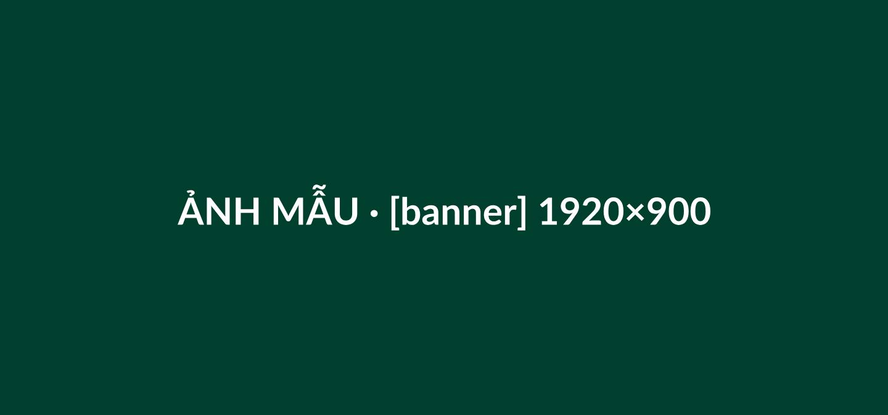
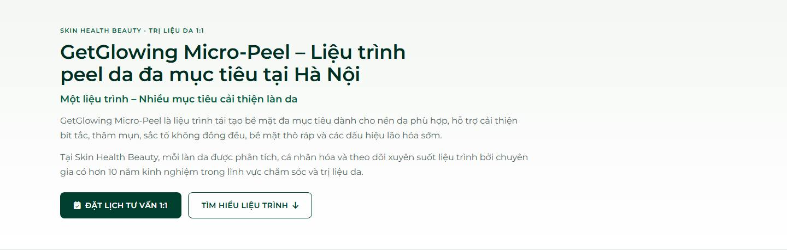
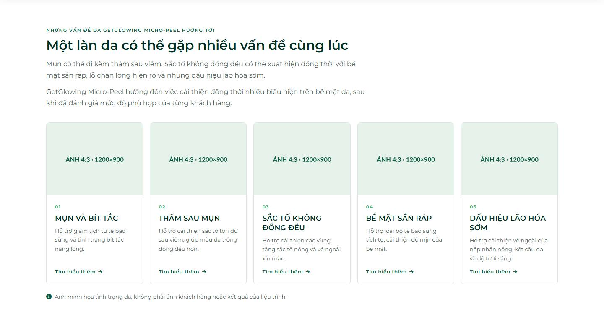
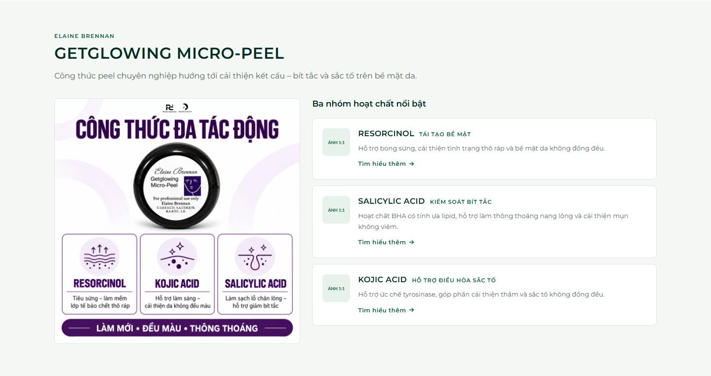
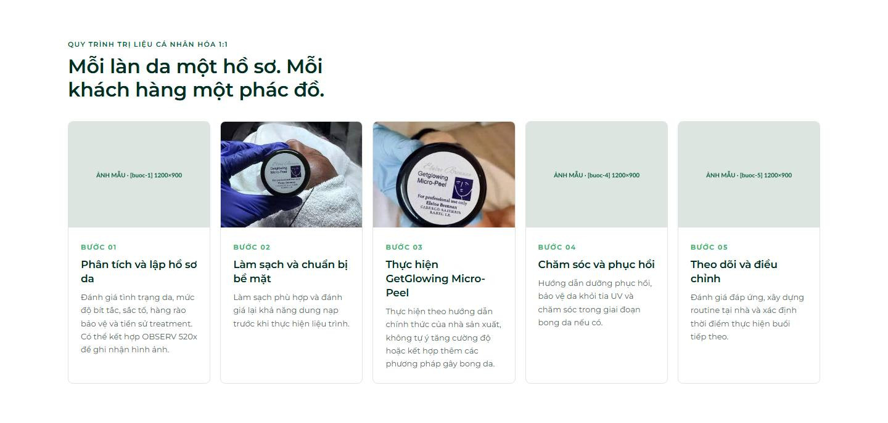
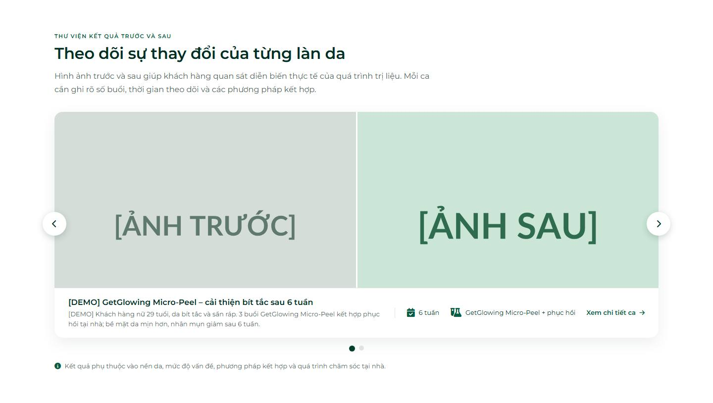
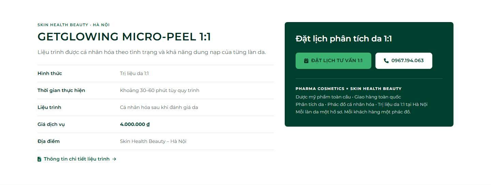
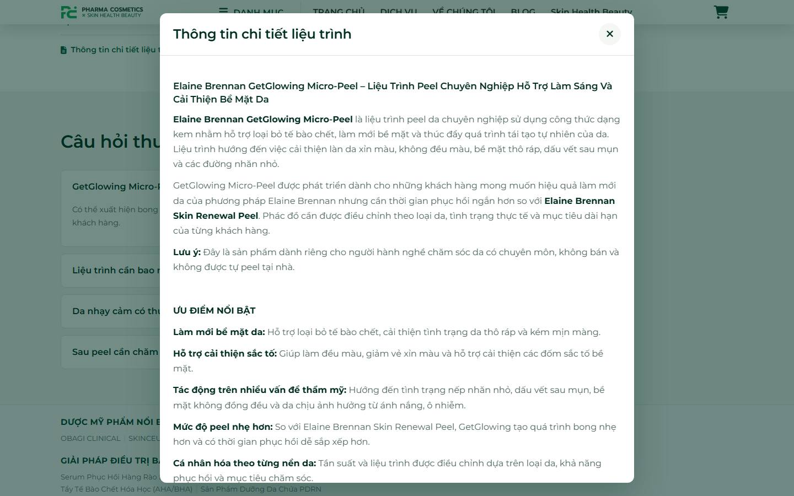
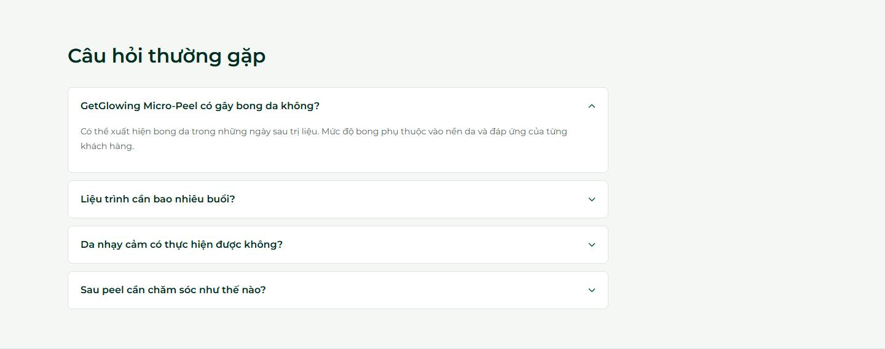

# Hướng dẫn tạo 1 trang LIỆU TRÌNH trên Sapo

*Dành cho người quản trị website — không cần biết code. Cập nhật 18/10/2026.*

Làm theo đúng thứ tự các bước dưới đây là có một trang liệu trình đầy đủ như mẫu
**GetGlowing Micro-Peel**. Thời gian: khoảng 45–60 phút cho liệu trình đầu tiên (đã chuẩn bị sẵn ảnh và chữ),
những liệu trình sau nhanh hơn vì dùng lại bài "Vấn đề da", "Hoạt chất" đã có.

> **Nguyên tắc vàng:** chỉ nhập **thông tin thật**. Phần nào chưa có dữ liệu thì cứ bỏ trống — trang **tự ẩn** phần đó,
> không hiện ô trống hay ảnh vỡ. Không dùng ảnh trước–sau của hãng hoặc của liệu trình khác làm "kết quả".
> Danh xưng luôn là **"Chuyên gia"**, không dùng "Bác sĩ".

---

## Mục lục

1. [Hiểu nhanh 4 khái niệm](#1-hiểu-nhanh-4-khái-niệm)
2. [Bản đồ trang — mỗi phần lấy dữ liệu ở đâu](#2-bản-đồ-trang--mỗi-phần-lấy-dữ-liệu-ở-đâu)
3. [Chuẩn bị trước khi nhập](#3-chuẩn-bị-trước-khi-nhập)
4. [Các bước tạo liệu trình (Bước 1 → 9)](#4-các-bước-tạo-liệu-trình)
5. [Lỗi thường gặp & cách sửa](#5-lỗi-thường-gặp--cách-sửa)
6. [Mẫu đã nhập: GetGlowing Micro-Peel](#6-mẫu-đã-nhập-getglowing-micro-peel)
7. [Cấu hình chung (chỉ làm 1 lần)](#7-cấu-hình-chung-chỉ-làm-1-lần)

---

## 1. Hiểu nhanh 4 khái niệm

| Khái niệm | Nghĩa là | Ví dụ |
| :-- | :-- | :-- |
| **Liệu trình = 1 sản phẩm** | Mỗi liệu trình được tạo ở mục **Sản phẩm** của Sapo (không phải Trang nội dung, không phải bài viết). | GetGlowing Micro-Peel là 1 sản phẩm giá 4.000.000 đ. |
| **Tag "khoá:giá trị"** | Ô **Tag** của sản phẩm/bài viết dùng để điền các thông tin riêng. Mỗi tag viết dạng `khoá:nội dung`, gõ xong bấm **Enter**. | `thoigian:Khoảng 30–60 phút tùy quy trình` |
| **Khoá ảnh `[...]`** | Ô **Văn bản thay thế (Alt)** của mỗi ảnh bắt đầu bằng một khoá trong ngoặc vuông để trang biết ảnh đặt ở đâu. | `[banner] Banner GetGlowing Micro-Peel` |
| **Bài viết dùng chung** | Vấn đề da, Hoạt chất, Câu hỏi, Ca Trước & Sau là **bài viết blog** — tạo 1 lần, nhiều liệu trình dùng lại. | Bài "Mụn và bít tắc" dùng cho cả GetGlowing và liệu trình trị mụn khác. |

> ⚠️ **Tag không được chứa dấu phẩy** — Sapo cắt tag tại dấu phẩy. Thay dấu phẩy bằng **"–"** hoặc chữ **"và"**.
> Ví dụ: ~~`congthuc:Cải thiện kết cấu, bít tắc`~~ → `congthuc:Cải thiện kết cấu – bít tắc`.

---

## 2. Bản đồ trang — mỗi phần lấy dữ liệu ở đâu

Ảnh chụp dưới đây là trang mẫu GetGlowing. Các khung ghi **"ẢNH MẪU · [khoá] kích thước"** là **chỗ bạn đặt ảnh thật**
— chữ trong khung cho biết khoá alt và kích thước cần chuẩn bị.

### ① Banner toàn ngang



- **Ảnh sản phẩm** có alt bắt đầu bằng `[banner]` (1920×900). Bản dọc cho điện thoại: `[banner-mobile]` (1080×1350, tuỳ chọn).
- Không có banner ⇒ phần ② hiện 2 cột, ảnh `[hero]` (vuông) ở bên phải.

### ② Giới thiệu



| Trên trang | Nhập ở đâu |
| :-- | :-- |
| Dòng nhỏ "SKIN HEALTH BEAUTY · TRỊ LIỆU DA 1:1" | Tag `nhan:` (không có thì dùng chữ chung trong Cấu hình theme) |
| Tiêu đề lớn (H1) | Tag `tieude:` (không có thì dùng **Tên sản phẩm**) |
| Dòng xanh "Một liệu trình – Nhiều mục tiêu…" | Tag `phude:` |
| 2 đoạn giới thiệu | Ô **Mô tả ngắn** của sản phẩm |
| 2 nút | Tự động (nút Đặt lịch mở trang đặt lịch chọn sẵn liệu trình này) |

### ③ Vấn đề da



- Mỗi thẻ = 1 **bài viết** trong danh mục **Vấn đề da**: Tiêu đề = tên vấn đề · **Tóm tắt** = câu mô tả · **Ảnh bài viết** = ảnh 4:3 (1200×900).
- Sản phẩm chọn thẻ nào bằng tag `vande:<đường dẫn bài>` — thứ tự tag = thứ tự thẻ.
- Bài có **Nội dung** ⇒ thẻ bấm được ("Tìm hiểu thêm →"). Chưa có ảnh ⇒ thẻ hiện icon (tag `icon:` trên bài, xem Bước 1).

### ④ Công nghệ & hoạt chất



| Trên trang | Nhập ở đâu |
| :-- | :-- |
| "ELAINE BRENNAN" | Ô **Nhà cung cấp** của sản phẩm |
| "GETGLOWING MICRO-PEEL" | Tag `tenngan:` |
| Câu mô tả | Tag `congthuc:` |
| Ảnh lớn bên trái | Ảnh sản phẩm alt `[congthuc]` (vuông) |
| Thẻ hoạt chất (ảnh nhỏ · tên · vai trò · mô tả) | Bài trong danh mục **Thư viện hoạt chất**, chọn bằng tag `hoatchat:<đường dẫn bài>` trên sản phẩm |

### ⑤ Quy trình 1:1 (5 bước)



- Chữ 5 bước **dùng chung mọi liệu trình** (Cấu hình theme › Trang liệu trình — mục 7).
- Ảnh từng bước: ảnh sản phẩm alt `[buoc-1]` … `[buoc-5]` (4:3, 1200×900). Bước thiếu ảnh hiện khung icon.

### ⑥ Trước – sau (trình chiếu)



- Mỗi ca = 1 bài trong danh mục **Trước & Sau**, gắn tag `lieutrinh:<đường dẫn sản phẩm>`. Hướng dẫn riêng:
  [huong-dan-tao-ca-truoc-sau.md](./huong-dan-tao-ca-truoc-sau.md). **Chỉ ca thật, khách đã đồng ý.** Chưa có ca ⇒ phần này tự ẩn.

### ⑦ Thông tin dịch vụ & đặt lịch



| Dòng | Nhập ở đâu |
| :-- | :-- |
| Hình thức | Tag `hinhthuc:` (bỏ trống ⇒ "Trị liệu da 1:1") |
| Thời gian thực hiện | Tag `thoigian:` |
| Liệu trình | Tag `sobuoi:` (bỏ trống ⇒ "Cá nhân hóa sau khi đánh giá da") |
| Giá dịch vụ | Ô **Giá** của sản phẩm (để 0 ⇒ "Liên hệ tư vấn") |
| Địa điểm | Tag `diadiem:` |
| Link "Thông tin chi tiết liệu trình →" | Tự hiện khi ô **Mô tả chi tiết** có nội dung — bấm vào mở cửa sổ ⑧ |

### ⑧ Cửa sổ "Thông tin chi tiết liệu trình"



- Toàn bộ ô **Mô tả chi tiết** của sản phẩm: ưu điểm, thành phần, đối tượng phù hợp, **trường hợp cần thận trọng**, phục hồi, chăm sóc sau.

### ⑨ Câu hỏi thường gặp



- Mỗi câu = 1 bài trong danh mục **Câu hỏi liệu trình**: Tiêu đề = câu hỏi · Nội dung = câu trả lời · tag `sanpham:<đường dẫn sản phẩm>`.

---

## 3. Chuẩn bị trước khi nhập

### 3.1. Ảnh

| Ảnh | Kích thước | Alt bắt đầu bằng | Bắt buộc? |
| :-- | :-- | :-- | :-- |
| Ảnh đại diện (lọ/sản phẩm, nền sáng) — **đặt làm ảnh đầu tiên** | vuông ≥ 1000px | `[sanpham]` | **Có** (hiện ở danh mục liệu trình) |
| Banner ngang đã duyệt | 1920×900 | `[banner]` | Nên có |
| Banner dọc cho điện thoại | 1080×1350 | `[banner-mobile]` | Tuỳ chọn |
| Ảnh bên phải phần giới thiệu (chỉ dùng khi **không** có banner) | vuông | `[hero]` | Tuỳ chọn |
| Infographic công thức / hoạt chất | vuông | `[congthuc]` | Nên có |
| Ảnh thực tế 5 bước tại Skin Health Beauty | 1200×900 (4:3) | `[buoc-1]` … `[buoc-5]` | Nên có |
| Ảnh minh họa cho mỗi bài Vấn đề da | 1200×900 (4:3) | *(Ảnh bài viết)* | Nên có |
| Ảnh cho mỗi bài Hoạt chất | vuông | *(Ảnh bài viết)* | Tuỳ chọn |
| Ảnh trước & sau của ca thật | cùng góc, cùng ánh sáng | *(trong bài Trước & Sau)* | Khi có ca |

Định dạng nên dùng **WebP hoặc JPG**, mỗi ảnh dưới ~500 KB. Ảnh vấn đề da: ảnh có bản quyền hoặc khách đã đồng ý.

### 3.2. Chữ — điền sẵn vào bảng này trước

| Thông tin | Ví dụ (GetGlowing) |
| :-- | :-- |
| Tên sản phẩm đầy đủ (SEO) | Elaine Brennan GetGlowing Micro-Peel – Liệu Trình Peel Chuyên Nghiệp… |
| Tên ngắn | GetGlowing Micro-Peel |
| Tiêu đề lớn trên trang | GetGlowing Micro-Peel – Liệu trình peel da đa mục tiêu tại Hà Nội |
| Tiêu đề phụ | Một liệu trình – Nhiều mục tiêu cải thiện làn da |
| Đoạn giới thiệu (1–2 đoạn) | GetGlowing Micro-Peel là liệu trình tái tạo bề mặt đa mục tiêu… |
| Câu mô tả công nghệ | Công thức peel chuyên nghiệp hướng tới cải thiện kết cấu – bít tắc và sắc tố trên bề mặt da. |
| Hãng | Elaine Brennan |
| Hình thức · Thời gian · Số buổi · Địa điểm | Trị liệu da 1:1 · Khoảng 30–60 phút tùy quy trình · *(bỏ trống)* · Skin Health Beauty – Hà Nội |
| Giá | 4000000 |
| Danh sách vấn đề da (tối đa 5) | Mụn và bít tắc · Thâm sau mụn · Sắc tố không đồng đều · Bề mặt sần ráp · Dấu hiệu lão hóa sớm |
| Danh sách hoạt chất | Resorcinol · Salicylic Acid · Kojic Acid |
| 3–5 câu hỏi thường gặp + trả lời | GetGlowing có gây bong da không? … |
| Bài mô tả chi tiết | ưu điểm, thành phần, đối tượng, thận trọng, phục hồi, chăm sóc sau |

---

## 4. Các bước tạo liệu trình

> Đăng nhập **Sapo Admin**. Tên nút trên Sapo có thể hơi khác tuỳ phiên bản — tìm theo ý nghĩa.

### Bước 1 — Bài "Vấn đề da" (bỏ qua bài nào đã có)

1. Vào **Website › Bài viết**, lọc **Blog: Vấn đề da** để xem bài nào đã có. Bài đã có thì **dùng lại**, không tạo trùng.
2. Bấm **Thêm bài viết**, điền:

   | Ô | Nhập |
   | :-- | :-- |
   | Tiêu đề | Tên vấn đề, viết thường — vd `Mụn và bít tắc` (trang tự in CHỮ HOA) |
   | Nội dung | Bài giải thích vấn đề da (có nội dung thì thẻ bấm được). Chưa viết được thì để trống. |
   | Tóm tắt | 1 câu — vd `Hỗ trợ giảm tích tụ tế bào sừng và tình trạng bít tắc nang lông.` |
   | Ảnh bài viết | Ảnh 4:3 (1200×900) |
   | Danh mục (Blog) | **Vấn đề da** |
   | Tag (tuỳ chọn) | `icon:fa-braille` — icon hiện khi chưa có ảnh. Gợi ý: mụn/bít tắc `fa-braille` · thâm `fa-droplet` · sắc tố `fa-circle-half-stroke` · sần ráp `fa-layer-group` · lão hóa `fa-hourglass-half` |

3. Bấm **Lưu**. Kéo xuống phần **Tối ưu SEO** (hoặc "Đường dẫn") → ghi lại **đường dẫn** của bài, vd `mun-va-bit-tac`.
   👉 Đây là giá trị dùng cho tag `vande:` ở Bước 5.

### Bước 2 — Bài "Hoạt chất" (bỏ qua bài nào đã có)

1. **Website › Bài viết**, lọc **Blog: Thư viện hoạt chất** — có rồi thì dùng lại.
2. **Thêm bài viết**: Tiêu đề = tên hoạt chất (vd `Resorcinol`) · Tóm tắt = công dụng 1–2 câu · Ảnh bài viết = ảnh vuông ·
   Danh mục = **Thư viện hoạt chất** · Tag `vaitro:TÁI TẠO BỀ MẶT` (nhãn vai trò hiện cạnh tên).
   **Chỉ ghi nồng độ khi đã đối chiếu tài liệu kỹ thuật chính thức.**
3. **Lưu** → ghi lại **đường dẫn** (vd `resorcinol`) cho tag `hoatchat:`.

### Bước 3 — Tạo sản phẩm liệu trình

**Sản phẩm › Thêm sản phẩm**, điền:

| Ô trên Sapo | Nhập |
| :-- | :-- |
| Tên sản phẩm | Tên đầy đủ (SEO) |
| Mô tả ngắn | Đoạn giới thiệu (phần ②). Chữ thường, không tô màu, không đổi cỡ chữ. |
| Mô tả chi tiết | Bài đầy đủ (phần ⑧). Dùng Heading / chữ đậm / gạch đầu dòng của trình soạn thảo. |
| Giá | Giá liệu trình (0 ⇒ "Liên hệ tư vấn") |
| Nhà cung cấp | Tên hãng — vd `Elaine Brennan` |
| Danh mục | **Điều trị chuyên nghiệp** |
| Tối ưu SEO | Tiêu đề ≤ 60 ký tự · Mô tả ≤ 160 ký tự · Đường dẫn ngắn, không dấu |

Bấm **Lưu** một lần, rồi làm tiếp Bước 4–6 trên chính sản phẩm này.
👉 Ghi lại **đường dẫn sản phẩm** (phần Tối ưu SEO) — dùng cho câu hỏi (Bước 7) và ca trước–sau (Bước 8).

### Bước 4 — Tải ảnh và ghi khoá alt

1. Ở khung **Ảnh sản phẩm**, tải lên các ảnh đã chuẩn bị (mục 3.1). Kéo ảnh **lọ sản phẩm** lên **vị trí đầu tiên**.
2. Với **từng ảnh**: bấm vào ảnh (hoặc biểu tượng sửa) → ô **Văn bản thay thế / Alt** → gõ **khoá** rồi một mô tả ngắn, ví dụ:

   | Ảnh | Alt |
   | :-- | :-- |
   | Lọ sản phẩm | `[sanpham] Lọ Elaine Brennan GetGlowing Micro-Peel` |
   | Banner ngang | `[banner] GetGlowing Micro-Peel tại Skin Health Beauty` |
   | Banner dọc | `[banner-mobile] GetGlowing Micro-Peel` |
   | Infographic | `[congthuc] Công thức Resorcinol – Kojic Acid – Salicylic Acid` |
   | Ảnh bước 3 | `[buoc-3] Chuyên gia thực hiện GetGlowing Micro-Peel` |

3. **Lưu**. Ảnh **không có khoá** vẫn lưu được nhưng trang liệu trình sẽ không dùng (hợp với ảnh tham khảo của hãng).

### Bước 5 — Thêm tag

Ở ô **Tag** của sản phẩm, gõ **từng tag rồi bấm Enter**. Có thể sao chép mẫu dưới, thay phần sau dấu `:` bằng thông tin của bạn
(dòng nào không có thông tin thì bỏ qua):

```text
tenngan:GetGlowing Micro-Peel
tieude:GetGlowing Micro-Peel – Liệu trình peel da đa mục tiêu tại Hà Nội
nhan:SKIN HEALTH BEAUTY · TRỊ LIỆU DA 1:1
phude:Một liệu trình – Nhiều mục tiêu cải thiện làn da
congthuc:Công thức peel chuyên nghiệp hướng tới cải thiện kết cấu – bít tắc và sắc tố trên bề mặt da.
hinhthuc:Trị liệu da 1:1
thoigian:Khoảng 30–60 phút tùy quy trình
sobuoi:Tham khảo 6 buổi – cách nhau 2–6 tuần
diadiem:Skin Health Beauty – Hà Nội
vande:mun-va-bit-tac
vande:tham-sau-mun
hoatchat:resorcinol
hoatchat:salicylic-acid
```

- `vande:` và `hoatchat:` lặp lại được — **mỗi vấn đề / mỗi hoạt chất 1 tag**, giá trị là **đường dẫn bài** đã ghi ở Bước 1–2.
- Các tag SEO bình thường (không có dấu `:`) vẫn giữ nguyên được.

### Bước 6 — Chọn giao diện liệu trình

Ở cột bên phải trang sửa sản phẩm, ô **Giao diện / Template** → chọn **`product.lieu-trinh`** → **Lưu**.
Không chọn bước này thì trang hiện như sản phẩm bán lẻ bình thường.

### Bước 7 — Câu hỏi thường gặp

1. **Website › Bài viết › Thêm bài viết**, mỗi câu hỏi 1 bài: Tiêu đề = câu hỏi · Nội dung = câu trả lời ·
   Danh mục = **Câu hỏi liệu trình** · Tag `sanpham:<đường dẫn sản phẩm>`.
2. Đường dẫn sản phẩm dài có thể ghi **phần đầu** tính đến một dấu `-`, vd `sanpham:elaine-brennan-getglowing-micro-peel`.
3. Một câu dùng cho nhiều liệu trình ⇒ gắn nhiều tag `sanpham:`.

### Bước 8 — Ca Trước & Sau (khi có ca thật)

Làm theo [huong-dan-tao-ca-truoc-sau.md](./huong-dan-tao-ca-truoc-sau.md), nhớ gắn tag `lieutrinh:<đường dẫn sản phẩm>` để ca hiện ở phần ⑥.

### Bước 9 — Kiểm tra trước khi công bố

Mở trang sản phẩm trên **máy tính** và **điện thoại** (khi đang thử giao diện, thêm `?previewThemeId=<mã theme>` vào cuối link):

- [ ] Tiêu đề lớn, tiêu đề phụ, đoạn giới thiệu đúng.
- [ ] Banner hiện (điện thoại hiện bản dọc nếu có).
- [ ] Đủ thẻ vấn đề da và hoạt chất, đúng thứ tự, có ảnh.
- [ ] 5 bước quy trình có ảnh.
- [ ] Bảng thông tin đúng; giá đúng; link "Thông tin chi tiết liệu trình" mở được cửa sổ.
- [ ] Câu hỏi thường gặp hiện đủ, bấm mở được.
- [ ] Nút **Đặt lịch** mở trang đặt lịch đã chọn sẵn liệu trình này.
- [ ] Điện thoại: cuộn xuống thấy thanh "Đặt lịch" bám đáy, không che nút liên hệ.
- [ ] Trang danh mục **Điều trị chuyên nghiệp** hiện ảnh đại diện gọn, tên không bị cắt xấu.

---

## 5. Lỗi thường gặp & cách sửa

| Hiện tượng | Nguyên nhân thường gặp | Cách sửa |
| :-- | :-- | :-- |
| Trang trông như sản phẩm bán lẻ | Chưa chọn giao diện | Bước 6: chọn `product.lieu-trinh` |
| Không có phần Vấn đề da | Tag `vande:` ghi sai đường dẫn, hoặc bài không thuộc danh mục **Vấn đề da** | So từng chữ với đường dẫn bài (không dấu, gạch nối) |
| Thiếu 1 thẻ hoạt chất | Tag `hoatchat:` sai, hoặc bài nằm ngoài **Thư viện hoạt chất** | Như trên |
| Không có Câu hỏi thường gặp | Tag `sanpham:` sai, hoặc bài ngoài danh mục **Câu hỏi liệu trình** | Sửa tag theo đường dẫn sản phẩm |
| Một tag bị tách làm 2 | Trong tag có **dấu phẩy** | Thay dấu phẩy bằng "–" hoặc "và" |
| Banner / ảnh bước không hiện | Alt thiếu khoá, gõ sai (vd `[buoc 1]`, `(banner)`) | Alt phải bắt đầu đúng `[banner]`, `[buoc-1]`… |
| Ảnh lọ không phải ảnh đại diện ở danh mục | Lọ không ở vị trí đầu | Kéo ảnh lọ lên đầu |
| Thẻ vấn đề da/hoạt chất không bấm được | Bài chưa có **Nội dung** | Viết nội dung cho bài |
| Không có link "Thông tin chi tiết liệu trình" | Ô **Mô tả chi tiết** trống | Nhập Mô tả chi tiết |
| Phần Trước – sau không hiện | Chưa có ca thật gắn `lieutrinh:`, hoặc ca thiếu 1 trong 2 ảnh | Xem hướng dẫn ca Trước & Sau |

---

## 6. Mẫu đã nhập: GetGlowing Micro-Peel

Đường dẫn sản phẩm: `elaine-brennan-getglowing-micro-peel-lieu-trinh-peel-chuyen-nghiep-ho-tro-lam-sang-va-cai-thien-be-mat-da`

- **Đã có trên Sapo:** giao diện `product.lieu-trinh`, Mô tả ngắn, tag đầy đủ, 5 bài Vấn đề da, 3 bài Hoạt chất (có `vaitro:`),
  4 bài Câu hỏi liệu trình (tag `sanpham:elaine-brennan-getglowing-micro-peel`).
- **Ảnh hiện có (8 ảnh)** — alt nên đặt:

  | Ảnh | Nội dung | Alt |
  | :-- | :-- | :-- |
  | 1 | Lọ sản phẩm nền trắng | `[sanpham] Lọ Elaine Brennan GetGlowing Micro-Peel` |
  | 2 | Banner vuông GETGLOWING MICRO-PEEL | `[hero] GetGlowing Micro-Peel – peel chuyên nghiệp làm sáng và cải thiện bề mặt da` |
  | 3 | Infographic "Công thức đa tác động" | `[congthuc] Công thức đa tác động: Resorcinol – Kojic Acid – Salicylic Acid` |
  | 4, 6, 8 | Ảnh trước–sau của hãng | **Không gắn khoá** — không dùng làm kết quả |
  | 5 | Thao tác với lọ, xông hơi | `[buoc-2] Làm sạch và chuẩn bị bề mặt trước khi peel` |
  | 7 | Thao tác với lọ trên mặt khách | `[buoc-3] Thực hiện GetGlowing Micro-Peel` |

- **Ảnh còn thiếu — cần chụp/thiết kế** (đúng các khung "ẢNH MẪU" trong ảnh chụp mục 2):
  `[banner]` 1920×900 · `[banner-mobile]` 1080×1350 · `[buoc-1]`, `[buoc-4]`, `[buoc-5]` 1200×900 ·
  ảnh 4:3 cho 5 bài Vấn đề da · ảnh vuông cho 3 bài Hoạt chất · ảnh trước–sau ca thật đã đồng ý.
- **Nội dung còn thiếu:** Nội dung cho 5 bài Vấn đề da và 3 bài Hoạt chất (để thẻ bấm được).
- **SEO sản phẩm:** Tiêu đề `GetGlowing Micro-Peel tại Hà Nội | Skin Health Beauty`; Mô tả `GetGlowing Micro-Peel tại Hà Nội.
  Liệu trình peel đa mục tiêu hỗ trợ cải thiện bít tắc, thâm mụn, sắc tố và bề mặt da. Trị liệu cá nhân hóa 1:1.`

---

## 7. Cấu hình chung (chỉ làm 1 lần)

**Website › Giao diện › Tùy chỉnh › nhóm "Trang liệu trình (sản phẩm)"** — chữ dùng chung cho mọi liệu trình:
nhãn và tiêu đề các phần, 5 bước quy trình (+ ảnh chung cho bước nếu sản phẩm không có `[buoc-N]`), nhãn bảng thông tin,
chữ nút, dòng thương hiệu, thanh đặt lịch bám đáy. Trong chữ có `[ten]` sẽ tự thay bằng tên ngắn của liệu trình.

Danh mục bài viết cần có (đã có đủ trên Sapo ngày 18/10/2026):

| Danh mục | Đường dẫn |
| :-- | :-- |
| Vấn đề da | `van-de-da` |
| Câu hỏi liệu trình | `cau-hoi-lieu-trinh` |
| Thư viện hoạt chất | `hoat-chat` |
| Trước & Sau | `truoc-va-sau-1` |

> Trang liệu trình là **sản phẩm**; `http://localhost:3000/?tpl=page.getglowing-micro-peel` chỉ là trang thử ở máy dev
> (hiện lại sản phẩm đặt ở cấu hình `lt_page_product`). Trên Sapo không có trang `/getglowing-micro-peel-ha-noi`.

<details>
<summary>Dành cho dev</summary>

- Ảnh chụp mục 2 lấy từ bản dev (`npm run preview`) với ảnh mẫu khung chỗ trong `data/products.js` (`LT_DEMO_SLOTS`) và
  `data/articles.js` (ảnh bài Vấn đề da/Hoạt chất). Chụp lại: `docs/images/lieu-trinh/`.
- Kiểm tra giao diện: `AUDIT_PAGES="/products/<alias>" npm run audit:ui` (Git Bash thêm `MSYS_NO_PATHCONV=1`) — 0 lỗi ở 1440px và 390px.
- Mã nguồn: `templates/product.lieu-trinh.bwt` → `snippets/lieu_trinh_page.bwt` (+ `lieu_trinh_*.bwt`), CSS `assets/lieu-trinh.css`, JS `assets/lieu-trinh.js`.

</details>
